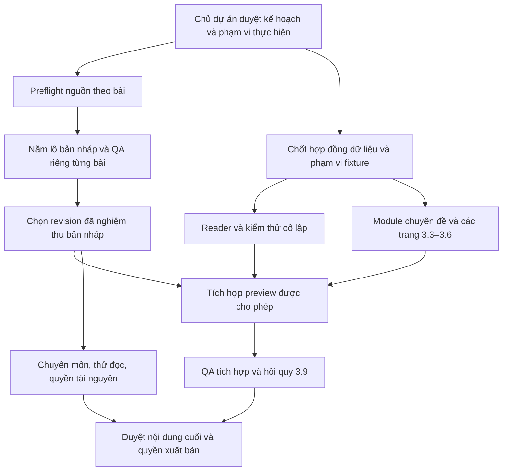

# Lộ trình tăng tốc sau 3.2 — đề xuất accel-plan-r1

25/10/2026. Main nền `80cdb4f65eebdf0c351d28b0d44588eec084f8d2`, đúng merge commit [PR #10](https://github.com/susootran207/Kho-ng-gian-Insight/pull/10). Nhánh `phase-3-accelerated-plan`. Chỉ lập kế hoạch: không biên soạn 25 bài hoặc đổi ứng dụng/tài liệu nền.

## Mục tiêu và điều đã được xác nhận
Hoàn thành **25 bản nháp còn lại**, cộng bốn mẫu thành 29 bài (24 core + 5 extension), đồng thời chuẩn bị website sớm hơn. Yêu cầu mới xác nhận C01-r2/C05-r2/C17-r2/E05-r2 đã nghiệm thu làm bản nháp mẫu; vì vậy mục chờ nghiệm thu riêng E05-r2 trong audit là lịch sử, không tiếp tục coi là nút chờ hiện tại. Không suy thành chuyên môn độc lập, nội dung cuối hoặc quyền xuất bản; không sửa audit để đổi lịch sử.

Đề xuất năm lô 5 bài, chọn r1 đạt chuẩn để nghiệm thu ngay; chỉ sửa khi có lỗi thực chất. Đầu tư đề xuất cho 25 bài: **7 FEATURED/18 STANDARD**, rủi ro **12 HIGH/11 MEDIUM/2 LOW**, hai trục độc lập. “Featured” là đề xuất, chưa được chủ dự án chọn hoặc hiển thị. [Ma trận](ARTICLE-PRIORITY.md) giữ ID/slug chính xác; không đặt giới hạn thư viện chỉ có 29 bài.

## Kế hoạch cũ và phương án đề xuất

| Đợt trong PLAN hiện hành | Phụ thuộc cũ | Điều chỉnh tăng tốc cần duyệt | Điều không cắt giảm |
|---|---|---|---|
| 3.3 Chuyên đề tuần | Sau 3.2, rồi mới 3.4 | Chuẩn bị ngay trên luồng website sau chốt hợp đồng dữ liệu/fixture; lời dẫn, thứ tự, lịch giờ Việt Nam, fallback | Cùng dữ liệu với trang chủ, chỉ link published, trạng thái trống khi chưa có nội dung |
| 3.4 Nền tảng | Chờ 3.3 xong | Chuẩn bị nội dung trang và module độc lập song song 3.3/lô bài; tích hợp theo quyền sở hữu tệp chung | Mô tả đúng quy trình/nguồn/quyền riêng tư, không reviewer/đối tác giả |
| 3.5 Dòng chảy | Chờ 3.4 xong | Chuẩn bị bốn chặng/gợi ý đọc và logic lọc sớm; nối dữ liệu sau hợp đồng | Không suy đoán cảm xúc, giữ timeline/URL/bộ lọc và chỉ liên kết nội dung đủ điều kiện |
| 3.6 Góc tâm tình | Chờ 3.5 xong | Chuẩn bị hướng dẫn/tương tác/QA riêng trong khi viết bài; nối phần chung tuần tự | Không lưu/gửi/log/URL lời tâm tình; cleanup, bàn phím, reduced motion, giới hạn đèn |
| 3.7 Tám bài và 3.8 Mười bảy bài | Bắt đầu sau 3.6, tổng bảy lô 4/…/1 | Gom lại **B01–B05, mỗi lô 5**, bắt đầu sau duyệt phạm vi lô và preflight nguồn, không chờ các trang xong | Mỗi bài đủ hồ sơ, kiểm nguồn/Bloom/quyền/an toàn; HIGH không giảm theo STANDARD |
| 3.9 Kết nối và kiểm tổng | Sau hoàn tất các đợt trước | Kiểm reader bằng fixture từ sớm; tích hợp tăng dần sau từng phần được duyệt; giữ một lượt tổng cuối | Guard không rò nháp, route/liên kết/tuổi/nguồn/alt, QA reader và hồi quy GĐ1–2; xuất bản riêng |

Đây là đề xuất **thay phụ thuộc thực thi**, không sửa hoặc tuyên bố PLAN đã được duyệt lại. PLAN cũ vốn đã có lô bài; không lấy quy trình thử từng bài của 3.2B thành yêu cầu 25 PR/25 vòng r2 bắt buộc. Lợi ích là chuyển từ bảy lô còn lại sang năm lô, bỏ phụ thuộc nội dung phải chờ 3.6, giảm tái nghiên cứu nguồn chung và giảm sửa hình thức; không hứa giảm thời gian theo phần trăm chưa đo.

## Luồng phụ thuộc đề xuất

Không cần đợi cả 25 bài mới làm reader hoặc trang. Không cần đợi reader để nghiên cứu/viết một bài. Chuyên môn/thử đọc có thể xếp lịch theo lô ngay khi bản nháp ổn định; không giả có người đã tham gia. Việc tích hợp preview, thay schema/guard và triển khai UI đều cần ủy quyền thực hiện tiếp, hiện chưa được cấp.

## Các mốc đo tiến độ

1. Phạm vi/risk từng bài, chủ tệp chung, hợp đồng dữ liệu và fixture được duyệt cho đợt thực hiện.
2. Từng lô có bảng PASS/FIX_REQUIRED/BLOCKED và PENDING_EXTERNAL_REVIEW độc lập; đếm bài hoàn thành theo hồ sơ, không theo số file đã tạo.
3. Đủ 25 bản nháp mới PASS và được nghiệm thu revision phù hợp → **29 bản nháp**, không đồng nghĩa 29 bài được xuất bản.
4. Các module website/reader đạt QA kỹ thuật theo PR; tích hợp tăng dần và tổng kiểm 3.9.
5. Các bài được chọn hoàn tất chuyên môn/thử đọc/quyền/duyệt cuối/quyền xuất bản; chỉ sau chỉ thị xuất bản/deploy tương ứng mới đưa công khai.

Không đặt ngày hoàn thành giả khi chưa biết nhân lực/thời lượng reviewer. Nhịp theo năng lực: một lô đang viết, một lô đang QA/chờ duyệt, một nhánh website nếu có người thực hiện độc lập. Một người làm thì xen kẽ tác vụ, không gọi là tăng gấp ba năng suất. Xem [BATCH-SCHEDULE](BATCH-SCHEDULE.md), [PARALLEL-WORK](PARALLEL-WORK.md), [QUALITY-GATES](QUALITY-GATES.md), [DECISIONS](DECISIONS.md).

## Căn cứ và giới hạn
Đã đọc [PRODUCT](../../../PRODUCT.md), [DESIGN](../../../DESIGN.md), [AGENTS](../../../AGENTS.md), [PLAN](../PLAN.md), [MATRIX](../MATRIX.md)/matrix.json, [STANDARDS](../STANDARDS.md), [TEMPLATES](../TEMPLATES.md), [ARCHITECTURE](../ARCHITECTURE.md), toàn bộ [audit-3-2](../audit-3-2/FINAL-AUDIT.md) và bốn bộ hồ sơ mẫu r2 trên main. Đây là lập lịch/risk sơ bộ, không nghiên cứu nguồn của 25 bài hoặc chọn featured chính thức.
Chỉ thêm sáu tài liệu kế hoạch; không sửa bốn mẫu, PLAN/STANDARDS/matrix/catalogue/UI/guard/deploy, không merge/publish hoặc bắt đầu lô tiếp. Dừng tại PR đề xuất.
