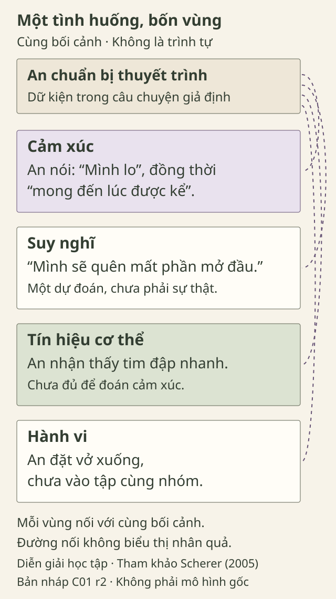

# Hôm nay mình đang cảm thấy gì?

> **Bản nháp để duyệt · KGNT-C01 · c01-draft-r2 · 25/10/2026.**
> Chưa được duyệt biên tập hoặc rà soát chuyên môn; không có quyền xuất bản.

Ngày mai, An sẽ thuyết trình trước lớp. Trong lúc chuẩn bị, An nghĩ: “Mình sẽ quên mất phần mở đầu.” An nhận thấy tim đập nhanh, đặt vở xuống và chưa bước vào buổi tập cùng nhóm. Khi một bạn hỏi, An nói: “Mình lo, nhưng cũng mong đến lúc được kể về chủ đề này.”

*Tình huống An và các nhân vật dưới đây đều do biên tập đặt ra.*

Trong câu chuyện ấy có điều An nghĩ, điều An nói mình cảm thấy, tín hiệu cơ thể và việc An làm. Thử nhìn riêng từng phần trước khi kết luận An “nhút nhát” hay “không chịu hợp tác”.

## Cảm xúc là gì?

Với An, “lo” là cách bạn ấy kể điều mình đang cảm thấy trước buổi thuyết trình. Câu “mình sẽ quên” lại nói về điều An dự đoán; tim đập nhanh là điều An nhận thấy ở cơ thể. Nhìn riêng những chi tiết ấy giúp ta đọc câu chuyện rõ hơn, thay vì gom tất cả vào một lời nhận xét về An.

Một cách giải thích trong tâm lý học là xem cảm xúc như một trải nghiệm có nhiều phần liên hệ với nhau, chứ không chỉ là một từ hay một biểu hiện. Scherer (2005, tr. 697–699) trình bày cách tiếp cận này dưới tên **mô hình quá trình thành phần**. Đây là một cách nhìn, không phải định nghĩa duy nhất về cảm xúc.

Trong bài, **cảm xúc, suy nghĩ, tín hiệu cơ thể và hành vi** là bốn vùng để ghi và phân tích dữ kiện tình huống. Đây không phải một cách phân loại chính thức nói rằng cảm xúc có đúng bốn thành phần. Phần “Tìm hiểu sâu hơn” giải thích mô hình gốc khác sơ đồ học tập này ở đâu.

## Nhìn từng phần trong câu chuyện An

| Vùng | Dữ kiện trong tình huống |
|---|---|
| Cảm xúc | An nói mình “lo”, đồng thời “mong đến lúc được kể”. |
| Suy nghĩ | “Mình sẽ quên mất phần mở đầu” là dự đoán của An. |
| Tín hiệu cơ thể | An nhận thấy tim đập nhanh. |
| Hành vi | An đặt vở xuống và chưa vào tập cùng nhóm. |

Bảng không phải một trình tự “nghĩ trước, rồi mới có cảm xúc, rồi mới hành động”. Việc tách các vùng để đọc không có nghĩa chúng tách rời trong trải nghiệm; khung thành phần xem xét sự phối hợp giữa các quá trình (Scherer, 2005, tr. 697–699).

Có một chi tiết cần giữ lại: An **nói** mình lo. Nếu chỉ biết An đặt vở xuống, ta chưa có lời kể ấy. Khi đó, một câu hỏi như “Lúc này bạn thấy thế nào? Có điều gì bạn muốn nhóm biết không?” để An trả lời sẽ phù hợp với mục đích tìm hiểu hơn là tự điền cảm xúc vào chỗ trống.

*Sơ đồ diễn giải do dự án biên soạn cho bài học; tham khảo Scherer (2005). Không tái tạo mô hình gốc hoặc dùng để chẩn đoán.*

**Mô tả tương đương bằng chữ:** Bối cảnh chung của sơ đồ là An chuẩn bị thuyết trình. Bốn vùng xếp dọc chứa dữ kiện trong bảng trên. Mỗi vùng có đường nét đứt nối riêng với bối cảnh, không có đầu mũi tên. Các đường chỉ nhắc đọc dữ kiện cùng bối cảnh, không biểu thị thứ tự hoặc phần nào gây ra phần nào.

## Khi chưa tìm được từ thật vừa

Nếu câu trả lời đầu tiên chỉ là “mình thấy không ổn”, bạn có thể thử xem từ nào gần hơn: buồn, lo, thất vọng hay bực. Chưa cần chọn ngay một từ cuối cùng. Trong câu chuyện An, cách kể cũng không bị giới hạn ở một từ: An nói cả điều khiến mình lo và điều mình mong chờ.

Chọn giữa “buồn” và “thất vọng” trong một câu chuyện là một ví dụ về việc tìm từ cụ thể hơn. Nghiên cứu gọi mức độ nhận diện trải nghiệm cảm xúc cụ thể là *emotion differentiation* — có thể hiểu ngắn là khả năng phân biệt cảm xúc (Nook, 2021, mục “Carving the Subject Matter”). Bài tập này không đo khả năng ấy hay chấm điểm sức khỏe tâm lý.

Bạn có thể thử một câu hỏi với nhân vật: “Điều gì trong tình huống khiến từ ‘lo’ có vẻ phù hợp?” Nếu chưa đủ dữ kiện, ghi “chưa biết” cũng là một câu trả lời có ích cho bài tập: nó chỉ ra điều cần hỏi thêm.

**Một cách hiểu cần tránh:** “An tim đập nhanh, vậy An chắc chắn đang sợ.” Trong tình huống giả định, hãy thử thêm dữ kiện rằng An vừa chạy lên cầu thang. Kết luận ban đầu còn chắc như vậy không? Đây là phản ví dụ để luyện thói quen hỏi rõ, không phải giải thích y khoa cho nhịp tim.

## Thử cùng Bình

Bình đang chờ kết quả đăng ký câu lạc bộ. Bình nghĩ: “Không biết nhóm có chọn mình không”, thấy bàn tay ẩm và mở lại trang thông báo. Bình chưa nói mình đang cảm thấy gì.

Bạn chỉ cần dùng câu chuyện này, không cần kể chuyện riêng. Có thể bỏ qua hoạt động nếu chưa muốn làm.

Bạn có thể điền bảng theo bốn bước sau:

1. Tìm những gì câu chuyện đã kể: Bình nghĩ gì, nhận thấy gì ở cơ thể và làm gì?
2. Ghi các dữ kiện vào vùng tương ứng bằng từ của bạn; không cần chép nguyên câu.
3. Ở vùng cảm xúc, ghi điều còn chưa biết. Nếu đề xuất “có thể hồi hộp”, giữ rõ đó là phỏng đoán.
4. Viết một câu hỏi mở để Bình có thể kể thêm, đồng thời có quyền chưa trả lời.

Mẫu điền:

| Vùng | Dữ kiện hoặc điều chưa biết |
|---|---|
| Suy nghĩ | … |
| Tín hiệu cơ thể | … |
| Hành vi | … |
| Cảm xúc | … |
| Câu hỏi làm rõ | … |

Chẳng hạn: “Trong lúc chờ kết quả, bạn đang cảm thấy thế nào? Nếu chưa muốn nói cũng được.” Câu hỏi mở chỗ cho lời kể của Bình, thay vì yêu cầu Bình xác nhận điều người hỏi đã đoán.

## Tự kiểm tra một chút

**1. Những mục nào là từ chỉ cảm xúc trong cách dùng dưới đây?**  
“Lo”, “vui”, “buồn”, “đặt vở xuống”, “tim đập nhanh”, “mình sẽ quên”.

**2. “Mình sẽ quên phần mở đầu” khác “mình lo” ở điểm nào?**  
Giải thích dựa trên lời kể của An. Sau đó, chỉ ra chi tiết nào nói về cơ thể và chi tiết nào là việc An đã làm.

**3. Dùng mẫu bốn vùng cho Bình. Bạn biết gì, chưa biết gì và sẽ hỏi câu nào?**  
Đừng kết luận cảm xúc chỉ từ bàn tay ẩm hoặc việc mở lại trang.

### Gợi ý trả lời

**Câu 1:** “Lo”, “vui”, “buồn” là các từ cảm xúc trong bài tập này. “Đặt vở xuống” mô tả việc làm; “tim đập nhanh” là tín hiệu cơ thể; “mình sẽ quên” là một suy nghĩ dạng dự đoán.

**Câu 2:** “Mình sẽ quên” nói về điều An dự đoán; “mình lo” là lời An mô tả cảm xúc. Có suy nghĩ ấy không chứng minh An sẽ quên, cũng không cho biết toàn bộ cảm xúc của An. Tim đập nhanh là tín hiệu cơ thể; đặt vở xuống là hành vi. Bạn có thể giải thích bằng cách khác nếu vẫn giữ các phân biệt này.

**Câu 3:** Ta có câu nghĩ của Bình, tín hiệu bàn tay ẩm và hành vi mở lại trang. Cảm xúc vẫn chưa có lời kể trực tiếp. Có thể ghi “chưa biết” rồi hỏi một câu mở. Nếu viết “có thể hồi hộp”, cần giữ chữ “có thể”, không biến thành kết luận. Bạn không cần dùng đúng một câu mẫu: lời diễn đạt khác vẫn phù hợp nếu dựa dữ kiện, giữ điều chưa biết và không ép Bình xác nhận cảm xúc người hỏi đoán.

## Khi cần có người cùng nhìn lại

Nếu cảm xúc làm bạn khổ sở, kéo dài hoặc ảnh hưởng việc học, sinh hoạt hay các mối quan hệ, hãy trao đổi với một người lớn đáng tin và cân nhắc hỗ trợ chuyên môn. Đây là hướng tìm trợ giúp, không phải danh sách tự chẩn đoán (National Institute of Mental Health [NIMH], 2024).

Bạn có thể bắt đầu với người chăm sóc, giáo viên hoặc nhân viên y tế; nếu trường có người phụ trách tư vấn phù hợp, đó cũng có thể là một lựa chọn. Nếu người đầu tiên không phù hợp hoặc bạn không thấy an toàn để nói, hãy tìm một người lớn khác. Bạn không cần gọi tên cảm xúc thật chính xác mới được mở lời.

Bài viết và hoạt động này không thay thế đánh giá hay điều trị cá nhân. Nook (2021) cũng lưu ý những câu hỏi còn mở trong bằng chứng về phân biệt cảm xúc; từ đó không thể hứa rằng bài tập gọi tên sẽ chữa bệnh hay chắc chắn giảm triệu chứng.

## Một điều mang theo

Với một tình huống, thử tách điều đã biết khỏi điều đang đoán. Một từ cảm xúc có thể giúp bắt đầu lời kể; một câu hỏi tôn trọng giúp lời kể ấy được nói bằng tiếng của chính người trong cuộc.

### Tìm hiểu sâu hơn — có thể đọc thêm

Scherer trình bày năm thành phần: đánh giá sự kiện, thay đổi sinh lý, xu hướng hành động, biểu hiện và trải nghiệm chủ quan — tức điều người trong cuộc cảm nhận (2005, tr. 697–699, Bảng 1). **Xu hướng hành động** là sự thôi thúc muốn làm gì đó, chưa đồng nghĩa với việc đã làm. Bốn vùng của bài không tương ứng một–một với năm thành phần ấy. Đặc biệt, “muốn tránh buổi tập” là xu hướng hoặc ý định, khác với việc đã thực sự bỏ tập. Các lý thuyết cũng không thống nhất một danh sách cảm xúc cơ bản duy nhất (Scherer, 2005, tr. 706–707). Khi đọc một mô hình, ta có thể hỏi nó đang mô tả khía cạnh nào và đã giản lược điều gì. Phần này không yêu cầu học thuộc thuật ngữ hoặc tự đánh giá bệnh lý.

## Tài liệu tham khảo

National Institute of Mental Health. (2024). *Children and mental health: Is this just a stage?* (NIH Publication No. 24-MH-8085). https://www.nimh.nih.gov/health/publications/children-and-mental-health

Nook, E. C. (2021). Emotion differentiation and youth mental health: Current understanding and open questions. *Frontiers in Psychology, 12*, Article 700298. https://doi.org/10.3389/fpsyg.2021.700298

Scherer, K. R. (2005). What are emotions? And how can they be measured? *Social Science Information, 44*(4), 695–729. https://doi.org/10.1177/0539018405058216

[Bằng chứng đối chiếu và mức truy cập nguồn](REFERENCES.md) · [Mô tả và hồ sơ hình](VISUAL-REVIEW.md)
