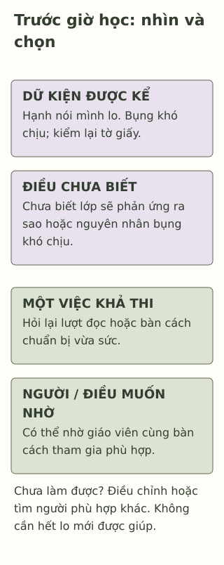

# Khi lo lắng ghé đến trước giờ học

> **Bản nháp để duyệt · KGNT-C02 · c02-draft-r1 · 25/10/2026.**
> Chưa duyệt nội dung cuối, chưa rà soát chuyên môn độc lập, chưa có quyền xuất bản.

Sáng nay, Hạnh sẽ đọc phần mở đầu trong buổi thảo luận. Bạn đã chuẩn bị, nhưng trước cửa lớp lại nghĩ: “Nếu mình đọc vấp, mọi người sẽ cười.” Hạnh nói mình lo, thấy bụng khó chịu và cứ kiểm lại tờ giấy. Một người bạn bảo: “Có mấy câu thôi mà.”

Tờ giấy ngắn chưa nói được điều Hạnh đang trải qua. Trong bài này, ta thử nhìn điều đã biết, điều còn cần hỏi và một lựa chọn có thể giúp Hạnh bước vào giờ học với sự hỗ trợ phù hợp.

*Hạnh, Đức, lời thoại và mọi tình huống là giả định do biên tập tạo. Không phải ca lâm sàng, dữ liệu nghiên cứu hoặc bài kiểm tra sức khỏe.*

## Có thể lo, mà chưa biết gọi tên thế nào

Khi nghĩ đến một điều sắp tới, ta có thể thấy bất an, khó tập trung hoặc khó chịu trong người. National Health Service (NHS, 2023, mục “Symptoms of anxiety in children and young people”) mô tả lo nghĩ, khó tập trung và đau bụng trong các biểu hiện có thể gặp ở trẻ em, người trẻ có lo âu. Không phải ai cũng có cùng biểu hiện; danh sách ấy không dùng để tự xác nhận một bệnh.

Bài dùng từ **lo lắng** cho lời kể đời thường của Hạnh; *anxiety* là thuật ngữ trong các nguồn được dẫn. NHS (2026) lưu ý người trẻ có thể lo trước thay đổi hoặc kiểm tra, đồng thời cần chú ý khi khó khăn cản trở đời sống. Không phải cứ có một giờ học khiến mình lo là đã có rối loạn; cũng không thể từ một câu chuyện ngắn kết luận chắc chắn không có khó khăn cần hỗ trợ.

Với Hạnh, “mọi người sẽ cười” là điều bạn dự đoán, chưa phải sự việc đã xảy ra. Bụng khó chịu là điều Hạnh cảm nhận, nhưng bài chưa xác định nguyên nhân. Không nên quy mọi khó chịu cơ thể cho lo lắng; nếu lo về sức khỏe, có thể hỏi người lớn và nhân viên y tế phù hợp.

## Ba điều cần nhìn riêng

| Đã biết trong câu chuyện | Điều chưa thể kết luận |
|---|---|
| Hạnh nói mình lo trước lượt đọc | Chưa biết những buổi khác ra sao hoặc khó khăn ảnh hưởng thế nào. |
| Bạn nghĩ người khác sẽ cười | Chưa biết lớp sẽ phản ứng ra sao; dự đoán không phải bằng chứng. |
| Bạn thấy bụng khó chịu, kiểm lại giấy | Chưa đủ thông tin để xác định nguyên nhân hoặc chẩn đoán. |

Lời “có mấy câu thôi” có thể bỏ qua điều Hạnh cần nói. NHS (2026, mục “How to help an anxious child”) khuyên người lớn lắng nghe, cùng tìm vấn đề và giải pháp, thay vì gạt đi lo lắng hoặc ép trẻ vào tình huống gây căng thẳng khi chưa trao đổi. Đó là hướng dẫn hỗ trợ, không phải bằng chứng rằng một câu nói sẽ làm hết lo.

## Chọn một việc vừa với lúc này

Hạnh không cần tự giải quyết cả buổi thảo luận. Bạn có thể thử chỉ vào chỗ đang vướng và chọn một việc cụ thể. Chẳng hạn: hỏi giáo viên lượt đọc bắt đầu ở đâu, xem lại câu mở đầu với bạn cùng nhóm, hoặc xin trao đổi riêng về điều đang làm mình khó tham gia.

Những ví dụ này do bài biên soạn, dựa hướng cùng tìm hỗ trợ của NHS (2026); không phải trị liệu tiếp xúc, CBT hoặc quy trình đã được thử nghiệm. Không cần ép bản thân làm điều quá sức để chứng minh can đảm. Nếu đang có điều khiến mình không an toàn, ưu tiên nhờ người lớn an toàn giúp, thay vì cố hoàn thành bài tập.

Một câu có thể mở lời là: “Em đã chuẩn bị nhưng đang lo ở lượt đọc. Cô có thể cùng em bàn một cách tham gia phù hợp không ạ?” Giáo viên có thể chưa sắp xếp được ngay; phản ứng của người lớn không hoàn toàn do Hạnh nói đã đủ hay chưa.

*Thẻ học tập do Không Gian Nội Tâm biên soạn với hỗ trợ AI, tham khảo NHS (2023, 2026) và National Institute of Mental Health (2024); không phải thang sàng lọc hoặc mô hình chẩn đoán.*

**Mô tả tương đương bằng chữ:** Thẻ có phần dữ kiện và điều chưa biết; phần lựa chọn gồm một việc khả thi, một người/điều muốn nhờ. Nếu chưa làm được, có thể điều chỉnh hoặc tìm người khác. Các khối không biểu thị trình tự sinh học hay mối quan hệ nhân quả; không yêu cầu phải hết lo mới được giúp.

## Thử với Đức ở tiết học khác

Đức sẽ tham gia phần đọc nhóm. Bạn nói “mình lo”, chưa rõ nhóm phân ai đọc đoạn nào và đang có khoảng nghỉ trước tiết. Câu chuyện chưa cho biết Đức đã trao đổi với giáo viên hay nhóm chưa.

Có thể bỏ qua hoạt động hoặc chỉ dùng nhân vật. Không cần kể triệu chứng, chuyện lớp hay sức khỏe riêng.

**1. Nêu hai biểu hiện được bài đề cập có thể đi cùng lo lắng.** Chỉ nhận diện thông tin, không dùng danh sách chấm sức khỏe.

**2. Vì sao câu “Hạnh thấy bụng khó chịu, vậy Hạnh chắc chắn có rối loạn lo âu” vượt quá dữ kiện?** Nêu một điều còn cần biết.

**3. Dùng thẻ để chọn một bước và một hỗ trợ cho Đức.** Nếu người định hỏi đang bận, bạn sẽ điều chỉnh thế nào? Không cần đặt nhiệm vụ Đức phải đọc ngay hoặc phải hết lo.

### Gợi ý phản hồi

**Câu 1:** Có thể nêu lo nghĩ, khó tập trung hoặc khó chịu ở bụng. Những mục này có trong nguồn hướng dẫn, nhưng không đặc hiệu để xác định bệnh hoặc nguyên nhân ở một người.

**Câu 2:** Một biểu hiện và một buổi chưa cho biết toàn bộ trải nghiệm, sức khỏe hoặc ảnh hưởng qua thời gian. Có thể hỏi điều đang khiến Hạnh lo, những lúc khác ra sao và cần hỗ trợ gì. Đánh giá cá nhân cần nhiều thông tin và chuyên môn; câu trả lời không nên đổi sang kết luận chắc chắn Hạnh không có vấn đề.

**Câu 3:** Đức có thể hỏi nhóm làm rõ đoạn phụ trách rồi bàn một cách chuẩn bị vừa sức; hoặc nhờ giáo viên giúp làm rõ phân công. Nếu chưa hỏi được, ghi câu hỏi để hẹn hoặc tìm người phù hợp khác. Cách khác vẫn hợp lý nếu dựa dữ kiện, có việc cụ thể và lựa chọn hỗ trợ, không ép tham gia khi chưa an toàn. Không chấm theo việc Đức có hết lo hay đọc thành công không.

## Không cần chờ đến khi “đủ nặng”

Khi cảm xúc gây khổ sở, kéo dài hoặc cản trở việc học, sinh hoạt hay quan hệ, có thể trao đổi với người lớn đáng tin và người có chuyên môn (National Institute of Mental Health [NIMH], 2024). Không phải đáp ứng đủ các điều kiện ấy mới được tìm giúp.

Có thể bắt đầu với người chăm sóc, giáo viên hoặc nhân viên y tế; người tư vấn ở trường là một lựa chọn nếu trường có người phù hợp. Nếu người đầu không an toàn hoặc không phù hợp, có thể tìm người khác. Không cần biết tên bệnh, dùng đúng thuật ngữ hay làm xong các bước tự hỗ trợ trước.

### Tìm hiểu sâu hơn — tùy chọn

NIMH (2024, mục “How is children’s mental health assessed?”) mô tả đánh giá có thể tìm hiểu nhiều mặt của đời sống và sức khỏe, không chỉ đếm biểu hiện. Bảng trong bài chỉ giúp đọc dữ kiện và chọn điều cần hỏi. Nó không thay đánh giá chuyên môn; không có số mục, số ngày hoặc mức lo nào ở đây được dùng làm ngưỡng chẩn đoán. Các nguồn Anh/Mỹ cũng không xác nhận dịch vụ hay điều kiện hỗ trợ của mọi trường Việt Nam.

## Tài liệu tham khảo

National Health Service. (2023, December 15). *Anxiety disorders in children.* https://www.nhs.uk/mental-health/children-and-young-adults/advice-for-parents/anxiety-disorders-in-children/

National Health Service. (2026, August 5). *Anxiety in children.* https://www.nhs.uk/mental-health/children-and-young-adults/advice-for-parents/anxiety-in-children/

National Institute of Mental Health. (2024). *Children and mental health: Is this just a stage?* https://www.nimh.nih.gov/health/publications/children-and-mental-health
