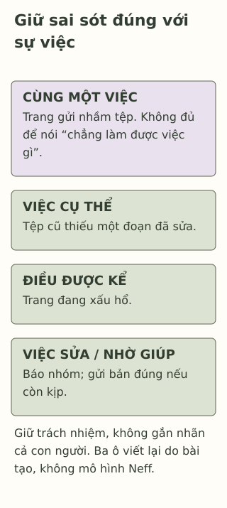

# Một sai sót không kể hết về bạn

> **Bản nháp để duyệt · KGNT-C03 · c03-draft-r1 · 25/10/2026.**
> Chưa duyệt nội dung cuối, chưa rà soát chuyên môn độc lập, chưa có quyền xuất bản.

Trang gửi nhầm bản cũ của bài làm nhóm. Khi nhóm phát hiện, bạn nghĩ: “Mình làm hỏng mọi thứ. Mình chẳng làm được việc gì.” Trong tệp cũ thiếu một đoạn nhóm đã sửa; các phần khác vẫn có thể dùng. Trang đang xấu hổ và chưa biết mở lời với các bạn ra sao.

Một tệp gửi nhầm là việc có thể nhìn lại. “Chẳng làm được việc gì” lại nói về cả con người Trang. Bài này mời bạn giữ đúng việc cần sửa mà không phải dùng một lời phán xét bao trùm.

*Nhân vật, lời nghĩ và ví dụ đều giả định do biên tập tạo, không phải dữ liệu học sinh thật.*

## Nhìn một việc trước khi kết luận về mình

Có thể tách hai câu trong ví dụ:

- “Mình gửi nhầm tệp, còn thiếu đoạn đã sửa”: mô tả sự việc cụ thể.
- “Mình chẳng làm được việc gì”: mở rộng từ sự việc sang một phán xét toàn bộ bản thân.

Sự khác nhau ấy là đối chiếu ngôn ngữ trong câu chuyện, không phải một bài test tư duy. Bài không biết Trang đã nghĩ gì ngoài lời được kể, và không yêu cầu bạn ấy phủ nhận xấu hổ.

Một cách diễn đạt khác có thể là: “Mình đang xấu hổ vì đã gửi nhầm. Mình cần báo nhóm và gửi lại bản đúng nếu còn kịp.” Câu ấy vẫn nhận trách nhiệm, không hứa nhóm sẽ hết khó chịu hoặc mọi việc sẽ ổn ngay.

## Tử tế với mình mà vẫn nhìn rõ sai sót

Khi gặp một việc khó, thử dành cho mình sự quan tâm thay vì chỉ trách móc là một ý trong **tự trắc ẩn** (*self-compassion*). Trong cách khái niệm hóa của Kristin Neff (2003), có ba mặt liên hệ: đối xử tử tế với bản thân; nhìn nhận sai sót, đau buồn là phần con người có thể trải qua; và nhận biết điều đang khó chịu mà không để nó trở thành toàn bộ câu chuyện về mình.

Đây là một cách tiếp cận tâm lý học, không phải lời yêu cầu “nghĩ tích cực”. Trong lập luận của Neff (2003, tr. 87), tự trắc ẩn không có nghĩa bỏ qua điều cần sửa. Bài cũng không gọi Neff là người đầu tiên nghĩ ra lòng trắc ẩn; nguồn năm 2003 xây dựng một cách khái niệm hóa trong nghiên cứu tâm lý.

Với Trang, thừa nhận đã gửi nhầm có thể đi cùng việc không tự gọi mình vô dụng. Nhìn nhận ai cũng có thể sai cũng không xóa ảnh hưởng lên nhóm, hoặc buộc các bạn phải tha thứ ngay.

*Sơ đồ đối chiếu do Không Gian Nội Tâm biên soạn với hỗ trợ AI; tham khảo Neff (2003). Ba ô của bài tập không tái tạo mô hình ba thành phần của Neff hoặc đo tự trắc ẩn.*

**Mô tả tương đương bằng chữ:** Cùng dữ kiện gửi nhầm tệp được giữ ở đầu. Ba ô gợi ý ghi điều đã xảy ra, điều nhân vật kể đang khó chịu và một việc sửa/nhờ giúp. Dòng nhắc cuối giữ trách nhiệm mà không gắn nhãn toàn bộ bản thân. Các ô là cách viết lại do bài tạo, không thang điểm hay chương trình trị liệu.

## Bằng chứng không phải lời hứa cho một câu nói

Phân tích gộp ở tuổi 10–19 ghi nhận tự trắc ẩn cao hơn có liên hệ với ít khó khăn tâm lý hơn, nhưng phần lớn bằng chứng là tương quan và có giới hạn về chất lượng, khác biệt giữa nghiên cứu (Marsh et al., 2018, mục “Discussion”, “Limitations”). Không thể từ đó nói việc viết lại một câu chắc chắn giảm buồn, chữa bệnh hoặc làm một người học tốt hơn.

Ở hoạt động này, điều ta xem là câu viết lại có giữ dữ kiện và chỉ được việc có thể làm không. Không chấm Trang đã cảm thấy tốt hơn hay đã đạt một mức “tự trắc ẩn”.

## Một mẫu ngắn để thử

Mẫu của bài là: **việc cụ thể — điều khó chịu đã được kể — điều có thể sửa hoặc hỏi**. Không cần thêm một lời khen nếu bạn không tin lời ấy đúng. Khi chưa đủ dữ kiện, có thể ghi rõ điều chưa biết.

Giả sử Khoa quên ghi tên nguồn cho một hình trong bài thuyết trình nháp. Giáo viên yêu cầu bổ sung trước khi nộp. Khoa nói mình thất vọng và nghĩ “mình là người thiếu trách nhiệm”. Bạn có thể dùng hoàn toàn câu chuyện hoặc bỏ qua; không cần kể sai sót riêng.

**1. Trong hai câu về Trang ở đầu bài, câu nào là lời tự phê bình bao trùm?**

**2. Vì sao “gửi nhầm tệp” không đủ chứng minh “chẳng làm được việc gì”?** Việc nhìn khác đi có xóa trách nhiệm sửa tệp không?

**3. Dùng mẫu để viết lại nhận xét của Khoa.** Giữ việc thiếu nguồn, điều Khoa tự kể và một bước sửa hoặc hỏi phù hợp; không mặc định quyền dùng hình đã hợp lệ.

### Gợi ý phản hồi

**Câu 1:** “Mình chẳng làm được việc gì” là lời phán xét rộng trong cách dùng này. Câu về tệp chỉ rõ việc và phần thiếu. Ta phân biệt câu chữ, không chấm giá trị của Trang.

**Câu 2:** Câu chuyện nêu một việc cụ thể; từ đó không thể kết luận về mọi khả năng của Trang. Vẫn cần báo nhóm, sửa nếu có thể và nhìn nhận ảnh hưởng. Tử tế với mình không phải yêu cầu người khác bỏ qua sai sót.

**Câu 3:** Có thể viết: “Mình thất vọng vì phần hình chưa ghi nguồn. Mình sẽ kiểm nguồn và quyền dùng; nếu chưa rõ, hỏi giáo viên hoặc thay hình phù hợp.” Chấp nhận lời khác nếu không phủ nhận sai sót, không gán nhãn cả con người và có bước làm được. “Không sao, khỏi cần nguồn” chưa đáp ứng trách nhiệm; “mình hoàn hảo” cũng không cần thiết. Không buộc Khoa phải hết thất vọng sau khi viết.

## Nếu lời trách mình khiến ngày học nặng hơn

Khi cảm xúc gây khổ sở, kéo dài hoặc cản trở sinh hoạt, có thể tìm người lớn đáng tin hay người có chuyên môn (National Institute of Mental Health [NIMH], 2024). Không cần chứng minh mình đã thử đủ các câu tự động viên. Nếu người đầu không phù hợp hoặc không an toàn, có thể tìm người khác; không giả định mọi trường có tham vấn viên.

### Tìm hiểu sâu hơn — tùy chọn

Neff (2003) là bài khái niệm, không thử nghiệm hiệu quả câu viết lại của Khoa. Marsh et al. (2018) tổng hợp mối liên hệ, không xác nhận một nguyên nhân duy nhất hoặc toàn bộ mô hình đo lường. Thuật ngữ Việt trong bài là cách diễn giải để học, chưa phải bản dịch thang đo được chuẩn hóa; bài không sao chép bảng hỏi hoặc chấm điểm.

## Tài liệu tham khảo

Marsh, I. C., Chan, S. W. Y., & MacBeth, A. (2018). Self-compassion and psychological distress in adolescents—a meta-analysis. *Mindfulness, 9*, 1011–1027. https://doi.org/10.1007/s12671-017-0850-7

National Institute of Mental Health. (2024). *Children and mental health: Is this just a stage?* https://www.nimh.nih.gov/health/publications/children-and-mental-health

Neff, K. D. (2003). Self-compassion: An alternative conceptualization of a healthy attitude toward oneself. *Self and Identity, 2*(2), 85–101. https://doi.org/10.1080/15298860309032
