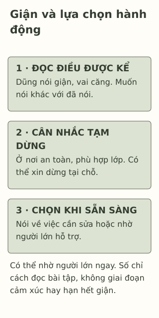

# Khi cơn giận đến trước lời nói

> **Bản nháp để duyệt · KGNT-C04 · c04-draft-r1 · 25/10/2026.**
> Chưa duyệt nội dung cuối, chưa rà soát chuyên môn độc lập, chưa có quyền xuất bản.

Trong buổi làm mô hình, một bạn vô tình làm đổ phần giấy Dũng vừa dựng. Dũng nói mình giận, thấy vai căng lên và muốn nói một câu xúc phạm. Bạn chưa nói câu ấy. Chiếc mô hình còn có thể sửa, nhưng lúc này Dũng chưa muốn cùng bàn cách làm lại.

“Mình giận”, “mình muốn nói” và “mình đã nói” là ba chi tiết cần phân biệt. Chúng không tự quyết định Dũng là một người thế nào.

*Các nhân vật, lời kể và lựa chọn dưới đây là giả định do biên tập tạo, không phải ca tư vấn hoặc dữ liệu nghiên cứu.*

## Cảm xúc không đồng nghĩa với việc đã làm

National Health Service (NHS, 2023, mục “Help your child spot the signs of anger”) nêu một số biểu hiện có thể được người trẻ nhận thấy khi giận, như cơ căng, tim nhanh hoặc siết tay. Những tín hiệu đó không riêng cho giận. Trong câu chuyện này, ta biết Dũng giận vì bạn nói vậy, không chỉ vì vai căng.

Muốn nói một câu xúc phạm là một thôi thúc, chưa phải lời đã nói. Có cảm xúc giận cũng không buộc một người phải làm đau hoặc hạ nhục người khác. Việc bài phân biệt cảm xúc và hành vi không phủ nhận trách nhiệm nếu hành vi gây hại đã xảy ra.

## Tạm dừng là một lựa chọn, không phải lệnh phải hết giận

Dũng có thể xin dừng cuộc bàn bạc một lúc, giữ khoảng cách phù hợp trong lớp rồi nhờ giáo viên giúp nếu cần. Khi đã sẵn sàng, bạn có thể nói về phần giấy bị đổ và điều muốn nhờ sửa. Không cần giả vờ mình không giận.

NHS (2023, mục “Anger tips for your child”) gợi ý cùng người trẻ tìm cách ứng phó, trong đó có tạm rời tình huống hoặc nói với người đáng tin. Đây là hướng dẫn, không bằng chứng rằng mọi lần tạm dừng đều có cùng hiệu quả. “Rời tình huống” trong ví dụ phải xét nơi an toàn và quy định thực tế, không tự bỏ lớp, đi ra đường hoặc tách đến nơi không an toàn.

Một lời giả định có thể là: “Mình đang giận, mình xin dừng nói một chút. Lát nữa mình muốn bàn phần này với thầy/cô.” Người khác không nhất thiết đồng ý ngay; học sinh có thể cần người lớn giúp tạo điều kiện tạm dừng.

## Điều tiết không chỉ là nén mọi biểu hiện

Trong tâm lý học, **điều tiết cảm xúc** (*emotion regulation*) là một lĩnh vực gồm nhiều cách theo dõi và điều chỉnh trải nghiệm, biểu hiện cảm xúc; các nhóm nghiên cứu có cách định nghĩa không hoàn toàn giống nhau (Compas et al., 2017, tr. 940–941, Bảng 1). Đây không phải tên riêng của thẻ ba bước trong bài.

Nghiên cứu ở trẻ em và vị thành niên còn phụ thuộc cách đo, tuổi, tình huống và thiết kế. Vì vậy, không nên dùng một kỹ thuật như đáp án luôn đúng hoặc hứa nó sẽ làm giận biến mất (Compas et al., 2017, phần “Discussion”). Bài chỉ hướng dẫn một lựa chọn hành động có thể xét trong tình huống thông thường, không xây chương trình can thiệp.

*Thẻ sư phạm do Không Gian Nội Tâm biên soạn với hỗ trợ AI; tham khảo NHS (2023), Compas et al. (2017). Không tái tạo mô hình điều tiết cảm xúc hoặc hướng dẫn xử trí bạo lực.*

**Mô tả tương đương bằng chữ:** Ba khối nhắc đọc tín hiệu và lời kể, cân nhắc tạm dừng an toàn, rồi lựa chọn nói về sự việc hoặc nhờ người lớn. Số chỉ thứ tự làm bài tập, không phải cảm xúc luôn diễn ra theo ba giai đoạn; có thể nhờ người lớn ngay, không phải đi đủ các ô trước.

## Thử chọn khi chưa nói ra

Trong một hoạt động khác, Yến bị bạn ngắt lời giữa lúc trình bày ý tưởng. Yến nói mình bực, nhận thấy tay siết lại và muốn đáp một câu nặng lời. Yến có thể xin giáo viên điều phối lượt nói; câu chuyện không có đe dọa hoặc bạo lực.

Có thể bỏ qua hoặc chỉ dùng nhân vật. Không cần kể lần tức giận riêng, tái hiện tranh cãi hoặc diễn vai điều gây bất an.

**1. Nêu một tín hiệu được kể trong câu chuyện và một điều cho biết nhân vật tự nhận mình giận hoặc bực.**

**2. Dũng muốn nói câu xúc phạm có đồng nghĩa bạn đã nói không?** Giải thích vì sao không thể chỉ nhìn vai căng mà biết chắc cảm xúc.

**3. Chọn một cách tạm dừng phù hợp cho Yến, rồi một lời nói hoặc hỗ trợ có thể dùng khi sẵn sàng.** Nếu không thể đổi chỗ, bạn có thể sửa lựa chọn thế nào?

### Gợi ý phản hồi

**Câu 1:** Có thể nêu vai Dũng căng hoặc tay Yến siết; Dũng nói mình giận, Yến nói mình bực là lời tự kể. Tín hiệu và lời kể có vai trò khác nhau, không dùng để chấm cảm xúc người thật.

**Câu 2:** “Muốn” là thôi thúc, “đã nói” là hành vi đã xảy ra; câu chuyện còn cho biết Dũng chưa nói. Vai căng không đặc hiệu, nên không thay được lời kể hoặc việc hỏi thêm. Cách giải thích khác được chấp nhận nếu giữ phân biệt ấy.

**Câu 3:** Yến có thể tạm chưa đáp câu nặng lời, xin giáo viên điều phối hoặc xin dừng trao đổi một lúc tại chỗ. Khi sẵn sàng, có thể nói “Mình muốn nói hết ý rồi nghe bạn.” Nếu không đổi được chỗ, vẫn có thể nhờ giáo viên hỗ trợ thay vì tự rời lớp. Đáp án phù hợp cần an toàn, cụ thể và không ép hết giận; có nhiều lựa chọn. Thẻ không thay trách nhiệm của người lớn tạo điều kiện lắng nghe.

## Khi cần người cùng hỗ trợ

Nếu giận hoặc cách hành động gây khổ sở, kéo dài hay cản trở đời sống, có thể trao đổi với người lớn đáng tin hoặc người có chuyên môn (National Institute of Mental Health [NIMH], 2024). Nếu người đầu không phù hợp hoặc không an toàn, có thể tìm người khác. Khi có nguy cơ gây hại, cần người lớn an toàn hỗ trợ ngay; không tiếp tục dùng bài tập như cách xử lý đủ cho tình huống ấy.

### Tìm hiểu sâu hơn — tùy chọn

Compas et al. (2017) tổng hợp nhiều nghiên cứu liên hệ, phần lớn cắt ngang; kết quả dọc theo thời gian yếu hơn và không đồng nhất. Nguồn ấy không chứng minh riêng thao tác tạm dừng của bài. Mục tiêu ở đây là chọn hành động trong một chuyện thông thường, không phân loại “người biết/không biết kiểm soát” hoặc đo sức khỏe.

## Tài liệu tham khảo

Compas, B. E., Jaser, S. S., Bettis, A. H., Watson, K. H., Gruhn, M. A., Dunbar, J. P., Williams, E., & Thigpen, J. C. (2017). Coping, emotion regulation, and psychopathology in childhood and adolescence: A meta-analysis and narrative review. *Psychological Bulletin, 143*(9), 939–991. https://doi.org/10.1037/bul0000110

National Health Service. (2023, April 24). *Helping your child with anger issues.* https://www.nhs.uk/mental-health/children-and-young-adults/advice-for-parents/help-your-child-with-anger-issues/

National Institute of Mental Health. (2024). *Children and mental health: Is this just a stage?* https://www.nimh.nih.gov/health/publications/children-and-mental-health
