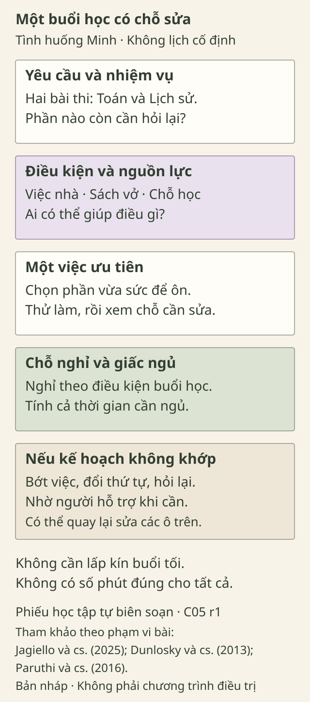

# Khi mùa thi đến gần

> **Bản nháp để duyệt · KGNT-C05 · c05-draft-r1 · 25/10/2026.**
> Chưa được duyệt biên tập hoặc rà soát chuyên môn; không có quyền xuất bản.

Minh có bài thi Toán vào thứ Tư và Lịch sử vào thứ Sáu. Tối nay, Minh còn rửa bát và trông em đến khi người chăm sóc đi làm về. Bạn đã mở sách nhưng chưa biết phần nào cần ưu tiên. Hai tối vừa rồi, Minh ngủ ít hơn thường lệ để học thêm.

Trong nhóm lớp, một bạn gửi lịch ôn kín buổi tối. Minh nhìn lịch ấy rồi nghĩ: “Chắc mình phải cố thêm.” Nhưng nếu điền hết những ô giờ giống bạn, việc nhà của Minh sẽ nằm ở đâu?

*Tất cả nhân vật và tình huống trong bài đều do biên tập đặt ra, không phải dữ liệu học sinh thật.*

## Áp lực nằm ở những đâu?

Trong câu chuyện Minh, có ít nhất ba việc cần nhìn riêng: hai bài thi đang đến, trách nhiệm ở nhà và phần kiến thức chưa biết bắt đầu từ đâu. Còn lịch ôn của người khác không cho biết người ấy có cùng những vướng mắc này hay không.

Trong nghiên cứu, *stress học tập* là cách gọi áp lực hoặc khó chịu liên quan đến việc đạt mục tiêu học tập. Lo âu thi cử tập trung hơn vào các tình huống kiểm tra, dù hai phạm vi có phần chồng lấp (Jagiello và cộng sự, 2025, mục “Introduction”). Cách gọi này không có nghĩa cứ lo trước bài thi là đã có một rối loạn.

Với Minh, câu hỏi thực hành là: **Việc gì cần chuẩn bị, mình có điều kiện gì và đang cần ai giúp điều gì?** Bài này dùng các câu hỏi đời thường ấy, không yêu cầu bạn học thuộc một lý thuyết về stress.

## Cùng lịch thi, khác điều kiện chuẩn bị

Giả sử Hà học cùng lớp Minh, thi cùng ngày và có sẵn một buổi tối yên tĩnh. Minh lại có những khoảng phải chăm em, chưa chắc mở máy tính được. Hai bạn cũng có thể đang vướng những phần bài khác nhau.

Nếu cả hai dùng một lịch giống hệt, những ô dành cho việc học có thể vừa với Hà nhưng chồng lên việc nhà của Minh. Điều cần sửa lúc ấy là tính khả thi của kế hoạch, không phải vội kết luận Minh ít nỗ lực.

Một cách nhìn tình huống:

| Điều cần biết | Với Minh, cần làm rõ gì? |
|---|---|
| Yêu cầu | Phạm vi ôn Toán và Lịch sử; phần nào còn chưa hiểu? |
| Điều kiện | Có sách và vở nào; lúc nào phải trông em; có chỗ học hoặc người cùng xem bài không? |
| Ưu tiên | Việc học cụ thể nào nên làm trước, dựa vào lịch thi và chỗ đang vướng? |
| Hỗ trợ | Có thể hỏi thầy cô về phạm vi bài, nhờ bạn giải thích hoặc trao đổi việc nhà với người lớn nào? |

Bạn không cần giải quyết hết các cột ngay. Một ô ghi “cần hỏi lại” có thể giúp nhận ra thông tin còn thiếu.

## Chọn cách học, không chỉ chọn giờ học

Hai hướng có căn cứ trong tổng quan của Dunlosky và cộng sự (2013) là **tự kiểm tra kiến thức** và **ôn cách quãng**:

- **Tự kiểm tra:** thử nhớ hoặc trả lời trước khi xem lại, rồi đối chiếu để biết chỗ cần sửa. Ví dụ của bài này: Minh che lời giải một bài đã học, thử làm lại và đánh dấu bước chưa hiểu.
- **Ôn cách quãng:** quay lại nội dung ở những lần học tách nhau, thay vì dồn tất cả vào một lần. Ví dụ: sau buổi hôm nay, Minh ghi phần cần xem lại vào một buổi còn có thể sắp xếp trước thi.

Hai hướng này được xếp mức hữu ích cao trong tổng quan; không có nghĩa chúng bảo đảm điểm số hoặc thay được việc giảng giải phần chưa hiểu (Dunlosky và cộng sự, 2013, mục 8–9 và Bảng 4). Các ví dụ của Minh là cách áp dụng do bài viết biên soạn, không phải lịch được thử nghiệm riêng.

Nếu chỉ còn một buổi trước thi, không cần cố tạo ra một “lịch ôn cách quãng hoàn hảo”. Minh vẫn có thể chọn một phần vừa sức, xem lại lỗi và hỏi chỗ chưa rõ. Phần chưa kịp học cần được nhìn nhận như một giới hạn có thật.

## Để chỗ cho nghỉ, ngủ và người hỗ trợ

Trong phiếu sắp làm, khoảng nghỉ là chỗ có thể điều chỉnh: Minh có thể rời bàn, uống nước hoặc ngồi yên một lúc theo điều kiện của mình. Đây là gợi ý tổ chức buổi học, không phải quy định rằng cứ học một số phút nhất định thì phải nghỉ đúng một số phút khác.

Giấc ngủ cũng cần được tính khi xếp buổi tối. Khuyến nghị AASM là **9–12 giờ mỗi 24 giờ cho trẻ 6–12 tuổi** và **8–10 giờ cho tuổi 13–18**, thường xuyên, để hỗ trợ sức khỏe (Paruthi và cộng sự, 2016). Đây là khoảng theo nhóm tuổi, không là ngưỡng tự chẩn đoán hay lời hứa “ngủ đủ sẽ thi tốt”. Không nên áp cùng một khoảng cho mọi học sinh THCS–THPT.

Nếu việc học và việc nhà đang khiến Minh không có đủ cơ hội ngủ, chỉ thêm lời nhắc “ngủ sớm đi” chưa giải quyết được lịch tối ấy. Một phần kế hoạch có thể là trao đổi với người lớn về việc cần chia sẻ hoặc với thầy cô về khó khăn đang gặp.

## Một phiếu có chỗ sửa

Phiếu dưới đây giúp nhìn lại một buổi học cụ thể. Nó không yêu cầu bạn lấp kín mọi khoảng trống.

*Phiếu học tập tự biên soạn; tham khảo Jagiello và cộng sự (2025), Dunlosky và cộng sự (2013), Paruthi và cộng sự (2016) theo phạm vi ghi trong bài. Không phải lịch tối ưu hoặc chương trình điều trị.*

**Mô tả tương đương bằng chữ:** Phiếu có năm vùng: xác định yêu cầu; ghi điều kiện và nguồn lực; chọn việc ưu tiên cùng cách học; dành chỗ cho nghỉ và giấc ngủ; ghi điều sẽ sửa hoặc cần nhờ ai. Vùng cuối nhắc có thể quay lại sửa các vùng trước. Hình không thể hiện dữ liệu nghiên cứu hoặc quan hệ nhân quả.

### Thử điền một phần cho Minh

Ví dụ một việc ưu tiên là: “Xem lại dạng Toán đã học nhưng còn sai một bước.” Minh có thể thử làm một bài, đối chiếu lời giải và ghi câu hỏi để hỏi giáo viên. Phạm vi nhỏ này cụ thể hơn “học xong cả môn Toán”.

Phần nghỉ có thể ghi: “Nghỉ sau lượt làm và xem lại bài; nếu đã quá mệt thì dừng để xem lại kế hoạch.” Phần điều chỉnh có thể ghi: “Nếu phải trông em lâu hơn, giữ một bài, chuyển phần luyện thêm và nhờ giải thích bước vướng vào hôm sau.”

Đây chỉ là **một phương án**. Nếu Minh chưa biết thi phần nào, việc ưu tiên đầu tiên có thể là ghi câu hỏi về phạm vi ôn, không phải tự đoán rồi làm càng nhiều càng tốt.

### Khi kế hoạch không khớp thực tế

Một kế hoạch yêu cầu Minh học liên tục suốt tối, không nghỉ, trong lúc vẫn trông em và phải thức khuya để hoàn thành sẽ không xử lý được những việc đang chồng lên nhau. Nếu có lúc nhà ồn hoặc không có người thay Minh, việc không làm hết phiếu không chứng minh bạn thiếu kỷ luật.

Trong tình huống ấy, có thể giảm phần việc, đổi thứ tự hoặc tìm người hỗ trợ. Nếu chưa có cách hỗ trợ ngay, kế hoạch vẫn có thể ghi rõ điều chưa làm được. Không cần biến khó khăn ngoài khả năng kiểm soát thành một lỗi của bản thân.

## Đến lượt bạn thử với tình huống Minh

Bạn có thể dùng hoàn toàn dữ kiện giả định, không cần kể lịch học hay hoàn cảnh riêng; cũng có thể bỏ qua hoạt động.

Dùng mẫu dưới đây theo ba bước: **chọn một việc ưu tiên → ghi cách học và chỗ nghỉ → thêm điều chỉnh hoặc câu hỏi cần hỗ trợ**.

| Vùng của phiếu | Bạn sẽ ghi gì cho Minh? |
|---|---|
| Yêu cầu và điều còn thiếu | Hai bài thi; phạm vi nào cần hỏi lại? |
| Điều kiện và nguồn lực | Việc nhà, sách/vở, người có thể hỏi… |
| Một việc ưu tiên và cách học | … |
| Phương án nghỉ, bảo vệ thời gian ngủ | … |
| Nếu hoàn cảnh thay đổi | Bớt/đổi việc gì, hoặc nhờ ai điều gì? |

Bạn có thể chọn Toán vì bài thi đến trước, hoặc chọn hỏi lại phạm vi vì chưa đủ thông tin. Điều quan trọng là giải thích lựa chọn và không đặt nhiệm vụ đòi hỏi những điều kiện Minh chưa có.

## Tự kiểm tra

**1. Từ câu chuyện Minh, nêu ít nhất hai nguồn áp lực và một người có thể hỗ trợ một việc cụ thể.**

**2. Vì sao Minh và Hà có cùng lịch thi nhưng có thể cần kế hoạch khác nhau?**  
Dựa trên điều kiện của hai nhân vật, không suy đoán ai chăm chỉ hay thông minh hơn.

**3. Điền phiếu cho Minh:** một việc ưu tiên, cách thực hiện, phương án nghỉ và ít nhất một cách điều chỉnh hoặc nhờ hỗ trợ. Nếu buổi trông em kéo dài, bạn sửa gì?

### Gợi ý phản hồi

**Câu 1:** Có thể nêu hai bài thi, việc nhà hoặc việc chưa rõ phần ưu tiên. Một nguồn hỗ trợ là giáo viên giúp làm rõ phạm vi ôn; cũng có thể là người lớn cùng trao đổi việc chăm em. Câu trả lời nêu rõ *nhờ việc gì* sẽ hữu ích hơn chỉ ghi một tên người.

**Câu 2:** Hà có buổi tối yên tĩnh; Minh còn thời gian phải chăm em và có điều kiện học khác. Vì vậy, số việc và cách sắp xếp có thể khác, dù hạn thi giống nhau. Có thể diễn đạt bằng lời riêng nếu gắn với dữ kiện; không dùng khác biệt ấy để kết luận về giá trị hay năng lực của hai bạn.

**Câu 3:** Một phương án là chọn một bài Toán còn vướng, thử làm rồi xem phản hồi, dành chỗ nghỉ và không kéo dài việc luyện thêm sang thời gian cần ngủ. Nếu phải chăm em lâu hơn, giảm số bài và ghi câu hỏi để hỏi giáo viên. Phương án khác vẫn phù hợp khi cụ thể, khả thi trong dữ kiện và có cách sửa. Không có một thời khóa biểu duy nhất là đáp án đúng.

## Khi cần có người cùng bàn cách hỗ trợ

Nếu lo lắng làm bạn khổ sở, kéo dài hoặc cản trở việc học, sinh hoạt hay quan hệ, có thể trao đổi với người lớn đáng tin hoặc người có chuyên môn. Đây là định hướng tìm trợ giúp, không phải bảng tự chẩn đoán (National Institute of Mental Health [NIMH], 2024).

Bạn có thể nói với người chăm sóc, giáo viên hoặc nhân viên y tế; nếu trường có người tư vấn phù hợp, đó cũng là một lựa chọn. Nếu người đầu tiên không an toàn hoặc không phù hợp để nói, có thể tìm người khác. Không cần đợi đến khi không chịu nổi hoặc tự chứng minh mình đã cố đủ mới được nhờ giúp.

Một phiếu học không thay thế hỗ trợ chuyên môn. Tổng quan của Jagiello và cộng sự (2025) xem xét các chương trình hỗ trợ ở trường và lưu ý giới hạn chất lượng nghiên cứu; không thể lấy kết quả ấy để nói phiếu của bài này đã được chứng minh làm giảm stress.

## Điều giữ lại sau buổi học

Cuối buổi, Minh có thể ghi một điều đã làm, một chỗ còn vướng và một việc cần sửa trong lần tới. Kế hoạch có ích cho hoạt động này khi giúp nhìn rõ việc đang có và điều đang thiếu, không phải khi trông kín và đẹp như lịch của người khác.

### Tìm hiểu sâu hơn — tùy chọn

“Có bằng chứng” không có nghĩa “chắc chắn đúng cho mọi người, mọi môn, mọi hoàn cảnh”. Tổng quan kỹ thuật học đánh giá cả giới hạn theo người học, tài liệu và nhiệm vụ (Dunlosky và cộng sự, 2013, phần “Closing Remarks”). Các nghiên cứu về học tập, chương trình hỗ trợ stress và khuyến nghị ngủ trả lời những câu hỏi khác nhau. Bài viết không gộp chúng thành bằng chứng rằng cả phiếu kế hoạch này có hiệu quả điều trị.

## Tài liệu tham khảo

Dunlosky, J., Rawson, K. A., Marsh, E. J., Nathan, M. J., & Willingham, D. T. (2013). Improving students’ learning with effective learning techniques: Promising directions from cognitive and educational psychology. *Psychological Science in the Public Interest, 14*(1), 4–58. https://doi.org/10.1177/1529100612453266

Jagiello, T., Belcher, J., Neelakandan, A., Boyd, K., & Wuthrich, V. M. (2025). Academic stress interventions in high schools: A systematic literature review. *Child Psychiatry & Human Development, 56*, 1836–1869. https://doi.org/10.1007/s10578-024-01667-5

National Institute of Mental Health. (2024). *Children and mental health: Is this just a stage?* (NIH Publication No. 24-MH-8085). https://www.nimh.nih.gov/health/publications/children-and-mental-health

Paruthi, S., Brooks, L. J., D’Ambrosio, C., Hall, W. A., Kotagal, S., Lloyd, R. M., Malow, B. A., Maski, K., Nichols, C., Quan, S. F., Rosen, C. L., Troester, M. M., & Wise, M. S. (2016). Recommended amount of sleep for pediatric populations: A consensus statement of the American Academy of Sleep Medicine. *Journal of Clinical Sleep Medicine, 12*(6), 785–786. https://doi.org/10.5664/jcsm.5866

[Hồ sơ nguồn](REFERENCES.md) · [Kiểm tra nhận định](CLAIM-AUDIT.md) · [Hồ sơ hình](VISUAL-REVIEW.md)
