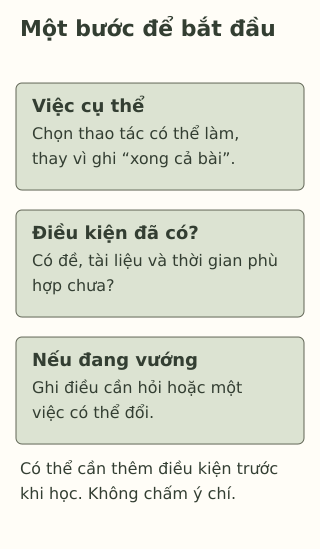

# Biết cần học, nhưng vẫn chưa bắt đầu

> **Bản nháp để duyệt · KGNT-C06 · c06-draft-r1 · 25/10/2026.**
> Chưa duyệt nội dung cuối, chưa rà soát chuyên môn độc lập, chưa có quyền xuất bản.

Khánh đã dành một khoảng buổi chiều để viết đoạn văn. Sách ở trên bàn, nhưng bạn cứ đổi màu tiêu đề rồi xếp lại bút. Khánh nói: “Mình định viết rồi. Để sát giờ thì khó sửa bài hơn, nhưng nhìn trang trắng mình chưa muốn bắt đầu.”

Cùng lúc ấy, Vy chưa mở vở vì đang trông em. Bản đề nằm trên máy tính dùng chung mà người nhà còn cần làm việc. Cả hai đều chưa viết, nhưng có nên giải thích bằng cùng một lý do?

*Nhân vật, lời nói và mọi ví dụ trong bài đều là giả định do biên tập đặt ra. Không phải dữ liệu nghiên cứu hay học sinh thật.*

## Chưa làm được khác với cứ để sau

Với Khánh, ta biết bạn có ý định, có tài liệu, tự kể đang để việc sang sau dù dự kiến bất lợi. Với Vy, có những điều kiện thiết yếu chưa sẵn có. Chỉ nhìn trang vở trống sẽ không thấy khác biệt này.

**Trì hoãn** (*procrastination*), theo định nghĩa tổng hợp của Steel (2007, tr. 66), là chủ động để chậm một việc đã định làm, dù dự kiến sự chậm trễ khiến mình bất lợi. “Chủ động” ở đây không có nghĩa việc bắt đầu luôn dễ, hoặc người ấy cố tình làm hỏng việc. Đây là cách mô tả hành vi, không phải tên bệnh hay nhãn “người lười”. Steel tổng hợp nhiều cách hiểu trước đó, không phải người khai sinh thuật ngữ.

Câu chuyện Vy chưa đủ căn cứ cho định nghĩa ấy: chậm vì thiếu điều kiện không tự là trì hoãn. Dời việc để nghỉ hoặc chờ thông tin cần thiết cũng cần xét lý do, thay vì cứ thấy chậm là kết luận.

Nghiên cứu ở trẻ em và vị thành niên còn có khác biệt về cách đo và bối cảnh; nhiều công trình là nghiên cứu quan sát (González-Brignardello et al., 2023). Không thể lấy một tình huống để suy ra tính cách, nguyên nhân tâm lý hay cách chữa cho một học sinh.

## Một việc đủ rõ để bắt đầu

“Viết đoạn văn” vẫn có thể quá mơ hồ trong phiếu của Khánh. Bạn có thể thử đổi nó thành “đọc lại đề và gạch dưới điều đề yêu cầu”, rồi mới chọn bước tiếp theo. Nếu không hiểu đề, bước cần làm có thể là ghi câu hỏi cho giáo viên.

Chia nhiệm vụ thành những phần nhỏ là một gợi ý trong tài liệu hướng dẫn của Centre for Clinical Interventions (CCI, n.d., mục “What Do I Need To Do?”). Tài liệu không phải thử nghiệm riêng ở học sinh Việt Nam; ví dụ dưới đây là cách biên soạn cho bài học, không phải quy trình điều trị hoặc mẹo bảo đảm hết trì hoãn.

Một bước khởi đầu cần trả lời được: **làm việc gì, cần gì để làm, và khi vướng thì đổi hoặc hỏi gì?** Không cần bắt đầu bằng phần khó nhất hoặc hoàn thành cả bài ngay.

*Thẻ học tập tự biên soạn, tham khảo gợi ý chia nhiệm vụ của CCI (n.d.); không tái tạo phiếu hoặc mô hình của nguồn.*

**Mô tả tương đương bằng chữ:** Ba khối độc lập nhắc chọn việc cụ thể, xem tài liệu và thời gian có sẵn, rồi ghi cách hỏi hoặc điều chỉnh. Không có mũi tên nhân quả hay thời gian bắt buộc. Thiếu điều kiện có thể là việc cần xử lý trước, không phải lỗi của nhân vật.

## Thử với một nhiệm vụ khác

Phúc phải chuẩn bị phần giới thiệu cho bài thuyết trình nhóm. Bạn có tờ yêu cầu, nhưng chưa biết mình cần nói phần nào; các bạn trong nhóm chưa phân công. Phúc hiện có một khoảng yên tĩnh và giấy bút.

Bạn có thể chỉ dùng nhân vật, không cần kể thói quen riêng; hoạt động có thể bỏ qua. Thử viết ba dòng theo thẻ: một bước cụ thể; điều kiện để làm bước ấy; một cách hỏi hoặc sửa khi chưa rõ. “Hoàn thành cả bài thuyết trình” chưa phải bước khởi đầu nhỏ. Bạn không cần đặt mốc phút.

## Tự kiểm tra

**1. Chi tiết nào phù hợp với trì hoãn trong câu chuyện Khánh?** Chọn giữa: chưa có tài liệu; tự để việc đã định làm sang sau dù dự kiến khó sửa hơn; đang trông em.

**2. Vì sao chưa thể gọi việc Vy chưa viết là trì hoãn?** Chỉ ra dữ kiện còn thiếu hoặc điều kiện đang cản trở.

**3. Dùng ba câu hỏi trong thẻ để lập bước khởi đầu cho Phúc.** Nếu nhóm vẫn chưa trả lời, Phúc có thể sửa phương án thế nào?

### Gợi ý phản hồi

**Câu 1:** Phương án thứ hai khớp với lời Khánh kể về ý định và bất lợi dự kiến. Ta đang nhận diện một hành vi trong câu chuyện, không đánh giá toàn bộ Khánh. Hai chi tiết còn lại không tự chứng minh trì hoãn.

**Câu 2:** Vy đang có trách nhiệm chăm em và chưa tiếp cận đề. Ta chưa biết lúc có điều kiện bạn sẽ làm gì. Cần tính những cản trở này trước; không biến trách nhiệm ở nhà thành bằng chứng thiếu ý chí.

**Câu 3:** Có thể đọc tờ yêu cầu, đánh dấu chỗ chưa phân công rồi hỏi nhóm mình phụ trách phần nào. Nếu chưa có hồi đáp, Phúc có thể chuẩn bị câu hỏi hoặc phác một ý có ghi rõ đang chờ xác nhận. Phương án khác vẫn phù hợp nếu bước rõ, làm được với điều kiện đã có và không đòi Phúc tự quyết thay cả nhóm. Chia nhỏ không làm mọi rào cản biến mất.

## Khi cần thêm người hỗ trợ

Nếu khó bắt đầu cứ lặp lại, Khánh có thể cùng giáo viên xem yêu cầu có rõ và khối lượng có vừa không. Khi khó khăn hoặc cảm xúc gây khổ sở, kéo dài hay cản trở sinh hoạt, có thể tìm người lớn đáng tin hoặc người có chuyên môn (National Institute of Mental Health [NIMH], 2024). Không cần tự nhận một chẩn đoán mới được hỏi giúp. Nếu người đầu không phù hợp hoặc không an toàn, có thể tìm người khác; không mặc định trường nào cũng có tham vấn viên.

### Tìm hiểu sâu hơn — tùy chọn

Tổng quan của González-Brignardello et al. (2023) tập trung lứa tuổi học đường; nó lập bản đồ lĩnh vực, không chứng minh thẻ ba câu hỏi này có hiệu quả. Các liên hệ giữa trì hoãn và yếu tố khác cũng không đủ để chọn một nguyên nhân cho Khánh. Với bài tập hôm nay, kết quả cần nhìn là một bước khả thi và điều còn thiếu, không phải nhãn về con người.

## Tài liệu tham khảo

Centre for Clinical Interventions. (n.d.). *Practical strategies to stop procrastination* [Information sheet]. https://www.cci.health.wa.gov.au/~/media/CCI/Mental-Health-Professionals/Procrastination/Procrastination---Information-Sheets/Procrastination-Information-Sheet---04---Practical-Strategies-to-Stop-Procrastinating.pdf

González-Brignardello, M. P., Sánchez-Elvira Paniagua, A., & López-González, M. Á. (2023). Academic procrastination in children and adolescents: A scoping review. *Children, 10*(6), Article 1016. https://doi.org/10.3390/children10061016

National Institute of Mental Health. (2024). *Children and mental health: Is this just a stage?* (NIH Publication No. 24-MH-8085). https://www.nimh.nih.gov/health/publications/children-and-mental-health

Steel, P. (2007). The nature of procrastination: A meta-analytic and theoretical review of quintessential self-regulatory failure. *Psychological Bulletin, 133*(1), 65–94. https://doi.org/10.1037/0033-2909.133.1.65

[Hồ sơ nguồn](REFERENCES.md) · [Đối chiếu nhận định](CLAIM-AUDIT.md) · [Bloom](BLOOM-REVIEW.md) · [Hồ sơ hình](VISUAL-REVIEW.md) · [Biên tập](EDITORIAL-REVIEW.md)
