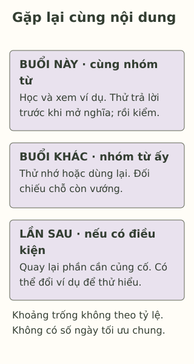

# Học nhiều chưa chắc đã nhớ lâu

> **Bản nháp để duyệt · KGNT-C07 · c07-draft-r1 · 25/10/2026.**
> Chưa duyệt nội dung cuối, chưa rà soát chuyên môn độc lập, chưa có quyền xuất bản.

Mai đọc lại trang từ vựng, thấy từ nào cũng quen. Đến lúc che nghĩa để đặt câu, bạn lại ngập ngừng. Mai hỏi: “Mình đã ngồi học lâu như vậy, sao vẫn không dùng được?”

Trang sách đang mở và một câu hỏi chưa có đáp án trước mặt là hai tình huống khác nhau. Bài này mời bạn cùng Mai thử một cách ôn có chỗ đối chiếu, rồi dành một lần quay lại chính phần đó.

*Mai, Duy và mọi lịch, câu trả lời trong bài là ví dụ giả định do biên tập tạo; không phải kết quả thí nghiệm.*

## Đọc trước, thử nhớ sau

Giả sử Mai vừa học một từ trong sách và xem ví dụ giáo viên đã giải thích. Bạn che phần nghĩa, tự nói nghĩa hoặc đặt câu, rồi mở lại để kiểm. Việc cố lấy lại điều đã học từ trí nhớ được gọi là **truy hồi** (*retrieval*); khi dùng để luyện, đó là *retrieval practice* (McDaniel et al., 2011, tr. 399–400). Chỉ nhìn đáp án rồi chép lại chưa thực hiện thao tác ấy.

Không nhớ được một mục là thông tin để chọn chỗ học tiếp, không phải kết luận “trí nhớ kém”. Mai có thể xem lại phần chưa hiểu, hỏi giáo viên rồi thử lại khi phù hợp. Không cần ép mình đoán mãi khi chưa được học hoặc chưa hiểu kiến thức nền.

Một nghiên cứu trong lớp khoa học lớp 8 tại Hoa Kỳ ghi nhận lợi ích của các câu hỏi luyện có phản hồi trên nội dung được kiểm tra (McDaniel et al., 2011). Nghiên cứu đó có giảng dạy và tài liệu lớp học đi kèm; nó không cho thấy chỉ cần tự hỏi là đủ thay việc học ban đầu, cũng không bảo đảm điểm của Mai.

## Nhớ rồi vẫn có chỗ kiểm lại

Mai thử trả lời trước khi mở đáp án. Sau đó, bạn dùng đáp án hoặc nhờ giáo viên xem cách dùng từ. Nếu viết sai, Mai ghi đúng chỗ cần sửa thay vì chỉ đánh dấu “sai cả bài”.

Trong tổng quan về kỹ thuật học, luyện tự kiểm tra có phản hồi và việc phân bố các lần học theo thời gian được đánh giá hữu ích cao; hiệu quả còn tùy nội dung, người học và cách triển khai (Dunlosky et al., 2013, mục 8–9). “Có bằng chứng” không có nghĩa một công thức sẽ hợp mọi môn.

## Quay lại cùng một phần ở buổi khác

**Ôn cách quãng** (*spaced/distributed practice*) là bố trí những lần học hoặc luyện cùng nội dung có khoảng cách, thay vì dồn sát liên tiếp (Dunlosky et al., 2013, mục 9). Học Toán hôm nay, Sử ngày mai chưa đủ thể hiện việc quay lại cùng nội dung.

Ví dụ của Mai chỉ dùng một nhóm từ:

| Lần gặp lại | Mai làm gì với cùng nhóm từ? |
|---|---|
| Buổi đang học | Học nghĩa, xem ví dụ; thử trả lời rồi kiểm. |
| Một buổi khác | Che nghĩa, thử dùng lại những từ ấy; kiểm chỗ còn vướng. |
| Lần ôn tiếp theo nếu có điều kiện | Quay lại phần cần củng cố, đổi ví dụ để thử hiểu cách dùng. |

Bảng không phải lịch tối ưu. Khoảng cách thích hợp phụ thuộc điều cần nhớ và thời điểm cần dùng; tổng quan không cho một số ngày duy nhất cho mọi nhiệm vụ (Dunlosky et al., 2013, mục 9.2a). Nếu chỉ còn một buổi, không cần thức khuya để ép đủ các ô.

*Lịch minh họa tự biên soạn theo nguyên tắc truy hồi và phân bố luyện tập; không phải lịch đã được nghiên cứu riêng hoặc dữ liệu của Dunlosky et al. (2013).* 

**Mô tả tương đương bằng chữ:** Ba thẻ đều nói về cùng nhóm từ. Mỗi thẻ cho biết một lần gặp, có thao tác thử và kiểm; khoảng trống giữa thẻ không theo tỷ lệ thời gian. Không có dự đoán số từ sẽ nhớ hoặc phần trăm tiến bộ.

## Chọn cách thử cho đúng việc

Nếu mục tiêu là dùng từ trong câu, Mai cần thử dùng từ; thuộc bản dịch chưa tự cho biết đặt câu đã phù hợp. Với bài Toán, một cách thử có thể là tự làm lại một bài đã học, kiểm từng bước và hỏi bước chưa hiểu. Đây là các ví dụ biên tập, không khẳng định mọi kỹ năng chỉ cần học thuộc.

Tổng quan lớp học của Agarwal et al. (2021, Abstract) ghi nhận lợi ích truy hồi ở nhiều bối cảnh, đồng thời cho biết nghiên cứu ngoài các quốc gia WEIRD còn ít — tức những bối cảnh thường được mô tả là phương Tây, có học vấn, công nghiệp hóa, giàu và dân chủ. Vì vậy, cần thận trọng khi áp thẳng kết quả vào mọi lớp học Việt Nam. Mẫu hoạt động ở đây chưa được thử với học sinh.

## Tự thử với lịch của Duy

Duy đã được học cách phân biệt ba loại tam giác và có sách cùng bài mẫu. Bạn có thể ôn ở hai buổi khác nhau trước bài kiểm tra, nhưng một buổi khác phải phụ việc gia đình. Duy chưa cần giải bài nâng cao.

Có thể bỏ qua hoạt động hoặc chỉ dùng nhân vật. Không cần cung cấp điểm hay lịch học thật.

**1. Gọi tên hai cách ôn trong bài:** thử trả lời trước khi mở sách; quay lại cùng nội dung ở những buổi tách nhau.

**2. Vì sao “đọc lại đáp án ba lần liên tiếp” chưa giống vừa luyện truy hồi vừa ôn cách quãng?** Nêu điều còn thiếu, không kết luận đọc lại lúc nào cũng vô ích.

**3. Lập hai lần ôn cho Duy:** mỗi lần thử điều gì, đối chiếu bằng gì; nếu mất một buổi thì sửa hoặc hỏi ai? Dùng mẫu “nội dung — cách thử — cách kiểm — lần quay lại/điều chỉnh”. Không cần điền ngày cố định.

### Gợi ý phản hồi

**Câu 1:** Luyện truy hồi và ôn cách quãng. Có thể nói “tự nhớ lại để trả lời” và “quay lại cùng phần ở lần học khác” nếu đúng thao tác.

**Câu 2:** Đáp án vẫn trước mắt nên chưa có lượt thử lấy kiến thức từ trí nhớ; các lượt liền nhau cũng chưa phải hai buổi tách nhau như ví dụ. Đọc lại có thể giúp xem chỗ chưa hiểu; điều cần thêm là cơ hội tự trả lời và quay lại có khoảng cách.

**Câu 3:** Một phương án là buổi đầu che nhãn một số hình trong sách, thử phân loại rồi kiểm tiêu chí; buổi khác làm lại với hình khác nhưng vẫn ba loại ấy, giải thích và đối chiếu. Nếu thiếu buổi, có thể giảm số mục, giữ phần cần củng cố và hỏi giáo viên chỗ chưa rõ. Chấp nhận cách khác có cùng nội dung qua các lần, lượt thử trước đáp án và phản hồi đáng tin. Không ép học bù bằng cách bỏ ngủ hoặc việc bắt buộc.

### Tìm hiểu sâu hơn — tùy chọn

Nghiên cứu McDaniel et al. (2011) so các nội dung đã được hỏi luyện với nội dung không được hỏi luyện trong cùng chương trình, không phải so “học sinh siêng” với “học sinh lười”. Một số phân tích loại người vắng buổi hoặc thuộc chương trình đặc biệt; điều này giới hạn suy rộng. Phiếu của Duy chỉ giúp thiết kế một cách thử. Nó chưa đo được trí nhớ lâu dài, khả năng vận dụng ngoài bài hay hiệu quả cho từng người.

## Tài liệu tham khảo

Agarwal, P. K., Nunes, L. D., & Blunt, J. R. (2021). Retrieval practice consistently benefits student learning: A systematic review of applied research in schools and classrooms. *Educational Psychology Review, 33*, 1409–1453. https://doi.org/10.1007/s10648-021-09595-9

Dunlosky, J., Rawson, K. A., Marsh, E. J., Nathan, M. J., & Willingham, D. T. (2013). Improving students’ learning with effective learning techniques: Promising directions from cognitive and educational psychology. *Psychological Science in the Public Interest, 14*(1), 4–58. https://doi.org/10.1177/1529100612453266

McDaniel, M. A., Agarwal, P. K., Huelser, B. J., McDermott, K. B., & Roediger, H. L., III. (2011). Test-enhanced learning in a middle school science classroom: The effects of quiz frequency and placement. *Journal of Educational Psychology, 103*(2), 399–414. https://doi.org/10.1037/a0021782

[Hồ sơ nguồn](REFERENCES.md) · [Đối chiếu nhận định](CLAIM-AUDIT.md) · [Bloom](BLOOM-REVIEW.md) · [Hồ sơ hình](VISUAL-REVIEW.md) · [Biên tập](EDITORIAL-REVIEW.md)
