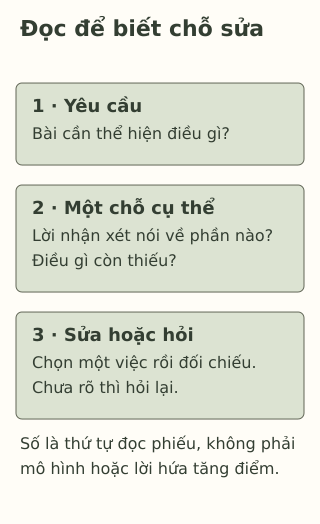

# Sau một bài kiểm tra không như mong đợi

> **Bản nháp để duyệt · KGNT-C08 · c08-draft-r1 · 25/10/2026.**
> Chưa duyệt nội dung cuối, chưa rà soát chuyên môn độc lập, chưa có quyền xuất bản.

Thảo nhận lại bài viết. Điểm thấp hơn bạn mong đợi. Bên lề có lời nhận xét: “Đoạn hai có dẫn chứng, nhưng chưa giải thích dẫn chứng liên quan thế nào đến ý chính.” Thảo nhìn con điểm rồi cất bài đi. Bạn chưa muốn đọc tiếp lúc ấy.

Trong bài này, bạn có thể quay lại tờ bài của Thảo khi nhân vật sẵn sàng, không cần buộc mình vui lên hay kể điểm của chính mình.

*Tình huống, bài làm và lời nhận xét đều do biên tập đặt ra. Đây không phải trích bài thi thật hoặc câu trích từ nghiên cứu.*

## Con điểm và lời chỉ chỗ sửa

Điểm cho biết một kết quả theo cách chấm của bài kiểm tra. Chỉ từ con số ấy, ta chưa biết Thảo cần sửa câu nào. Lời bên lề có thêm thông tin: có dẫn chứng ở đoạn hai, còn thiếu lời giải thích mối liên hệ.

**Phản hồi học tập** (*feedback*) có thể hiểu là thông tin về phần thể hiện hoặc mức hiểu của người học; Hattie và Timperley (2007, tr. 81–82) phân biệt thông tin gắn với nhiệm vụ với việc chỉ nhận xét con người. “Bạn kém Văn” không cho Thảo một thao tác để sửa đoạn hai.

Không phải lời phản hồi nào cũng rõ hoặc có ích như nhau. Tổng quan của Wisniewski et al. (2020) ghi nhận tác động thay đổi đáng kể theo loại thông tin và bối cảnh. Bài không hứa rằng đọc lời nhận xét sẽ chắc chắn nâng điểm.

## Thử đọc lại một chỗ, không sửa cả bài cùng lúc

Thảo có thể làm ba việc: **tìm yêu cầu — đối chiếu một chỗ trong bài — chọn bước sửa hoặc câu hỏi**. Đây là phiếu biên tập để luyện đọc phản hồi, không phải mô hình điều trị hay thang đánh giá bản thân.

| Chi tiết ở bài của Thảo | Một hướng xử lý trong ví dụ |
|---|---|
| Yêu cầu cần làm rõ ý chính bằng dẫn chứng | Tìm xem đoạn hai đang nêu ý nào. |
| Đã có dẫn chứng, chưa giải thích liên hệ | Gạch chỗ chuyển từ dẫn chứng về ý chính; xem có thiếu câu nối ý không. |
| Chưa hiểu “giải thích liên quan” là thế nào | Hỏi giáo viên một ví dụ đối chiếu, thay vì đoán phải thêm thật nhiều câu. |

Bảng giúp hiểu lời nhận xét, chưa viết sẵn câu sửa. Nếu việc chấm có chỗ chưa rõ, Thảo có thể hỏi tiêu chí hoặc cách tính điểm. Không cần mặc định mọi đánh giá đều chính xác hoặc mọi sai sót đều do ít cố gắng.

*Phiếu tự biên soạn, tham khảo cách xem phản hồi theo nhiệm vụ của Hattie và Timperley (2007); không chép hình hoặc bảng của nguồn.*

**Mô tả tương đương bằng chữ:** Ba thẻ nhắc đọc yêu cầu, nhìn một chi tiết trong bài rồi chọn việc sửa hoặc hỏi. Số chỉ thứ tự làm bài tập; không thể hiện quan hệ nhân quả hay bảo đảm tăng điểm.

## Khi lời nhận xét quá chung

Giả sử bên lề chỉ có “cần cố gắng hơn”. Ta có thể hỏi: “Em nên xem lại phần dẫn chứng hay cách giải thích? Thầy/cô chỉ giúp em một chỗ được không?” Đây là câu do bài biên soạn. Nó xin thông tin cụ thể, không yêu cầu giáo viên bảo đảm lần sau đạt điểm nào.

Nếu Thảo cần nghỉ trước khi đọc lại, hoạt động có thể để sau. Bài không chấm cảm xúc thất vọng là sai, cũng không yêu cầu biến nó ngay thành động lực.

## Tự kiểm tra bằng một bài làm khác

Tuấn nhận lại bài đọc biểu đồ. Lời nhận xét giả định ghi: “Đọc đúng hai giá trị, nhưng chưa ghi đơn vị trong câu so sánh.” Tuấn có biểu đồ, yêu cầu và bài đã chấm; chưa rõ phải ghi đơn vị ở đâu.

Bạn có thể bỏ qua hoặc chỉ dùng nhân vật, không kể điểm, cảm xúc hay bài kiểm tra riêng.

**1. Lời nào chỉ được việc cần xem lại?** A. “Mình dở môn này.” B. “Câu so sánh còn thiếu đơn vị.”

**2. Vì sao biết điểm của Thảo chưa đủ để chọn câu cần sửa?** So với lời nhận xét ở đoạn hai, con điểm còn thiếu thông tin gì?

**3. Dùng phiếu ba vùng cho Tuấn.** Chọn một bước sửa và một cách kiểm hoặc hỏi khi chưa biết đặt đơn vị ở đâu.

### Gợi ý phản hồi

**Câu 1:** B chỉ ra một phần của nhiệm vụ. A là phán xét rộng, chưa nêu chỗ hoặc thao tác. Nhận diện này không phủ nhận điều người nói đang cảm thấy.

**Câu 2:** Con số không xác định đoạn nào đang thiếu điều gì; lời bên lề gắn yêu cầu với một chỗ cụ thể. Không từ điểm mà suy rằng Thảo lười, thiếu năng lực hoặc không có khả năng tiến bộ. Cách giải thích khác được chấp nhận nếu phân biệt kết quả tổng với thông tin sửa bài.

**Câu 3:** Có thể đọc tên và đơn vị trên biểu đồ, đối chiếu câu so sánh, bổ sung đơn vị phù hợp rồi kiểm lại theo mẫu giáo viên. Nếu vẫn chưa rõ, hỏi chỗ đặt đơn vị trong chính câu ấy. Phương án đạt tiêu chí khi gắn với lỗi được nêu và có cách kiểm, không chỉ “học chăm hơn”. Không cần đoán Tuấn đã sai vì sao.

### Tìm hiểu sâu hơn — tùy chọn

Nguồn của Hattie và Timperley (2007) là tổng quan và phân tích khái niệm, không chứng minh riêng phiếu này. Phân tích gộp của Wisniewski et al. (2020) cũng không có nghĩa mọi dạng phản hồi đều có lợi như nhau. C08 chỉ luyện đọc thông tin và chọn điều chỉnh trong bài làm giả định; không giải thích thất bại bằng lý thuyết quy kết, không đánh giá sức khỏe hay hứa hiệu quả can thiệp.

## Tài liệu tham khảo

Hattie, J., & Timperley, H. (2007). The power of feedback. *Review of Educational Research, 77*(1), 81–112. https://doi.org/10.3102/003465430298487

Wisniewski, B., Zierer, K., & Hattie, J. (2020). The power of feedback revisited: A meta-analysis of educational feedback research. *Frontiers in Psychology, 10*, Article 3087. https://doi.org/10.3389/fpsyg.2019.03087

[Hồ sơ nguồn](REFERENCES.md) · [Đối chiếu nhận định](CLAIM-AUDIT.md) · [Bloom](BLOOM-REVIEW.md) · [Hồ sơ hình](VISUAL-REVIEW.md) · [Biên tập](EDITORIAL-REVIEW.md)
