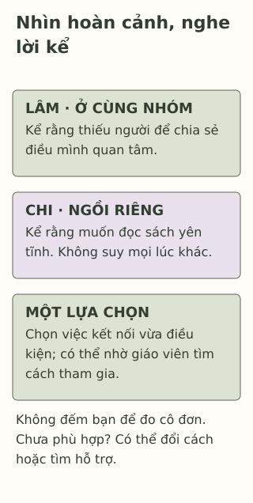

# Ở giữa lớp, vẫn thấy một mình

> **Bản nháp để duyệt · KGNT-C09 · c09-draft-r1 · 25/10/2026.**
> Chưa duyệt nội dung cuối, chưa rà soát chuyên môn độc lập, chưa có quyền xuất bản.

Giờ nghỉ, lớp vẫn đông. Lâm ngồi cùng một nhóm nhưng nói: “Mình chưa có ai để kể điều mình quan tâm.” Ở bàn gần cửa, Chi đang đọc sách một mình và nói bạn muốn có một khoảng yên tĩnh.

Nếu chỉ đếm người ngồi cạnh, ta có thể bỏ lỡ điều hai bạn kể. Bài này thử phân biệt hoàn cảnh bên ngoài với trải nghiệm kết nối, rồi chọn một bước nhỏ không đòi học sinh phải trở nên hoạt bát.

*Các nhân vật, lời thoại và tình huống là giả định do biên tập tạo, không phải dữ liệu về một lớp thật.*

## Có người quanh mình chưa kể hết cảm giác kết nối

Cô đơn có thể được hiểu là cảm giác khó chịu khi sự kết nối mình đang có khác với điều mình mong muốn. Tổng quan của Loades et al. (2020, phần “Introduction”) dùng cách hiểu về khoảng cách giữa tiếp xúc thực tế và mong muốn; nguồn cũng phân biệt cô đơn với sự tách biệt xã hội. Đây là tổng quan dùng khái niệm đã có, không phải công trình khai sinh thuật ngữ.

Ở một mình là một hoàn cảnh; cô đơn nói về trải nghiệm chủ quan. Trong ví dụ, Lâm tự kể thiếu người để chia sẻ, còn Chi muốn đọc yên tĩnh. Không thể chỉ nhìn Chi ngồi riêng rồi điền cảm xúc cho bạn; lời Chi kể cũng không cho phép suy rằng Chi sẽ không bao giờ cô đơn.

## Thuộc về không phải được tất cả mọi người thích

Centers for Disease Control and Prevention (CDC, 2024, mục “What to know”) mô tả **gắn kết với trường học** (*school connectedness*) khi học sinh cảm thấy người lớn và bạn bè ở trường quan tâm đến mình và việc học, thấy được coi trọng, hỗ trợ và thuộc về. Khái niệm này rộng hơn số bạn hoặc số cuộc nói chuyện.

Một lớp học có thể hỗ trợ việc ấy bằng cách làm rõ cách tham gia, lắng nghe và tạo cơ hội phù hợp. Bài không đặt toàn bộ trách nhiệm kết nối lên Lâm, hoặc yêu cầu bạn phải làm quen với mọi người. Học sinh cũng không cần thay đổi sở thích hay chịu lời trêu để được ở trong một nhóm.

## Một bước có thể chọn, không phải chỉ tiêu kết bạn

Lâm nói thích vẽ nhưng chưa biết ai cùng quan tâm. Một bước giả định có thể là hỏi một bạn về hoạt động vẽ trong trường, hoặc hỏi giáo viên có hoạt động nào phù hợp thời gian và cách tham gia của mình. Nếu chưa muốn trò chuyện với nhóm đông, một cuộc trao đổi ngắn với một người có thể là phương án để cân nhắc.

Đây là ví dụ biên tập, không kết quả thử nghiệm. Không phải ai cũng có tiền, thời gian ngoài giờ hoặc điều kiện tham gia câu lạc bộ. Một lựa chọn trong giờ nghỉ hoặc trong hoạt động lớp sẵn có cũng có thể được bàn; người lớn cần giúp xem lựa chọn nào thực sự mở cho học sinh.

*Sơ đồ đối chiếu do Không Gian Nội Tâm biên soạn với hỗ trợ AI, tham khảo Loades et al. (2020) và CDC (2024); không phải thang cô đơn hoặc chương trình can thiệp.*

**Mô tả tương đương bằng chữ:** Hai thẻ đầu đối chiếu Lâm ngồi cùng nhóm nhưng kể thiếu kết nối, Chi ngồi riêng và muốn yên tĩnh. Thẻ cuối gồm một bước tự chọn với người phù hợp và đường nhờ hỗ trợ. Không có số bạn chuẩn, thang điểm hoặc mũi tên hứa rằng làm theo sẽ hết cô đơn.

## Khi thử một lần mà chưa thấy hợp

Một lời mời chưa được đáp lại không đủ để kết luận Lâm không đáng được quan tâm. Bạn có thể đổi thời điểm, tìm người khác hoặc nói với giáo viên điều đang khó. Nếu có hành vi khiến mình không an toàn, không cần tiếp tục tiếp cận người ấy để hoàn thành hoạt động; có thể nhờ người lớn phù hợp.

Tổng quan Loades et al. (2020) ghi nhận mối liên hệ giữa cô đơn và khó khăn tâm lý ở người trẻ, nhưng phần lớn nghiên cứu quan sát, có nguy cơ sai lệch; tăng số lần tiếp xúc đơn thuần cũng không nhất thiết thay đổi trải nghiệm cô đơn. Không thể từ đó dự đoán bệnh cho Lâm hay hứa một lần tham gia sẽ giải quyết khó khăn.

## Thử đọc một tình huống mới

Hương muốn tham gia làm báo lớp nhưng chưa quen ai trong nhóm. Bạn chỉ ở trường đến hết buổi vì phải về cùng người nhà; có thể trao đổi với giáo viên trước khi về. Câu chuyện chưa cho biết nhóm có nhận thêm thành viên không.

Có thể bỏ qua hoạt động hoặc dùng hoàn toàn nhân vật. Không cần liệt kê bạn bè, kể cảm giác cô đơn hoặc quan hệ riêng của bạn.

**1. Nhân vật nào ở đầu bài tự kể một điều cho thấy sự kết nối đang khác mong muốn?** Nêu dữ kiện thay vì đoán từ vị trí ngồi.

**2. Vì sao không thể kết luận Chi cô đơn chỉ vì ngồi đọc một mình?** Gắn câu trả lời với lời Chi kể; đừng đổi sang kết luận Chi chắc chắn luôn ổn.

**3. Chọn một bước kết nối và một hỗ trợ khả thi cho Hương.** Nếu nhóm chưa nhận thêm hoặc cần gặp ngoài giờ, bạn sẽ điều chỉnh thế nào?

### Gợi ý phản hồi

**Câu 1:** Lâm nói chưa có người để kể điều mình quan tâm dù đang ngồi cùng nhóm. Đây là lời nhân vật kể, không một phép đo hoặc chẩn đoán cô đơn cho người thật.

**Câu 2:** Ngồi riêng chỉ là hoàn cảnh. Chi nói mình muốn yên tĩnh, nên không đủ căn cứ tự gán cô đơn. Cũng không có dữ kiện cho mọi lúc khác; câu trả lời nên giữ giới hạn ấy.

**Câu 3:** Hương có thể hỏi giáo viên về cách tham gia báo lớp và điều kiện thời gian; nếu chưa có chỗ, bàn một việc trong buổi học hoặc cơ hội khác phù hợp. Có thể chọn hướng khác nếu tôn trọng lời đáp, không ép kết bạn, không đòi ở lại ngoài điều kiện và có đường điều chỉnh. Thành công của bài tập là lựa chọn có căn cứ, không phải Hương chắc chắn được nhận hoặc lập tức hết cô đơn.

## Khi muốn có người cùng nhìn lại

Khi cảm xúc gây khổ sở, kéo dài hoặc cản trở sinh hoạt, có thể tìm người lớn đáng tin hay người có chuyên môn (National Institute of Mental Health [NIMH], 2024). Không cần tự chấm mức cô đơn mới được hỏi giúp. Nếu người đầu không phù hợp hoặc không an toàn, có thể tìm người khác; không mặc định mọi trường có người tham vấn chuyên trách.

### Tìm hiểu sâu hơn — tùy chọn

Loades et al. (2020) là tổng quan nhanh trong bối cảnh COVID-19, sử dụng phần lớn nghiên cứu trước đó và không chỉ ở học sinh trung học. Cô đơn, số tiếp xúc và chất lượng gắn kết là những câu hỏi cần phân biệt. Bài không lấy kết quả gộp để suy nguyên nhân, chẩn đoán hoặc hiệu quả của thẻ lựa chọn này ở lớp học Việt Nam.

## Tài liệu tham khảo

Centers for Disease Control and Prevention. (2024, November 18). *School connectedness helps students thrive.* https://www.cdc.gov/youth-behavior/school-connectedness/index.html

Loades, M. E., Chatburn, E., Higson-Sweeney, N., Reynolds, S., Shafran, R., Brigden, A., Linney, C., McManus, M. N., Borwick, C., & Crawley, E. (2020). Rapid systematic review: The impact of social isolation and loneliness on the mental health of children and adolescents in the context of COVID-19. *Journal of the American Academy of Child & Adolescent Psychiatry, 59*(11), 1218–1239.e3. https://doi.org/10.1016/j.jaac.2020.05.009

National Institute of Mental Health. (2024). *Children and mental health: Is this just a stage?* https://www.nimh.nih.gov/health/publications/children-and-mental-health
