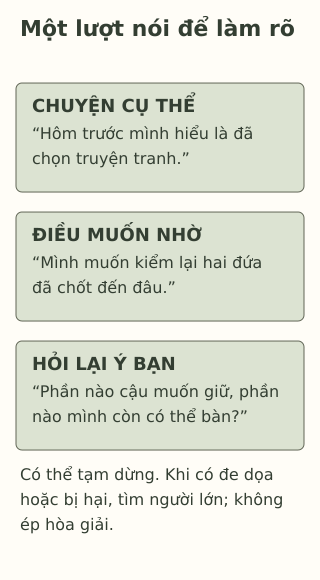

# Một bất đồng có làm mất tình bạn?

> **Bản nháp để duyệt · KGNT-C10 · c10-draft-r1 · 25/10/2026.**
> Chưa duyệt nội dung cuối, chưa rà soát chuyên môn độc lập, chưa có quyền xuất bản.

“Báo tường nên vẽ truyện tranh,” Hân nói. Quỳnh muốn dùng ảnh cây trong sân trường. Hai bạn cùng phụ trách phần hình, còn thời gian hỏi giáo viên về yêu cầu. Hân nói mình bực vì tưởng cả hai đã thống nhất. Quỳnh đáp rằng hôm trước bạn chỉ đồng ý bàn tiếp, chưa chọn phương án.

Hai bạn đang không hiểu giống nhau về một việc. Câu chuyện chưa cho biết tình bạn sẽ ra sao. Nó cho ta một điểm để bắt đầu: **đang khác nhau ở đâu, cần nói rõ điều gì?**

*Hân, Quỳnh, Tú, Duyên và hội thoại dưới đây đều giả định do biên tập tạo; không phải dữ liệu nghiên cứu hoặc ca tư vấn.*

## Khác ý chưa nói hết về mối quan hệ

Trong ví dụ, bất đồng nằm ở cách làm phần hình và chuyện đã chốt hay chưa. Không có dữ kiện một bạn đe dọa, dùng ưu thế để hạ nhục hoặc ngăn bạn kia tham gia. Ta không cần đổi “hai bạn đang khác ý” thành “hai bạn không còn quý nhau”.

Childline (n.d., mục “Falling out with friends”) lưu ý tranh cãi không nhất thiết chấm dứt tình bạn; cách nhìn của người khác và thời gian suy nghĩ có thể là điều cần cân nhắc. Đó là hướng dẫn cho người trẻ, không lời bảo đảm rằng cứ trò chuyện là quan hệ sẽ trở lại như cũ.

Hân có thể cần Quỳnh nghe điều mình đã hiểu hôm trước. Quỳnh có thể cần được giải thích ý còn bỏ ngỏ. Hai điều này là cách đọc lời thoại giả định, chưa phải điều ta biết về mọi học sinh có tranh cãi.

## Khi cần đổi cách nhìn từ “bất đồng” sang an toàn

Bắt nạt (*bullying*) không chỉ là hai người khác ý. Định nghĩa thực hành của StopBullying.gov (2024) nêu hành vi gây hấn không mong muốn, có chênh lệch quyền lực thực tế hoặc được cảm nhận, lặp lại hoặc có khả năng lặp lại. Ưu thế có thể đến từ vị thế trong nhóm, không chỉ sức vóc.

Nếu thêm dữ kiện rằng một nhóm liên tục bêu tên Quỳnh và đe dọa loại bạn khỏi hoạt động, ta không còn nên mặc định đây chỉ là chuyện cần hai bạn nhường nhau. Hướng dẫn StopBullying.gov (2021) nhấn mạnh vai trò người lớn khi có bắt nạt, tránh ép các em xin lỗi hoặc làm hòa ngay tại chỗ.

Không cần tự chứng minh đủ định nghĩa mới được tìm giúp. Một hành vi làm hại vẫn cần được quan tâm dù mới xảy ra hoặc thông tin còn thiếu. Phần tập nói trong bài chỉ dành cho bất đồng thông thường có thể trao đổi an toàn; nó không thay hỗ trợ bảo vệ.

## Một lượt nói, một lượt hỏi lại

Thử trở về phần hình báo tường. Thay vì “Cậu lúc nào cũng đổi ý”, Hân có thể nói: “Hôm trước mình hiểu là đã chọn truyện tranh. Mình muốn kiểm lại xem hai đứa đã chốt đến đâu.” Quỳnh có thể trả lời theo điều bạn ấy nhớ.

Một lượt tiếp theo có thể là: “Vậy điều cậu muốn giữ là ảnh sân trường, còn cách trình bày vẫn có thể bàn, đúng không?” Đây là câu hỏi để người kia sửa điều ta hiểu, không phải đoán nội tâm rồi buộc họ đồng ý. Nếu Quỳnh nói không đúng, Hân còn cơ hội hỏi lại.

Childline (n.d., mục “Think about how your friend is feeling”) gợi ý xét góc nhìn của bạn, đồng thời không yêu cầu chấp nhận cách đối xử gây hại. Bài biến hướng ấy thành mẫu học tập: **nêu một việc cụ thể — nói điều mình cần — hỏi lại điều người kia muốn**. Không phải liệu pháp, mô hình giao tiếp gốc hoặc công thức đã chứng minh giữ được tình bạn.

*Hội thoại có chú giải do Không Gian Nội Tâm biên soạn với hỗ trợ AI, tham khảo Childline (n.d.) và StopBullying.gov (2021, 2024); không phải kịch bản hòa giải bắt nạt.*

**Mô tả tương đương bằng chữ:** Ba khối chú giải một lượt nói: chuyện đã xảy ra; điều người nói muốn làm rõ; câu hỏi cho người kia xác nhận hoặc sửa. Dải cuối nhắc có thể tạm dừng; nếu có đe dọa hoặc cách đối xử gây hại, tìm người lớn thay vì buộc hòa giải. Không có mũi tên hứa kết quả quan hệ.

## Không cần chốt mọi điều trong một lần

Hai bạn có thể cùng đọc lại yêu cầu, hỏi giáo viên hoặc hẹn bàn tiếp. Chưa chọn được hình không nhất thiết phải chọn ngay ai đúng hoàn toàn. Nếu đã nói câu làm tổn thương, việc xin lỗi cần gắn với câu ấy; không đồng nghĩa phải bỏ mọi ý kiến của mình. Childline (n.d., mục “Saying sorry to a friend”) cũng lưu ý xin lỗi không tự sửa được tất cả và cần tôn trọng phản hồi của người kia.

Không muốn nói ngay là một lựa chọn. Viết một câu hỏi ra giấy hoặc nhờ người phù hợp hỗ trợ là phương án khác; không cần có điện thoại hay phải nhìn thẳng vào mắt. Khi việc trao đổi không an toàn, có thể dừng và tìm người lớn đáng tin khác nếu người đầu chưa phù hợp.

## Thử với chuyện phân công

Tú muốn nhóm tập vào giờ nghỉ; Duyên phải đi nhận suất ăn lúc đó và muốn tập trong tiết làm việc nhóm được giáo viên cho phép. Chưa có lịch chốt, hai bạn chưa hỏi rõ điều kiện của nhau. Không có đe dọa hoặc hành vi gây hấn trong câu chuyện này.

Có thể bỏ qua hoạt động hoặc chỉ dùng nhân vật, không cần kể bạn bè hay tranh cãi riêng.

**1. Hân và Quỳnh đang bất đồng ở hai điểm nào?**

**2. Vì sao câu chuyện báo tường chưa đủ để gọi là bắt nạt?** Nếu có đe dọa và lặp lại việc loại khỏi nhóm, hướng xử lý có còn chỉ là tập câu nói không?

**3. Dùng mẫu để soạn một lượt nói của Tú với Duyên:** một việc cụ thể, điều muốn nhờ và câu hỏi làm rõ. Nếu chưa tìm được lúc tập chung, có thể hỏi ai hoặc sửa phương án thế nào?

### Gợi ý phản hồi

**Câu 1:** Khác phương án hình và khác cách nhớ chuyện đã chốt hay còn bàn. Nhận diện nội dung ấy giúp tránh phán xét “bạn không coi trọng mình” khi chưa có dữ kiện.

**Câu 2:** Mới biết hai ý kiến khác nhau, chưa có dữ kiện gây hấn cùng chênh lệch quyền lực và lặp lại/khả năng lặp lại. Điều đó không chứng minh mọi lúc đều an toàn. Khi thêm đe dọa và loại trừ, cần người lớn xem xét bảo vệ; không ép hai bên tự làm hòa. Không cần hoàn thành phân loại mới được nhờ giúp.

**Câu 3:** Chẳng hạn: “Mình muốn tập đủ phần chung nhưng chưa tính giờ nhận suất ăn của cậu. Cậu có thể cho biết phần nào tập trong tiết nhóm được không?” Nếu chưa khớp, cùng hỏi giáo viên về thời gian hoặc phân phần chuẩn bị riêng khả thi. Chấp nhận lời khác nếu dựa dữ kiện, nói nhu cầu và mở chỗ cho trả lời; không buộc Duyên bỏ bữa. Không chấm theo việc hai bạn có đồng ý ngay hay tình bạn có được giữ nguyên không.

### Đọc sâu hơn — tùy chọn

Bài không gọi ba câu là một lý thuyết giải quyết xung đột, không gán tác giả gốc cho một kỹ thuật chưa nghiên cứu. Các nguồn hướng dẫn giúp đặt giới hạn ứng xử; không đo hiệu quả hoạt động này ở THCS–THPT Việt Nam. Phân biệt bất đồng và bắt nạt là để chọn hỗ trợ, không tìm lý do bỏ qua một việc gây hại.

## Tài liệu tham khảo

Childline. (n.d.). *Friendship problems.* https://www.childline.org.uk/info-advice/friends-relationships-sex/friends/friendship-problems/

StopBullying.gov. (2021, November 17). *Respond to bullying.* https://www.stopbullying.gov/prevention/on-the-spot

StopBullying.gov. (2024, October 7). *What is bullying.* https://www.stopbullying.gov/bullying/what-is-bullying

[Hồ sơ nguồn](REFERENCES.md) · [Đối chiếu nhận định](CLAIM-AUDIT.md) · [Bloom](BLOOM-REVIEW.md) · [Hình](VISUAL-REVIEW.md) · [Biên tập](EDITORIAL-REVIEW.md)
