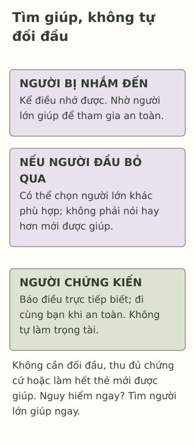

# Khi lời trêu chọc không còn là đùa

> **Bản nháp để duyệt · KGNT-C11 · c11-draft-r1 · 25/10/2026.**
> Chưa duyệt nội dung cuối, chưa rà soát chuyên môn độc lập, chưa có quyền xuất bản.

Mỗi khi Ngân đọc bài, vài bạn lại nhại một biệt danh bạn không muốn nghe. Ngân đã nói dừng, nhưng việc ấy tiếp diễn nhiều buổi. Một bạn trong nhóm thường quyết định ai được tham gia hoạt động và dọa sẽ gạt Ngân ra nếu bạn kể với cô. “Có đùa chút thôi,” bạn ấy nói.

Ở bàn gần đó, Phúc nghe được và muốn giúp. Phúc không biết cần nói gì, cũng sợ mình trở thành người tiếp theo bị nhắm đến.

*Ngân, Phúc, các nhân vật và mọi lời thoại là giả định do biên tập tạo. Bài không dùng câu chuyện học sinh thật hoặc dựng bài kiểm tra nguy cơ cá nhân.*

## Nhìn hành vi, không chỉ nghe tên gọi

Một lời nói được gọi là “đùa” chưa đủ cho biết người bị nhắm đến có muốn tham gia không. Trong chuyện này, ta biết Ngân không muốn biệt danh ấy, đã yêu cầu dừng, việc vẫn lặp lại và có lời đe dọa dùng vị thế trong nhóm.

StopBullying.gov (2024, phần mở đầu) định nghĩa **bắt nạt** (*bullying*) ở tuổi đi học bằng hành vi gây hấn không mong muốn, chênh lệch quyền lực thực tế hoặc được cảm nhận, cùng tính lặp lại hoặc khả năng lặp lại. Trong chuyện Ngân, dữ kiện về biệt danh lặp lại và quyền gạt khỏi nhóm cần được người lớn xem xét nghiêm túc, không gạt đi bằng tên “đùa”.

Định nghĩa giúp đọc tình huống, không phải bảng chấm học sinh. Không cần đếm đủ lần hoặc tự chứng minh động cơ của người khác mới được tìm hỗ trợ. Cũng không gọi một người là “kẻ bắt nạt” như một bản chất không thể đổi; điều cần được nhận diện và dừng là hành vi gây hại.

## Bất đồng khác ở đâu?

Hai bạn muốn chọn hai bài hát khác nhau, đều được nói ý kiến và có thể từ chối, là một ví dụ bất đồng về lựa chọn. Nó khác việc một nhóm liên tục dùng ưu thế để hạ nhục hay đe dọa một bạn. Đây là đối chiếu sư phạm, không khẳng định mọi trường hợp thực tế đều dễ phân loại.

Khi chưa rõ chuyện đã diễn ra thế nào, người lớn cần lắng nghe và tìm thông tin từ nhiều phía; không buộc các em trình bày chung trước đám đông hoặc làm hòa tại chỗ (StopBullying.gov, 2021, mục “Stop Bullying on the Spot”, “Find Out What Happened”). Việc chưa chốt tên gọi không nên làm chậm bảo vệ người đang bị hại.

## Với Ngân: đi cùng người có thể giúp

Hướng dẫn dành cho trẻ/người trẻ của StopBullying.gov (2022, mục “What to Do If You’re Bullied”) có lựa chọn tránh đối đầu khi lên tiếng không an toàn và tìm người lớn đáng tin. Bài không yêu cầu Ngân phải đáp trả thật sắc, cười cho qua hoặc tự làm nhóm kia dừng lại.

Trong hoàn cảnh giả định ở lớp, Ngân có thể nhờ giáo viên nghe riêng: “Có nhiều buổi các bạn gọi tên em không muốn, rồi dọa gạt em khỏi nhóm nếu em kể. Em cần cô giúp để việc này dừng và em tham gia an toàn.” Chỉ cần kể điều nhớ được; không phải thu đủ bằng chứng hoặc quay lại chỗ nguy hiểm để ghi hình.

Người lớn cần cùng bàn cách bảo vệ và theo dõi tiếp; một cuộc nói chuyện không bảo đảm mọi việc dừng ngay. Nếu người đầu tiên bỏ qua hoặc không an toàn, có thể tìm giáo viên khác hay người lớn phù hợp. Khi có nguy hiểm đang diễn ra, ưu tiên tìm người lớn có thể can thiệp ngay, không chờ đến lượt hẹn hoặc làm hết hoạt động.

## Với Phúc: giúp mà không tự lao vào nguy hiểm

StopBullying.gov (2022, mục “Stand Up for Others”) gợi ý báo người lớn và thể hiện sự quan tâm với bạn bị nhắm đến. Trong ví dụ, Phúc có thể nói riêng với giáo viên điều mình trực tiếp nghe; hoặc hỏi Ngân có muốn cùng tới gặp cô không, nếu cách đó an toàn. Phúc không cần tranh cãi với nhóm, điều tra hay đứng ra làm trọng tài.

Không cười hùa hoặc lan truyền biệt danh là lựa chọn của người chứng kiến. Nhưng việc Phúc sợ và chưa biết nói không biến Phúc thành người chịu trách nhiệm cho hành vi nhóm kia. Người lớn vẫn có trách nhiệm bảo vệ; không đặt nhiệm vụ ngăn bắt nạt lên một học sinh.

*Thẻ tìm hỗ trợ do Không Gian Nội Tâm biên soạn với hỗ trợ AI, tham khảo StopBullying.gov (2021, 2022, 2024); không phải thang xác định bắt nạt hoặc quy trình điều tra.*

**Mô tả tương đương bằng chữ:** Phần đầu dành cho người bị nhắm đến: kể điều nhớ được, nhờ một người lớn phù hợp giúp an toàn và chọn người khác nếu cần. Phần riêng dành cho người chứng kiến: báo điều trực tiếp biết hoặc đi cùng bạn khi an toàn. Dải cuối nêu không cần đối đầu, thu đủ bằng chứng hoặc hoàn thành các ô trước khi được giúp. Không có điểm hay số lần tối thiểu.

## Vì sao cần được xem nghiêm túc?

Tổng quan và phân tích gộp của Moore et al. (2017) ghi nhận liên hệ giữa bị bắt nạt trong thời thơ ấu/vị thành niên và nhiều khó khăn sức khỏe. Các tác giả còn đánh giá bằng chứng nhân quả cho một số kết quả, nhưng dữ liệu quan sát, cách đo và yếu tố nhiễu có giới hạn. Kết quả nhóm không cho biết Ngân chắc chắn có bệnh hoặc tương lai sẽ ra sao; bài không chẩn đoán từ một câu chuyện.

## Thử chọn một đường hỗ trợ

Nhi nhiều lần bị vài bạn chế giễu phần trình bày. Một bạn trong nhóm dọa không cho Nhi tham gia nếu Nhi kể. Bảo trực tiếp nghe lời dọa; cả hai hiện ở lớp, có thể nhờ giáo viên khác trong trường, nhưng người đầu Nhi từng hỏi đã gạt đi. Không cần dựng thêm cảnh gây hại để làm bài.

Có thể bỏ qua, dùng hoàn toàn nhân vật hoặc đọc phần phản hồi. Không cần kể tên người, trường, ảnh chụp hay chuyện riêng.

**1. Nêu hai nhóm dữ kiện quan trọng khi nhận diện bắt nạt trong bài.**

**2. Tình huống Nhi khác hai bạn cùng được chọn bài hát ở điểm nào?** Vì sao không nên chỉ bảo cả hai bên nhường nhau?

**3. Chọn một việc cho Nhi và một cách Bảo có thể hỗ trợ an toàn.** Nêu người lớn thay thế và điều muốn nhờ khi người đầu bỏ qua.

### Gợi ý phản hồi

**Câu 1:** Có tính lặp lại/khả năng lặp lại và chênh lệch quyền lực đi cùng hành vi gây hấn không mong muốn. Trong ví dụ có biệt danh không muốn, tiếp diễn và đe dọa dùng vị thế. Không dùng hai mục làm điều kiện phải đủ mới được báo khó khăn.

**Câu 2:** Nhi bị nhắm đến, việc lặp lại và có lời dọa dùng quyền trong nhóm; không chỉ hai sở thích ngang nhau. Ép nhường nhau có thể bỏ qua việc cần bảo vệ. Người lớn phải xem xét thông tin và hỗ trợ, không giao Nhi tự thương lượng với người đe dọa.

**Câu 3:** Nhi có thể chọn giáo viên khác để kể ngắn điều đã diễn ra và xin giúp tham gia an toàn. Bảo có thể báo điều trực tiếp nghe hoặc đi cùng nếu cả hai thấy an toàn; không cần đối đầu hay quay phim. Cách khác đạt nếu có người phù hợp, việc muốn nhờ và đường thay thế; không quy việc chưa dừng cho Nhi nói chưa đủ hay Bảo chưa can đảm. Không chấm theo kết quả nhóm kia có dừng ngay không.

### Đọc sâu hơn — tùy chọn

Moore et al. (2017, mục “Assessment of causality”, “Limitations”) phân mức bằng chứng khác nhau theo kết quả và nêu sai lệch công bố, dị biệt, cách đo và nhiễu. Tổng quan không phải thang chẩn đoán hoặc thử nghiệm thẻ trong bài. Định nghĩa StopBullying.gov là hướng dẫn thực hành từ Mỹ, không thay quy định địa phương hoặc kết luận điều tra ở một trường Việt Nam. Những việc ấy cần người lớn có trách nhiệm và thông tin thực tế, không một nhãn do người đọc tự gán.

## Tài liệu tham khảo

Moore, S. E., Norman, R. E., Suetani, S., Thomas, H. J., Sly, P. D., & Scott, J. G. (2017). Consequences of bullying victimization in childhood and adolescence: A systematic review and meta-analysis. *World Journal of Psychiatry, 7*(1), 60–76. https://doi.org/10.5498/wjp.v7.i1.60

StopBullying.gov. (2021, November 17). *Respond to bullying.* https://www.stopbullying.gov/prevention/on-the-spot

StopBullying.gov. (2022, March 8). *What kids can do.* https://www.stopbullying.gov/kids/what-you-can-do

StopBullying.gov. (2024, October 7). *What is bullying.* https://www.stopbullying.gov/bullying/what-is-bullying

[Hồ sơ nguồn](REFERENCES.md) · [Đối chiếu nhận định](CLAIM-AUDIT.md) · [Bloom](BLOOM-REVIEW.md) · [Hình](VISUAL-REVIEW.md) · [Biên tập](EDITORIAL-REVIEW.md)
