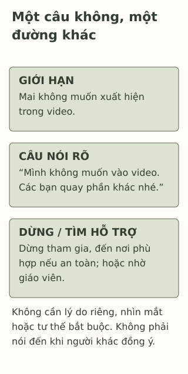

# Nói “không” mà vẫn tôn trọng nhau

> **Bản nháp để duyệt · KGNT-C12 · c12-draft-r1 · 25/10/2026.**
> Chưa duyệt nội dung cuối, chưa rà soát chuyên môn độc lập, chưa có quyền xuất bản.

Một nhóm bạn muốn quay đoạn video giờ nghỉ. Khi máy quay hướng tới, Mai nói mình không muốn xuất hiện. Có bạn vẫn giục: “Ai cũng quay mà, không tham gia thì mất vui.” Mai thích chơi cùng nhóm nhưng không muốn có mặt trong video.

Hai ý ấy có thể cùng đúng: muốn ở cùng bạn và không muốn tham gia một việc. Bài này thử viết một câu từ chối và một lựa chọn để dừng tình huống, không yêu cầu Mai tìm lời đủ hay mới được tôn trọng.

*Mai, Sơn, lời thoại và mọi lựa chọn đều giả định do biên tập tạo. Bài không đánh giá kỹ năng hay quan hệ của học sinh thật.*

## Lời mời khác với sức ép

Một lời mời để người nghe còn được chọn. Trong ví dụ, câu “không tham gia thì mất vui” đặt việc hòa vào nhóm lên quyết định của Mai, dù bạn đã nói không muốn quay.

Childline (n.d.-b, mục “what peer pressure means”) giải thích **áp lực từ người xung quanh/đồng trang lứa** (*peer pressure*) là cảm giác phải làm vì người khác muốn hoặc mong đợi mình làm. Ảnh hưởng từ bạn bè không phải lúc nào cũng xấu; cùng thích một cuốn sách khác với bị thúc ép làm điều không muốn. Đây là giải thích thực hành cho người trẻ, không lý thuyết gắn nhãn “ai dễ bị ảnh hưởng”.

“Ranh giới” trong bài chỉ điều một người muốn hoặc không muốn tham gia: Mai không muốn vào video. Nó không phải điểm số sức khỏe. Người khác không cần có cùng sở thích mới tôn trọng lựa chọn ấy.

## Nói rõ điều không muốn

**Bày tỏ rõ nhu cầu một cách tôn trọng** (*assertiveness*) được Childline (n.d.-a, mục “What does it mean to be assertive?”) mô tả là nói điều cần hoặc muốn mà không đe dọa, ép người khác. Bài không dùng thuật ngữ này như một kiểu tính cách tốt/xấu.

Một câu giả định có thể là: “Mình không muốn xuất hiện trong video. Các bạn quay phần khác nhé.” Không bắt buộc thêm lý do riêng, xin lỗi vì lựa chọn hoặc hứa đổi ý sau. Nếu Mai thật sự muốn giúp phần khác, bạn có thể đề nghị; không cần đổi sang một việc mình cũng không muốn làm để bù cho câu “không”.

Cách nói ấy không bảo đảm nhóm sẽ đồng ý. Childline (n.d.-b, mục “Ways to say no”) cũng lưu ý người khác không phải lúc nào cũng tôn trọng quyết định. Việc họ tiếp tục ép không chứng minh Mai từ chối sai.

*Thẻ hội thoại do Không Gian Nội Tâm biên soạn với hỗ trợ AI, tham khảo Childline (n.d.-a, n.d.-b); không phải bài test assertiveness hoặc kỹ thuật bảo đảm người khác nghe theo.*

**Mô tả tương đương bằng chữ:** Hai vùng đầu là giới hạn và một câu nói. Vùng tiếp theo là phương án dừng tham gia ở nơi an toàn hoặc nhờ người lớn. Dải cuối nhắc không bắt buộc nhìn mắt, đứng theo một tư thế hay có lý do riêng mới được từ chối. Các vùng là lựa chọn làm bài, không bậc năng lực.

## Nếu họ vẫn tiếp tục

Trong tình huống thông thường, Mai có thể nhắc lại câu ngắn hoặc dừng tham gia, đến khu vực phù hợp có người lớn nếu làm vậy an toàn. Không phải rời trường, đi một mình đến nơi vắng hoặc nhường máy cho người khác là những điều bài mặc định yêu cầu.

Childline (n.d.-a, mục “When to be assertive”) đặt an toàn lên trước việc đứng ra đối đáp: khi có đe dọa, tìm người lớn có thể phù hợp hơn tự đối đầu. Bài chỉ tập trong chuyện quay video/giờ nghỉ, không hướng dẫn xử trí bạo lực. Nếu khó nói hoặc không thể rời chỗ, nhờ giáo viên hỗ trợ cũng là một lựa chọn; không cần lặp câu từ chối đến khi người kia chịu nghe.

Có thể dùng chữ viết, lời nói hoặc cách giao tiếp có thể tiếp cận. Không bắt nhìn thẳng, nói to, hết run hoặc thể hiện tự tin như điều kiện được tôn trọng. Cũng không cần kể chuyện gia đình, ngoại hình hay trải nghiệm riêng để giải thích vì sao không muốn vào hình.

## Thử một lời từ chối khác

Sơn được rủ bỏ phần ăn để ở lại quay thêm cảnh cho nhóm. Sơn muốn đi ăn theo giờ đã có; nhóm vẫn còn người thực hiện, nhưng một bạn bảo “bạn thân thì phải ở lại”. Giáo viên đang gần khu vực lớp, Sơn có thể tới nhờ nếu việc gây sức ép tiếp diễn.

Có thể bỏ qua hoặc chỉ dùng nhân vật, không cần kể lần bị ép của chính mình.

**1. Ranh giới nào Mai đã nói rõ?**

**2. Câu “bạn thân thì phải ở lại” tạo áp lực ở điểm nào?** Nó khác lời “Cậu có muốn tham gia không?” như thế nào nếu người được hỏi có thể từ chối?

**3. Soạn một câu từ chối cho Sơn và một phương án dừng/rời tình huống an toàn.** Nếu chưa thể rời chỗ hoặc bạn kia tiếp tục ép, Sơn có thể nhờ ai điều gì?

### Gợi ý phản hồi

**Câu 1:** Mai không muốn xuất hiện trong video; không phải không muốn chơi với nhóm trong mọi việc. Cách diễn đạt khác được chấp nhận nếu giữ đúng giới hạn cụ thể.

**Câu 2:** Câu ấy gắn tình bạn với việc phải làm theo, gây sức ép lên lựa chọn. Lời mời có thể được đáp “không” mà không đem quan hệ ra buộc. Ta phân tích câu trong tình huống, không từ một câu gắn nhãn tính cách người nói hoặc suy mọi quan hệ đều xấu.

**Câu 3:** Chẳng hạn: “Mình đi ăn theo giờ, mình không ở lại quay thêm.” Sơn có thể dừng tham gia để tới nơi ăn theo điều kiện an toàn; nếu chưa rời được hoặc bị gây sức ép tiếp, nhờ giáo viên giúp dừng việc ép. Đạt khi có giới hạn cụ thể, lời không hạ nhục và phương án khả thi/hỗ trợ. Không buộc bỏ bữa, đưa lý do riêng, tranh luận đến cùng hay đổi sang một việc không muốn. Không chấm theo việc cả nhóm có vui hay Sơn có nói trôi chảy không.

### Đọc sâu hơn — tùy chọn

Các nguồn là hướng dẫn chuyên môn cho người trẻ tại Anh, không thử nghiệm mẫu câu này với học sinh Việt Nam. Bài không dùng toàn bộ kỹ thuật hoặc chỉ dẫn tư thế của nguồn; chỉ giữ nghĩa nói rõ nhu cầu và giới hạn an toàn. Không phải một cử chỉ hay cách phát âm quyết định một người có “biết đặt ranh giới” hay không.

## Tài liệu tham khảo

Childline. (n.d.-a). *Being assertive.* https://www.childline.org.uk/info-advice/your-feelings/feelings-emotions/being-assertive/

Childline. (n.d.-b). *Peer pressure: What it is and how to say no.* https://www.childline.org.uk/info-advice/friends-relationships-sex/friends/peer-pressure/

[Hồ sơ nguồn](REFERENCES.md) · [Đối chiếu nhận định](CLAIM-AUDIT.md) · [Bloom](BLOOM-REVIEW.md) · [Hình](VISUAL-REVIEW.md) · [Biên tập](EDITORIAL-REVIEW.md)
