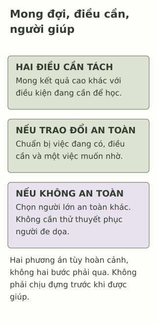

# Khi kỳ vọng ở nhà làm mình thấy nặng

> **Bản nháp để duyệt · KGNT-C13 · c13-draft-r1 · 25/10/2026.**
> Chưa duyệt nội dung cuối, chưa rà soát chuyên môn độc lập, chưa có quyền xuất bản.

Thu nghe người chăm sóc nói: “Kỳ này cố vào nhóm điểm cao nhé.” Thu muốn làm tốt, nhưng còn hai phần bài chưa hiểu và tối có việc nhà. Bạn nói mình thấy nặng khi nghĩ đến kết quả, chưa biết mở lời thế nào để người lớn không hiểu là bạn muốn bỏ học.

Bài không biết người chăm sóc đang nghĩ gì, cũng chưa biết cuộc trao đổi sẽ an toàn hay được lắng nghe đến đâu. Ta có thể đọc riêng điều được mong đợi, điều Thu đang cần và người có thể cùng bàn; không cần kết luận ai thương hay không thương ai.

*Thu, Giang và các lời thoại là giả định do biên tập tạo, không phải thông tin một gia đình thật.*

## Mong đợi và nhu cầu không phải cùng một câu

“Kỳ này vào nhóm điểm cao” nói về kết quả được mong đợi. “Con chưa hiểu hai phần bài và cần một khoảng để hỏi” nói về điều đang cần để học. Thu có thể muốn cố gắng mà vẫn cần nghỉ, thời gian và giải thích; không phải chỉ được chọn một trong hai.

Mind (2025, mục “What causes exam stress?”, “Feeling under pressure”) nêu áp lực có thể đến từ người chăm sóc, nhà trường hoặc bản thân, cùng nhiều điều kiện khác. Không phải cứ có người lớn mong kết quả là đã xác định nguyên nhân một vấn đề tâm lý. Bài cũng không xem mọi kỳ vọng đều giống nhau hoặc mọi học sinh có cùng cơ hội đáp ứng.

| Trong chuyện Thu | Đang nói về điều gì? |
|---|---|
| Mong vào nhóm điểm cao | Kết quả người lớn đề cập. |
| Thu nói thấy nặng | Trải nghiệm Thu tự kể; không tự là chẩn đoán. |
| Hai phần bài chưa hiểu, tối có việc nhà | Điều kiện cụ thể cần được tính khi bàn hỗ trợ. |

## Nghiên cứu không cho phép kết tội một gia đình

Steare et al. (2023) tổng quan nghiên cứu về áp lực học tập và sức khỏe tâm thần ở học sinh. Phạm vi áp lực có cả lo về mong đợi của cha mẹ, bài vở và cạnh tranh; phần lớn nghiên cứu ghi nhận mối liên hệ với khó khăn tâm lý. Nhưng đa số là nghiên cứu cắt ngang, cách đo khác nhau và còn yếu tố nhiễu, nên chưa kết luận chắc chiều nguyên nhân.

Vì vậy, nguồn này không chứng minh câu nói của người chăm sóc làm Thu mắc bệnh, hoặc một cuộc nói chuyện sẽ giải quyết khó khăn. Nghiên cứu từ nhiều bối cảnh không thay việc hỏi Thu đang gặp gì. Cũng không dùng chữ “văn hóa” để kết luận mọi gia đình Việt Nam đều có cùng mong đợi.

## Nếu có thể trao đổi an toàn

YoungMinds (n.d., mục “Talking to your family about how you’re feeling”) gợi ý chọn lúc phù hợp, nói phần mình sẵn sàng và có thể chuẩn bị bằng chữ viết. Đây là hướng dẫn, không điều kiện phải làm hoàn hảo mới đáng được nghe.

Thu có thể chuẩn bị ba dòng của bài: **việc đang có — điều cần — một việc muốn nhờ**. Chẳng hạn: “Con muốn chuẩn bị tốt nhưng còn hai phần chưa hiểu. Con muốn cùng bàn một khoảng để hỏi bài và xem việc nhà có thể chia thế nào.” Không cần đặt chẩn đoán hoặc kể mọi cảm xúc trước khi nêu khó khăn.

Người lớn có thể chưa hiểu ngay, hoặc chưa có cách đổi lịch. Thu có thể hỏi lại một việc cụ thể, hoặc nhờ giáo viên giúp làm rõ phần bài và một người lớn phù hợp cùng bàn điều kiện. Những hỗ trợ chưa có cũng cần được ghi nhận; một câu nói không tạo thêm thời gian hay nguồn lực tự động.

## Nếu nói trực tiếp không an toàn

YoungMinds (n.d., mục “If you don’t feel safe in your own home”) nêu lựa chọn tìm hỗ trợ ngoài nhà khi không an toàn. Không cần thử thuyết phục người đang đe dọa hoặc làm hại mình trước. Một giáo viên, người thân khác an toàn hoặc nhân viên y tế có thể là người để mở lời; không mặc định người chăm sóc luôn là lựa chọn phù hợp nhất.

Trong bài tập, có thể bỏ hẳn phương án trao đổi trực tiếp và chỉ chọn một người lớn khác. Nếu nguy hiểm đang diễn ra, tìm người lớn an toàn có thể giúp ngay và hỗ trợ khẩn cấp phù hợp, không chờ hẹn hoặc chuẩn bị đủ ba dòng. Bài không hướng dẫn tự điều tra, đối đầu, tự rời nhà hoặc cung cấp số dịch vụ địa phương chưa xác minh.

*Sơ đồ lựa chọn do Không Gian Nội Tâm biên soạn với hỗ trợ AI, tham khảo Mind (2025), YoungMinds (n.d.); không phải phép phân loại gia đình hoặc mô hình can thiệp.*

**Mô tả tương đương bằng chữ:** Một vùng ghi mong đợi và điều học sinh cần. Hai khối tiếp theo là phương án tùy hoàn cảnh, không phải hai bước: trao đổi nếu an toàn, hoặc chọn người lớn khác nếu không phù hợp/không an toàn. Dải cuối nhắc không phải chịu đựng hoặc thử thuyết phục trước khi được giúp. Không thang điểm hoặc kết luận nguyên nhân.

## Thử giúp Giang chuẩn bị

Giang được mong đạt kết quả cao, muốn học nhưng chưa rõ phần bài cần ôn. Một người lớn ở nhà từng đe dọa làm hại khi Giang nêu khó khăn; Giang không thấy an toàn để nói tiếp. Ngày học này, Giang có thể nhờ một giáo viên từng lắng nghe mình. Câu chuyện không yêu cầu người đọc tưởng tượng thêm cảnh gây hại.

Có thể bỏ qua hoặc dùng hoàn toàn nhân vật. Không cần nêu người thân, tình trạng an toàn hoặc quan hệ thật của bạn; có thể đọc thẳng phản hồi.

**1. Nêu một kỳ vọng và một điều Thu đang cần trong câu chuyện.**

**2. Vì sao muốn học tốt và cần hỗ trợ không mâu thuẫn?** Có thể từ tổng quan kết luận chắc nguyên nhân cảm xúc của Thu không?

**3. Chọn đường hỗ trợ cho Giang.** Chuẩn bị một lời mở với người lớn phù hợp và một việc muốn nhờ; không bắt Giang nói lại với người đã đe dọa. Nếu người đầu chưa giúp được, phương án khác là gì?

### Gợi ý phản hồi

**Câu 1:** Kỳ vọng là vào nhóm điểm cao; nhu cầu có thể là được giải thích phần chưa hiểu hoặc cùng bàn thời gian/việc nhà. “Cần phải đạt điểm cao hơn” chỉ nhắc lại kết quả, chưa chỉ điều kiện đang thiếu.

**Câu 2:** Muốn kết quả không làm phần chưa hiểu hoặc việc nhà biến mất; cần hỗ trợ không tự là bỏ cố gắng. Tổng quan nghiên cứu mối liên hệ, không xác định nguyên nhân ở Thu hoặc động cơ người lớn. Chấp nhận giải thích khác có dựa dữ kiện.

**Câu 3:** Giang có thể xin nói riêng với giáo viên: “Em đang có việc ở nhà khiến em không thấy an toàn khi nói về học. Em muốn cô giúp tìm người và cách hỗ trợ phù hợp.” Không cần đưa lời giải cho gia đình hoặc kể toàn bộ trước đám đông. Nếu giáo viên chưa phù hợp/không giúp được, tìm người lớn an toàn khác; nếu nguy hiểm ngay lúc ấy thì cần hỗ trợ ngay. Đáp án đạt khi ưu tiên an toàn, có người/việc nhờ và đường thay thế; không ép đối đầu, không đổ lỗi cho Giang vì phản ứng người lớn.

### Đọc sâu hơn — tùy chọn

Steare et al. (2023, tr.303–304, 314–315) tổng hợp nghiên cứu chủ yếu ở bậc trung học; tiêu chí là tuổi trung bình mẫu dưới18, không phải mọi cá nhân đều cùng độ tuổi. Các cách đo áp lực chưa thống nhất, và có thể khó khăn tâm lý ảnh hưởng cách cảm nhận áp lực. Bài không chọn thang điểm hoặc diễn giải toàn bộ kỳ vọng gia đình như một yếu tố có hại. Ba dòng là công cụ viết câu hỏi do biên tập tạo, không chương trình điều trị hoặc phương pháp đã thử nghiệm ở gia đình Việt Nam.

## Tài liệu tham khảo

Mind. (2025, March). *Understanding exam stress.* https://www.mind.org.uk/for-young-people/feelings-and-experiences/exam-stress/

Steare, T., Gutiérrez Muñoz, C., Sullivan, A., & Lewis, G. (2023). The association between academic pressure and adolescent mental health problems: A systematic review. *Journal of Affective Disorders, 339*, 302–317. https://doi.org/10.1016/j.jad.2023.07.028

YoungMinds. (n.d.). *Family.* https://www.youngminds.org.uk/young-person/coping-with-life/family/

[Hồ sơ nguồn](REFERENCES.md) · [Đối chiếu nhận định](CLAIM-AUDIT.md) · [Bloom](BLOOM-REVIEW.md) · [Hình](VISUAL-REVIEW.md) · [Biên tập](EDITORIAL-REVIEW.md)
