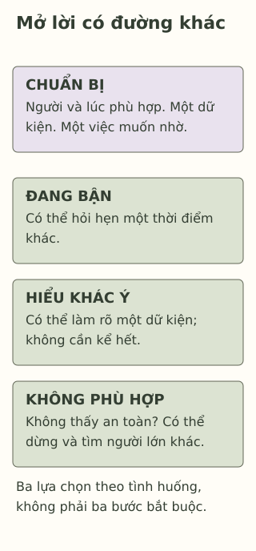

# Bắt đầu một cuộc trò chuyện khó với người lớn

> **Bản nháp để duyệt · KGNT-C14 · c14-draft-r1 · 25/10/2026.**
> Chưa duyệt nội dung cuối, chưa rà soát chuyên môn độc lập, chưa có quyền xuất bản.

Linh muốn nói với cô chủ nhiệm rằng bạn khó theo kịp phần việc nhóm. Có hai lần nhóm đổi nhiệm vụ sát buổi trình bày. Linh chưa biết xin phân công rõ hơn có khiến cô nghĩ bạn đang than phiền không.

Giờ ra chơi, cô đang giải quyết nhiều việc trước cửa lớp. Linh cầm tờ ghi chú nhưng chưa đưa. Bạn có thể bắt đầu thế nào mà không phải kể tất cả trước mặt các bạn?

*Linh, Nam, lời thoại và mọi nhánh lựa chọn trong bài là giả định do biên tập đặt ra. Không phải ca tư vấn thật hoặc kịch bản đã được thử nghiệm.*

## Chọn người, không chỉ chọn một câu hay

Với Linh, cô chủ nhiệm là một người có thể cùng làm rõ việc nhóm. Với việc khác, có thể là người chăm sóc, giáo viên khác hoặc nhân viên y tế. “Đáng tin” trong bài là cách cân nhắc đời thường: người từng lắng nghe, tôn trọng và có khả năng giúp việc đang cần; không phải danh hiệu bảo đảm người đó luôn phản hồi tốt.

Tổng quan về tìm hỗ trợ sức khỏe tinh thần ở người trẻ ghi nhận các rào cản như ngại bị đánh giá và lo về sự riêng tư, lòng tin (Gulliver et al., 2010). Nguồn này không kiểm nghiệm cuộc trao đổi việc nhóm của Linh; nó nhắc ta không coi việc chưa mở lời đơn giản là “không chịu nói”.

Nếu một người từng đe dọa, làm hại hoặc khiến Linh không thấy an toàn, bài không yêu cầu bạn thử thuyết phục người ấy. Có thể chọn một người lớn khác phù hợp. Không cần đối đầu để hoàn thành hoạt động.

## Một tờ ghi chú, một việc muốn nhờ

Hướng dẫn cho thanh thiếu niên của National Alliance on Mental Illness (NAMI, n.d.) gợi ý chuẩn bị điều muốn nói, tìm thời điểm riêng tư và bàn bước tiếp theo. Bài dùng những hướng chuẩn bị ấy cho tình huống thông thường, không coi chúng là kỹ thuật điều trị hay công thức bảo đảm được đồng ý.

Linh có thể ghi ngắn:

- **Việc đã xảy ra:** hai lần nhiệm vụ đổi sát buổi trình bày.
- **Điều muốn người lớn hiểu:** bạn chưa biết phần nào cần chuẩn bị trước.
- **Một việc muốn nhờ:** cùng làm rõ phần phụ trách và cách báo thay đổi.

Chưa cần gọi tên một trạng thái tâm lý hoặc trình bày thật trôi chảy. Một lời mở đầu có thể là: “Cô ơi, em muốn hỏi riêng về việc phân công nhóm. Khi nào cô có thể nghe em một lúc ạ?” Đây là lời do bài tự viết, không phải câu nói bắt buộc.

## Cuộc trò chuyện có thể rẽ hướng

**Nếu cô hẹn một thời điểm khác:** Linh có thể hỏi lại thời điểm hoặc nơi phù hợp, rồi giữ ghi chú để khỏi quên. Việc người lớn đang bận chưa tự chứng minh họ từ chối giúp.

**Nếu cô hiểu khác ý:** Linh có thể làm rõ một dữ kiện, chẳng hạn chuyện đổi nhiệm vụ, thay vì phải kể hết mọi chuyện trong nhóm. Cô cũng có thể hỏi thêm. Linh không phải đoán trước mọi câu hỏi.

**Nếu cô gạt đi hoặc Linh không thấy an toàn:** có thể dừng, chọn giáo viên hay người lớn khác, hoặc nhờ người phù hợp đồng hành. NAMI (n.d., mục “Talk to Someone Else in Your Family or Network”) cũng đề cập lựa chọn người khác khi không nhận được hỗ trợ. Không cần cố nói tiếp bằng mọi giá.

Phản ứng của người lớn không hoàn toàn do cách Linh dùng từ. CDC (2024) hướng dẫn người lớn lắng nghe, kiểm lại điều đã hiểu và tạo điều kiện để người trẻ chia sẻ an toàn. Vì vậy, trách nhiệm không chỉ nằm ở học sinh phải “nói cho đúng”.

*Thẻ lựa chọn sư phạm tự biên soạn, tham khảo NAMI (n.d.) và CDC (2024); không phải quy trình xử trí khủng hoảng.*

**Mô tả tương đương bằng chữ:** Phần đầu ghi người và thời điểm phù hợp, dữ kiện, điều muốn nhờ. Bên dưới là ba thẻ lựa chọn ngang hàng theo tình huống: hẹn lại; làm rõ; dừng và tìm người khác nếu cần. Chúng không phải ba bước phải đi qua, cũng không phải ba mức nguy cơ. Không nhánh nào bắt buộc kể thêm để được giúp.

## Thử một cuộc mở lời khác

Nam muốn trao đổi với người chăm sóc về việc phải làm bài trong phòng có tiếng tivi. Tối nay người ấy đang chuẩn bị đi làm. Nam có thể nhờ một người cô trong gia đình cùng bàn nếu cần. Câu chuyện chưa cho biết người chăm sóc sẽ phản hồi ra sao.

Có thể bỏ qua hoặc dùng hoàn toàn nhân vật. Không cần nêu tên người lớn, hoàn cảnh gia đình hay khó khăn riêng của bạn.

**1. Nêu hai việc có thể chuẩn bị trước khi mở lời.**

**2. Vì sao Linh có thể hỏi một thời điểm riêng thay vì kể ngay trước cửa lớp?** Điều đó có bảo đảm cô sẽ đồng ý không?

**3. Dùng thẻ để giúp Nam chọn người/thời điểm, soạn lời mở đầu và một việc muốn nhờ.** Thêm phương án nếu người ấy đang bận hoặc không phù hợp để nói. Không cần diễn vai tình huống gây bất an.

### Gợi ý phản hồi

**Câu 1:** Có thể nêu người phù hợp, thời điểm, dữ kiện và việc muốn nhờ. Chấp nhận cách nói khác; không cần thuộc một câu mẫu.

**Câu 2:** Cửa lớp đang đông và cô bận; hỏi hẹn riêng giúp chọn điều kiện phù hợp với chuyện Linh muốn trao đổi. Không bảo đảm phản ứng. Nếu chưa được nghe, điều đó không tự là lỗi của Linh.

**Câu 3:** Chẳng hạn Nam xin hẹn khi người chăm sóc rảnh, kể việc phòng có tivi và nhờ cùng bàn một khoảng yên hơn. Nếu chưa có chỗ riêng, có thể bàn giảm tiếng trong một khoảng phù hợp, hoặc hỏi người cô về một lựa chọn khác. Phương án đạt khi dùng dữ kiện, có lời nhờ cụ thể và đường thay thế; không buộc người khác đồng ý, không hứa giữ kín tuyệt đối. Không cần thử với người khiến Nam không an toàn.

## Khi điều muốn nói cần hỗ trợ chuyên môn

Nếu khó khăn hoặc cảm xúc gây khổ sở, kéo dài hay cản trở sinh hoạt, có thể tìm thêm người có chuyên môn (National Institute of Mental Health [NIMH], 2024). Không cần biết tên bệnh mới được mở lời. Nếu trường có người tư vấn phù hợp, đó là một lựa chọn; không mặc định mọi trường đều có.

Bài chỉ chuẩn bị trò chuyện thường ngày, không phải hướng dẫn xử trí nguy hiểm cấp thời. Khi không an toàn, không cần chờ đúng lịch hẹn trong bài mới tìm người lớn an toàn có thể hỗ trợ ngay. Bài không cung cấp hoặc xác nhận dịch vụ địa phương, không hứa người nhận sẽ giữ mọi thông tin bí mật.

### Tìm hiểu sâu hơn — tùy chọn

Gulliver et al. (2010) tổng hợp rào cản do người trẻ thuật lại, chủ yếu từ một số nước và nghiên cứu đã khá lâu; không chứng minh câu mở lời nào hiệu quả nhất. Chuẩn bị là một lựa chọn, không phải điều kiện học sinh phải đáp ứng để xứng đáng được lắng nghe.

## Tài liệu tham khảo

Centers for Disease Control and Prevention. (2024, November 29). *Conversation tips for connecting conversations.* https://www.cdc.gov/healthy-youth/connecting-conversations/index.html

Gulliver, A., Griffiths, K. M., & Christensen, H. (2010). Perceived barriers and facilitators to mental health help-seeking in young people: A systematic review. *BMC Psychiatry, 10*, Article 113. https://doi.org/10.1186/1471-244X-10-113

National Alliance on Mental Illness. (n.d.). *How to talk to my parents or guardian.* https://www.nami.org/kids-teens-and-young-adults/teens/how-to-talk-to-my-parents-or-guardian/

National Institute of Mental Health. (2024). *Children and mental health: Is this just a stage?* (NIH Publication No. 24-MH-8085). https://www.nimh.nih.gov/health/publications/children-and-mental-health

[Hồ sơ nguồn](REFERENCES.md) · [Đối chiếu nhận định](CLAIM-AUDIT.md) · [Bloom](BLOOM-REVIEW.md) · [Hồ sơ hình](VISUAL-REVIEW.md) · [Biên tập](EDITORIAL-REVIEW.md)
