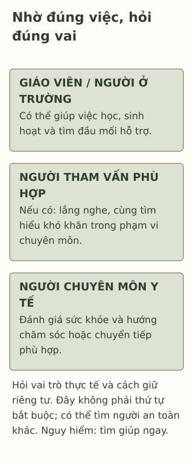

# Khi nào mình nên tìm thêm sự giúp đỡ?

> **Bản nháp để duyệt · KGNT-C15 · c15-draft-r1 · 25/10/2026.**
> Chưa duyệt nội dung cuối, chưa rà soát chuyên môn độc lập, chưa có quyền xuất bản.

Mấy buổi gần đây, Trâm thấy khó theo bài. Bạn rời buổi làm nhóm sớm vì quá khổ sở, tối lại chưa biết bắt đầu từ đâu. Trâm muốn có người cùng nhìn lại nhưng nghĩ: “Mình vẫn đi học được, chắc chưa cần làm phiền ai.”

Một người không cần ngừng làm được tất cả mọi việc mới được hỏi giúp. Với Trâm, ta có thể bắt đầu từ điều đang ảnh hưởng ngày học và một việc muốn nhờ, chưa cần tìm tên bệnh.

*Trâm, Đạt và mọi lời thoại, bảng vai trò trong tình huống là giả định do biên tập tạo; không phải ca lâm sàng, danh bạ dịch vụ hoặc bài sàng lọc.*

## Nhìn việc đang khó, không tự chấm xem đã “đủ nặng” chưa

Trong chuyện này, ta biết Trâm khó theo bài, khổ sở khi làm nhóm và thấy việc chuẩn bị buổi tối khó hơn. Chưa biết nguyên nhân, những ngày khác ra sao hoặc Trâm cần hình thức hỗ trợ nào. Việc vẫn đến lớp không phủ nhận những điều bạn kể.

National Institute of Mental Health (NIMH, 2024, mục “What are the signs of mental health conditions in children?”) lưu ý nên tìm giúp khi cảm xúc hoặc hành vi gây khổ sở, kéo dài hay cản trở hoạt động ở trường, nhà hoặc quan hệ. Đó là hướng tìm hỗ trợ, không bảng để tự kết luận một rối loạn. Không phải chờ đủ tất cả dấu hiệu hoặc một số ngày cố định mới được nói.

Mind (2026) cũng nêu người trẻ có thể tìm hỗ trợ ngay cả khi chưa biết mình cần loại nào. Bài không yêu cầu Trâm tự thử hết mọi cách, đạt mức điểm nào hoặc biết giải thích nguyên nhân trước.

## Người có thể cùng giúp làm những việc khác nhau

Ta có thể hỏi: **việc đang vướng cần người hiểu chuyện học, người có thể lắng nghe chuyên môn hay người đánh giá sức khỏe?** Các vai trò có thể phối hợp, không phải một chiếc thang phải leo đủ bậc.

| Người có thể tìm | Một việc có thể hỏi trong ví dụ | Điều cần kiểm lại |
|---|---|---|
| Giáo viên hoặc người phụ trách phù hợp ở trường | Cùng làm rõ phần bài/phân công đang vướng, hỏi trường có cách hỗ trợ nào. | Không tự coi giáo viên là người chẩn đoán hoặc trường chắc chắn có một dịch vụ. |
| Người làm tham vấn/tư vấn được đào tạo phù hợp, nếu có thể tiếp cận | Có không gian trao đổi điều đang khó, tìm hiểu cách hỗ trợ trong phạm vi chuyên môn. | Hỏi người ấy làm công việc gì, có chuyên môn nào và khi cần sẽ phối hợp với ai. |
| Nhân viên y tế/bác sĩ và người có chuyên môn sức khỏe tâm thần phù hợp | Đánh giá sức khỏe, tìm hiểu nhiều mặt và bàn hỗ trợ/chuyển tiếp khi cần. | Chức danh và phạm vi công việc khác nhau; không suy quyền chẩn đoán hoặc kê thuốc chỉ từ chữ “tư vấn”. |

Bảng diễn giải từ các phần về hỗ trợ ở trường, bác sĩ, counsellor của Mind (2026) và đánh giá/chăm sóc của NIMH (2024). Nguồn mô tả bối cảnh Anh/Mỹ; bảng không xác nhận nhân sự, thủ tục hoặc quyền hành nghề ở một trường Việt Nam. Nếu chưa biết có ai phù hợp, một việc có thể nhờ giáo viên hoặc người lớn đáng tin là cùng tìm thông tin ấy.

Với Trâm, hỏi cô về bài nhóm và nhờ người có chuyên môn nhìn lại khó khăn có thể diễn ra cùng lúc. Không phải giải quyết xong việc học mới được hỏi về sức khỏe, hoặc phải đến một nơi cụ thể đầu tiên.

*Bản đồ vai trò do Không Gian Nội Tâm biên soạn với hỗ trợ AI, tham khảo Mind (2026) và NIMH (2024); không phải danh bạ dịch vụ hoặc quy trình phân tuyến.*

**Mô tả tương đương bằng chữ:** Ba thẻ ngang hàng về việc học, trao đổi với người có đào tạo và đánh giá sức khỏe. Mỗi thẻ là một loại việc có thể nhờ, không một chức danh bảo đảm mọi năng lực. Dải cuối nhắc hỏi điều thực có, có thể phối hợp/đổi người; không cần đi hết ba nơi trước khi được giúp. Nếu đang nguy hiểm, cần tìm giúp ngay.

## Chuẩn bị một lời mở, không chuẩn bị cả hồ sơ bệnh

Trâm có thể ghi ba ý: một việc đang bị ảnh hưởng, một ví dụ gần đây và một điều muốn nhờ. Chẳng hạn: “Em đang khó theo bài và phải rời buổi nhóm sớm vì quá khổ sở. Em muốn cô giúp xem có thể trao đổi riêng với ai và phần học nào cần làm rõ.” Đây là lời tự biên soạn, không câu nói được thử nghiệm hoặc điều kiện được hỗ trợ.

Trước khi kể phần riêng, Trâm có thể hỏi người tiếp nhận: “Thông tin em nói sẽ được trao đổi với ai? Khi nào cô cần nhờ người khác để giúp em an toàn?” Bài không hứa giữ kín tuyệt đối. Cũng không cần kể trước lớp, gửi chuyện riêng lên mạng hoặc đưa thông tin sức khỏe vào hoạt động này.

Ngại mở lời không đơn giản là không muốn được giúp. Tổng quan của Gulliver et al. (2010) ghi nhận lo về bị đánh giá, riêng tư/lòng tin và khả năng tiếp cận trong những rào cản người trẻ thuật lại. Nghiên cứu có cả người trẻ trưởng thành, đã khá lâu và không đại diện riêng học sinh Việt Nam; nó không xác định Trâm đang ngại vì lý do nào.

## Khi người đầu tiên chưa giúp được

Nếu người ấy đang bận, Trâm có thể hỏi thời điểm khác hoặc người phù hợp khác. Nếu bị gạt đi, người ấy không có khả năng giúp hoặc không an toàn, có thể đổi người; không phải cố kể nhiều hơn để chứng minh mình xứng đáng. Mind (2026, mục “Support from people you know and trust”) cũng đề cập lựa chọn người khác khi chưa nhận được hỗ trợ.

Không phải ai cũng có tiền, điện thoại riêng, người nhà sẵn sàng hoặc dịch vụ gần nhà. Bước đầu có thể chỉ là nhờ một người lớn an toàn cùng tìm phương án tiếp cận. Không biết sẵn đáp án, hoặc chưa liên hệ được ngay, không phải lỗi của học sinh.

Nếu đang có nguy cơ bị hại, muốn làm hại bản thân/người khác hoặc cần chăm sóc y tế khẩn cấp, tìm người lớn an toàn và trợ giúp khẩn cấp phù hợp ngay, không chờ lịch hẹn hay hoàn thành các bước trong bài (NIMH, 2024). Bài không là dịch vụ tiếp nhận khẩn cấp và không cung cấp số/địa chỉ địa phương chưa xác minh.

## Thử chọn một bước cho Đạt

Đạt nói những khó khăn gần đây đang làm mình khổ sở và khó tham gia lớp. Bạn muốn hỏi người có chuyên môn nhưng chưa biết trường có hỗ trợ gì, không có điện thoại riêng; có một giáo viên từng lắng nghe. Đạt chưa có chẩn đoán, câu chuyện không nêu nguy hiểm cấp thời.

Có thể bỏ qua, dùng hoàn toàn nhân vật hoặc đọc phản hồi; không cần kể tên người hỗ trợ, trường hay sức khỏe của chính mình.

**1. Nêu hai ảnh hưởng đến sinh hoạt/học tập được kể về Trâm.**

**2. Giáo viên, người làm tham vấn phù hợp và nhân viên y tế có thể giúp những việc khác nhau thế nào?** Vì sao không cần tự chọn đúng tên bệnh để hỏi họ?

**3. Chọn một bước liên hệ cho Đạt:** nói với ai, một điều muốn nhờ và cách khác nếu người đầu chưa giúp được. Tính điều kiện không có điện thoại riêng.

### Gợi ý phản hồi

**Câu 1:** Có thể nêu khó theo bài, rời buổi làm nhóm vì khổ sở hoặc khó bắt đầu việc buổi tối. Đây là dữ kiện ảnh hưởng, không phải ba mục để chẩn đoán.

**Câu 2:** Giáo viên có thể làm rõ việc học và lựa chọn ở trường; người có đào tạo tham vấn trao đổi trong phạm vi chuyên môn; người làm y tế đánh giá sức khỏe và phối hợp khi cần. Vai trò có thể giao nhau, cần hỏi thực tế, không mặc định mỗi chức danh làm mọi việc. Đánh giá cá nhân cần chuyên môn/nhiều thông tin, không nhiệm vụ của học sinh tự tìm bệnh trước.

**Câu 3:** Đạt có thể xin giáo viên một lúc nói riêng, kể việc khó tham gia lớp và nhờ cùng tìm người có chuyên môn/cách liên hệ không cần máy riêng. Nếu người ấy chưa giúp được, hỏi một người lớn an toàn khác hoặc hẹn lại khi phù hợp. Đạt không cần nộp đủ “bằng chứng” khổ sở. Đạt tiêu chí khi có bước khả thi, việc nhờ và đường khác, không phải khi chắc chắn được đặt lịch hay thấy khỏe ngay.

### Đọc sâu hơn — tùy chọn

Gulliver et al. (2010) tổng hợp điều người trẻ tự nhận là rào cản, không thử nghiệm lời mở trong bài; mẫu gồm tuổi thiếu niên và 18–25. NIMH mô tả đánh giá nhiều mặt, không một dấu hiệu đơn lẻ. Bản đồ vai trò giúp biết có thể hỏi gì; nó không chọn phương pháp điều trị, xếp mức nguy cơ hoặc xác minh dịch vụ tại Việt Nam.

## Tài liệu tham khảo

Gulliver, A., Griffiths, K. M., & Christensen, H. (2010). Perceived barriers and facilitators to mental health help-seeking in young people: A systematic review. *BMC Psychiatry, 10*, Article 113. https://doi.org/10.1186/1471-244X-10-113

Mind. (2026, January). *Where to get mental health support.* https://www.mind.org.uk/for-young-people/how-to-get-help-and-support/where-to-look-for-mental-health-support/

National Institute of Mental Health. (2024). *Children and mental health: Is this just a stage?* (NIH Publication No. 24-MH-8085). https://www.nimh.nih.gov/health/publications/children-and-mental-health

[Hồ sơ nguồn](REFERENCES.md) · [Đối chiếu nhận định](CLAIM-AUDIT.md) · [Bloom](BLOOM-REVIEW.md) · [Hình](VISUAL-REVIEW.md) · [Biên tập](EDITORIAL-REVIEW.md)
