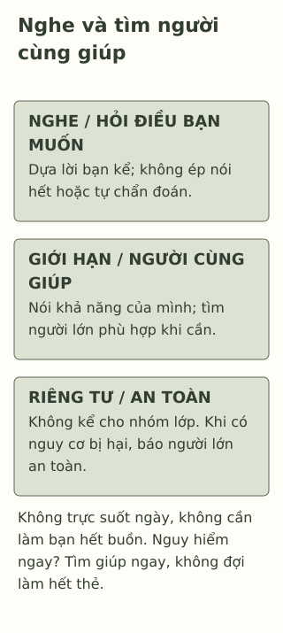

# Khi một người bạn nói rằng bạn ấy đang rất buồn

> **Bản nháp để duyệt · KGNT-C16 · c16-draft-r1 · 25/10/2026.**
> Chưa duyệt nội dung cuối, chưa rà soát chuyên môn độc lập, chưa có quyền xuất bản.

Sau tiết học, Vy nói với Hòa: “Mấy hôm nay mình buồn lắm, mình chưa muốn kể hết.” Hòa muốn giúp nhưng sắp phải về cùng người nhà. Bạn băn khoăn: nên tìm lời khuyên ngay hay cứ ngồi nghe? Nếu chưa làm Vy vui lên, có phải mình là bạn tệ?

Hòa không cần biết mọi câu trả lời. Điều bài này thử là cách nghe, hỏi điều bạn muốn và tìm người cùng hỗ trợ, trong giới hạn Hòa có thể làm.

*Vy, Hòa, Khôi, My và mọi lời thoại là giả định do biên tập tạo. Không phải dữ liệu nghiên cứu, ca lâm sàng hoặc tình huống để người đọc tự đánh giá nguy cơ của bạn thật.*

## Nghe điều bạn đang nói

Hòa có thể bắt đầu: “Cảm ơn cậu đã nói với mình. Lúc này cậu muốn mình nghe hay cùng tìm một người để nói thêm?” Nếu Vy chưa muốn kể, không cần hỏi dồn nguyên nhân. Một câu trả lời ngắn, một khoảng im lặng hoặc cách giao tiếp khác cũng có thể là điều Vy chọn.

YoungMinds (n.d., mục “How to talk to a friend who’s struggling”) khuyên lắng nghe, không ép kể và tránh tự chẩn đoán. Bài dùng hướng ấy cho cuộc nói chuyện giả định, không coi lời thoại là liệu pháp hoặc hứa giúp Vy hết buồn.

“Buồn lắm” là lời kể cần được lắng nghe, không tự là tên một rối loạn. National Institute of Mental Health (NIMH, 2024, mục “How is children’s mental health assessed?”) mô tả đánh giá cần nhiều thông tin và người có chuyên môn. Hòa không phải nhận diện đúng bệnh mới được quan tâm; cũng không cần trấn an chắc rằng “chỉ là một giai đoạn”.

## Một phản hồi có chỗ cho bạn sửa

So sánh hai lời của Hòa:

| Lời giả định | Điều cần nhìn |
|---|---|
| “Đừng nghĩ nữa, có gì đâu mà buồn.” | Gạt lời Vy kể và chốt thay bạn mức độ khó khăn. |
| “Mình nghe cậu nói đang rất buồn. Có điều gì cậu muốn mình hiểu lúc này không?” | Dựa lời đã nghe, mở chỗ để Vy nói thêm hoặc chưa nói. |

Đây là đối chiếu câu chữ, không chấm Hòa là người tốt/xấu. Hòa có thể hiểu chưa đúng và hỏi lại; không cần biểu diễn lắng nghe bằng nhìn mắt hoặc nói thật trôi chảy. Bài không yêu cầu luyện bằng chuyện riêng hoặc tái hiện một cuộc trò chuyện gây bất an.

## Bạn bè không phải người trực hỗ trợ suốt ngày

YoungMinds (n.d., mục “Looking after yourself”) lưu ý người hỗ trợ có thể đặt giới hạn, nghỉ và chia sẻ việc hỗ trợ với những người phù hợp. Trong ví dụ, Hòa có thể nói mình sắp phải về, rồi cùng Vy chọn người lớn đáng tin để nhờ thêm nếu cần; không hứa luôn trả lời tin nhắn hoặc giữ toàn bộ trách nhiệm.

Có thể hỏi Vy muốn gặp ai, hoặc đề nghị đi cùng tới giáo viên khi có điều kiện. Không mặc định mọi trường có tham vấn viên. Nếu cảm xúc gây khổ sở, kéo dài hoặc cản trở sinh hoạt, NIMH (2024) định hướng tìm hỗ trợ; không phải chờ đủ một số ngày hoặc tự thử mọi cách mới được mở lời.

Nếu người đầu gạt đi hoặc không an toàn, có thể tìm người lớn khác. Hòa cũng có thể nhờ giúp cho chính mình khi thấy quá tải; không cần kể chuyện của Vy cho cả lớp để được hỗ trợ.

## Riêng tư không phải lời hứa giữ kín mọi chuyện

Childline (n.d., mục “Worrying about a friend”) và YoungMinds (n.d., mục “Should I tell someone what my friend said?”) đều đặt an toàn lên trước lời hứa giữ bí mật khi bạn đang có nguy cơ bị hại. Nếu bạn nói muốn làm hại bản thân/người khác, đang nguy hiểm hoặc kể đang bị làm hại, cần báo người lớn an toàn để giúp; không tự giữ và xử lý một mình. Nếu có thể làm vậy an toàn, nói cho bạn biết mình đang nhờ ai.

Ngoài tình huống an toàn đáng lo, tôn trọng điều bạn muốn giữ riêng: không chuyển lời kể hoặc tin nhắn cho nhóm lớp. Nhờ một người có thể giúp khác với lan truyền chuyện riêng. Nếu chưa chắc có cần báo hay không, Hòa có thể hỏi người lớn đáng tin cách hỗ trợ; không phải tự điều tra hoặc tự chấm nguy cơ bằng danh sách.

Khi có nguy hiểm ngay lúc đó hoặc cần chăm sóc y tế khẩn cấp, tìm người lớn an toàn có thể hỗ trợ ngay và trợ giúp khẩn cấp phù hợp; không chờ hẹn trò chuyện. Bài không hướng dẫn bạn bè tự xử trí khủng hoảng, giám sát, điều tra, thu giữ vật dụng hoặc cam kết bảo đảm an toàn cho người khác. Không cung cấp số dịch vụ địa phương chưa xác minh.

*Thẻ hội thoại do Không Gian Nội Tâm biên soạn với hỗ trợ AI, tham khảo YoungMinds (n.d.), Childline (n.d.) và NIMH (2024); không phải quy trình trị liệu hoặc thang đánh giá nguy cơ.*

**Mô tả tương đương bằng chữ:** Các vùng nhắc nghe lời tự kể và hỏi nhu cầu; nói khả năng hỗ trợ của mình, tìm người lớn cùng giúp; tôn trọng riêng tư, nhưng báo người lớn an toàn khi có nguy cơ gây hại. Dải cuối nêu không phải đợi làm đủ các vùng mới tìm giúp ngay; không có điểm số hoặc trách nhiệm trực suốt ngày cho bạn bè.

## Thử với một cuộc nói chuyện khác

Khôi nói với My rằng mình đang rất buồn sau việc ở lớp, muốn nhờ cô giáo nhưng chưa biết mở lời. My chỉ còn một khoảng nghỉ trước khi sang tiết khác; hai bạn biết một giáo viên có thể nghe. Câu chuyện không có dữ kiện nguy hiểm cấp thời, và không cho biết nguyên nhân hay chẩn đoán.

Có thể bỏ qua, dùng nhân vật hoặc đọc phản hồi, không cần kể sức khỏe hay chuyện của bạn thật.

**1. Lời nào trong bảng là phản hồi lắng nghe?** Chỉ ra chi tiết cho thấy điều đó.

**2. Vì sao Hòa chưa làm Vy vui lên không có nghĩa Hòa thất bại?** Giải thích một giới hạn trách nhiệm của bạn bè và giới hạn của lời hứa giữ kín.

**3. Soạn một phản hồi cho Khôi, kèm một cách My có thể nhờ người lớn trong điều kiện đang có.** Nếu giáo viên đầu chưa giúp được, có đường nào khác? Không tự thêm chẩn đoán hoặc việc My phải trực liên tục.

### Gợi ý phản hồi

**Câu 1:** Câu thứ hai nhắc đúng lời Vy kể và hỏi điều bạn muốn chia sẻ; không gạt cảm xúc hoặc ép kể hết. Câu khác cũng có thể lắng nghe nếu giữ những điểm ấy; không bắt thuộc mẫu.

**Câu 2:** Bạn bè có thể nghe và cùng tìm hỗ trợ, không điều trị hoặc chịu trách nhiệm làm người kia vui. Hòa có thời gian/khả năng hữu hạn. Riêng tư cần tôn trọng, nhưng không hứa giữ kín khi bạn có nguy cơ bị hại; lúc ấy cần người lớn an toàn. Không suy Hòa phải tự phân loại mọi nguy cơ mới được báo lo ngại.

**Câu 3:** Chẳng hạn: “Mình nghe cậu muốn nhờ cô mà chưa biết bắt đầu. Cậu có muốn cùng xin một lúc nói riêng không? Mình còn giờ nghỉ này, sau đó phải vào tiết.” Có thể cùng hỏi hẹn cô hoặc tìm người lớn phù hợp khác nếu cô chưa giúp được. Đáp án đạt khi nghe đúng điều đã kể, có lời hỏi tôn trọng lựa chọn, giới hạn của My và một đường hỗ trợ. Không tự hứa giữ kín mọi chuyện hoặc làm Khôi hết buồn. Nếu xuất hiện thông tin nguy hiểm mới, không dùng lịch hẹn để trì hoãn giúp ngay.

### Đọc sâu hơn — tùy chọn

Các hướng dẫn giải thích cách hỗ trợ, không chứng minh hiệu quả của thẻ này hoặc biến học sinh thành người có chuyên môn. Một người đang buồn không có nghĩa đã biết nguyên nhân, bệnh hoặc điều sẽ giúp nhất. Tìm thêm người phù hợp vừa mở rộng hỗ trợ cho bạn, vừa giữ giới hạn của người đang nghe; không phải một phép thử tình bạn.

## Tài liệu tham khảo

Childline. (n.d.). *Friendship problems.* https://www.childline.org.uk/info-advice/friends-relationships-sex/friends/friendship-problems/

National Institute of Mental Health. (2024). *Children and mental health: Is this just a stage?* (NIH Publication No. 24-MH-8085). https://www.nimh.nih.gov/health/publications/children-and-mental-health

YoungMinds. (n.d.). *Supporting a friend with their mental health.* https://www.youngminds.org.uk/young-person/supporting-a-friend-with-their-mental-health/

[Hồ sơ nguồn](REFERENCES.md) · [Đối chiếu nhận định](CLAIM-AUDIT.md) · [Bloom](BLOOM-REVIEW.md) · [Hình](VISUAL-REVIEW.md) · [Biên tập](EDITORIAL-REVIEW.md)
