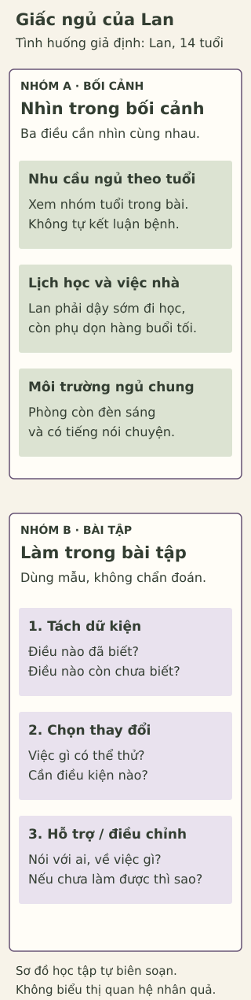

# Đêm dài, mình chưa ngủ

> **Bản nháp để duyệt · KGNT-C17 · c17-draft-r1 · 25/10/2026.**
> Chưa được duyệt biên tập hoặc rà soát chuyên môn; chưa có quyền xuất bản.

Lan 14 tuổi. Tối qua, sau khi phụ dọn hàng cùng gia đình, Lan làm nốt bài tập trong căn phòng vẫn còn tiếng nói chuyện và đèn sáng. Bạn có xem tin nhắn nhóm lớp. Khi nằm xuống thì đã muộn; Lan muốn ngủ nhưng còn thức một lúc. Sáng nay, bạn phải dậy sớm đi học và buồn ngủ trong lớp.

Một bạn bảo: “Chắc tại cậu dùng điện thoại.” Lan cũng chưa biết vì sao. Trong câu chuyện này, ta biết những việc đã xảy ra, nhưng chưa biết chúng góp phần thế nào, hoặc những đêm khác của Lan ra sao.

*Lan và các nhân vật trong bài đều là tình huống giả định do biên tập đặt ra, không phải dữ liệu học sinh thật.*

Bài viết mời bạn nhìn cả nhu cầu ngủ lẫn điều kiện sinh hoạt, rồi thử chọn một bước phù hợp cho Lan. Không cần kể giấc ngủ của chính mình.

## Số giờ ngủ nói được điều gì?

Ngủ có liên quan đến sức khỏe, sự chú ý và học tập; thời lượng chỉ là một phần, bên cạnh chất lượng, thời điểm và tính đều đặn (Paruthi và cộng sự, 2016, tr. 785).

Khuyến nghị của American Academy of Sleep Medicine (AASM) nêu các khoảng **thường xuyên, mỗi 24 giờ**:

| Tuổi | Thời lượng ngủ khuyến nghị |
|---|---|
| 6–12 tuổi | 9–12 giờ |
| 13–18 tuổi | 8–10 giờ |

Nguồn: Paruthi và cộng sự (2016, mục “Consensus Recommendations”). Như vậy, nhân vật 12 tuổi và Lan 14 tuổi thuộc hai nhóm khác nhau. Không dùng bảng này cho người từ 19 tuổi trở lên.

Đây là khuyến nghị sức khỏe theo nhóm tuổi, không phải phép thử chẩn đoán. Nhu cầu giữa các cá nhân có biến thiên (Paruthi và cộng sự, 2016, tr. 786). Ngủ ngoài khoảng không tự chứng minh có bệnh; ở trong khoảng cũng không đủ kết luận không có vấn đề sức khỏe. Các con số không dùng để chấm sự chăm chỉ hoặc trách móc học sinh.

Với Lan, chỉ bảo “đi ngủ sớm hơn” chưa giải quyết được việc dọn hàng, bài tập và căn phòng dùng chung. Trước khi chọn thay đổi, cần nhìn xem bạn có thể quyết định phần nào.

## Vì sao muốn ngủ mà vẫn chưa ngủ được?

Cơ thể có nhịp ngày–đêm gần 24 giờ, gọi là **nhịp sinh học** (*circadian rhythm*). Ánh sáng và những tín hiệu môi trường góp phần đồng bộ nhịp ấy. Còn **áp lực ngủ** là xu hướng cần ngủ tích lũy khi thức, khác với áp lực bài vở. Hai quá trình tương tác trong điều hòa ngủ–thức (National Heart, Lung, and Blood Institute [NHLBI], 2022c, mục “Your body clock”). Đây là cách giải thích giản lược, không phải đồng hồ đo riêng cho Lan.

NHLBI (2022c, mục “Changes in body clock with aging”) cũng mô tả xu hướng giờ ngủ muộn hơn ở tuổi thiếu niên. Xu hướng chung ấy không cho biết nhịp của từng người và không chứng minh nguyên nhân một đêm của Lan.

Ánh sáng, tiếng ồn, lịch sinh hoạt và chất kích thích như caffeine đều là những yếu tố cần cân nhắc; hướng dẫn thói quen ngủ lành mạnh đề cập các yếu tố này (NHLBI, 2022b). Tuy vậy, câu chuyện không cho biết Lan có dùng caffeine hay không. Không nên thêm một dữ kiện chưa có, hoặc kết luận điện thoại là nguyên nhân duy nhất.

### Nhìn lại dữ kiện trước khi giải thích

| Đã biết về Lan | Còn chưa biết |
|---|---|
| Phụ dọn hàng, rồi làm bài | Việc nào có thể đổi hoặc chia sẻ với người khác? |
| Phòng còn sáng và có tiếng nói chuyện | Có cách nào cùng gia đình giảm ánh sáng, tiếng ồn không? |
| Phải dậy sớm, buồn ngủ ở lớp | Tình trạng này diễn ra ra sao qua những ngày khác? |

Bảng giúp phân biệt điều cần hỏi với điều có thể khẳng định. Nó không xác định nguyên nhân hay mức độ bệnh.

## Một đêm chưa kể hết câu chuyện

Nói “Lan khó vào giấc tối qua” là mô tả điều được kể. Nói “Lan mắc rối loạn mất ngủ” là một kết luận khác, cần đánh giá chuyên môn. NHLBI (2022a, phần mở đầu và mục “Medical history and physical exam”) mô tả việc đánh giá phải xem xét nhiều thông tin về giấc ngủ, sức khỏe và ảnh hưởng ban ngày. Một đêm trong câu chuyện không cung cấp đủ thông tin ấy.

Điều này cũng không có nghĩa Lan phải bỏ qua buồn ngủ hoặc chờ đến một mốc ngày mới được nhờ giúp. Bài không đưa ngưỡng số đêm, bảng điểm nguy cơ hay bộ tiêu chí để tự kết luận bệnh.

## Chọn việc có thể thử, cùng người có thể giúp

Một vài hướng trong hướng dẫn NHLBI (2022b) là giữ sinh hoạt ngủ–thức tương đối đều khi có thể, dành thời gian yên tĩnh trước ngủ và tạo chỗ ngủ bớt sáng, bớt ồn. Đây là hướng hỗ trợ thói quen, không phải cách chữa khó ngủ được bảo đảm cho mọi người.

Với hoàn cảnh Lan, có thể bắt đầu bằng **một việc** thay vì đổi cả buổi tối. Chẳng hạn, Lan có thể hỏi người chăm sóc xem sau lúc dọn hàng có thể giảm bớt đèn gần chỗ ngủ không. Nếu người khác vẫn cần ánh sáng làm việc, hai bên còn phải tìm cách phù hợp hơn; không mặc định Lan có phòng riêng hoặc tự thay được lịch gia đình.

*Sơ đồ học tập tự biên soạn; tham khảo Paruthi và cộng sự (2016), NHLBI (2022a, 2022b). Không phải sơ đồ cơ chế sinh học, thang sàng lọc hay phác đồ điều trị.*

**Mô tả tương đương bằng chữ:** Hình có hai phần. Phần bối cảnh nhắc ba điều cần nhìn cùng nhau: nhu cầu ngủ theo tuổi; lịch học và việc nhà; môi trường dùng chung. Phần thao tác có ba bước: ghi điều biết và chưa biết, chọn một việc có thể thử, xác định hỗ trợ hoặc điều cần hỏi. Các khối xếp dọc để đọc, không có đường nối biểu thị nhân quả.

## Thử ba bước với Lan

Bạn có thể dùng hoàn toàn tình huống giả định hoặc bỏ qua hoạt động. Không cần ghi nhật ký ngủ, cung cấp thông tin sức khỏe hay chấm nguy cơ cho bản thân.

| Bước | Bạn điền cho Lan |
|---|---|
| 1. Tách dữ kiện | Một điều đã biết: … Một điều cần hỏi thêm: … |
| 2. Chọn một việc khả thi | Lan có thể thử … nếu có điều kiện … |
| 3. Tìm hỗ trợ hoặc hỏi thêm | Có thể nói với … về … Nếu việc đã chọn chưa làm được thì … |

Ví dụ về cách điền bước 1: “Biết Lan dậy sớm đi học; chưa biết gia đình có thể chia sẻ việc dọn hàng thế nào.” Phần lựa chọn và hỗ trợ dành cho bạn thử tiếp. Không cần ấn định giờ ngủ hoặc hứa rằng việc đã chọn sẽ giúp Lan ngủ ngay.

## Tự kiểm tra

**1. Một nhân vật 12 tuổi và Lan 14 tuổi thuộc khoảng ngủ khuyến nghị nào, tính theo đơn vị gì? Nêu thêm một yếu tố trong bối cảnh Lan có thể liên quan đến giấc ngủ.**

**2. Vì sao chưa thể từ tối qua kết luận Lan mắc rối loạn mất ngủ hoặc chỉ khó ngủ vì điện thoại?** Nêu một điều còn cần biết, không tự đặt chẩn đoán.

**3. Dùng mẫu ba bước để chọn một việc cho Lan.** Nếu gia đình chưa thể thay đổi điều kiện như dự tính, bạn sẽ điều chỉnh lựa chọn hoặc nhờ ai về việc gì? Nếu đã điền phiếu, có thể dùng câu này để xem lại.

### Gợi ý phản hồi

**Câu 1:** Nhân vật 12 tuổi thuộc nhóm 6–12: 9–12 giờ; Lan 14 tuổi thuộc nhóm 13–18: 8–10 giờ. Cả hai khoảng đều tính mỗi 24 giờ và theo hướng thường xuyên. Có thể nêu phòng sáng, tiếng nói chuyện hoặc lịch dậy sớm. Đây là nhận diện khuyến nghị và dữ kiện, không kết luận bệnh cho hai nhân vật.

**Câu 2:** Câu chuyện chỉ kể một đêm và chưa xác định tác động riêng của từng yếu tố. Có thể hỏi thêm về điều kiện ngủ hoặc tình trạng qua những ngày khác. Việc có xem tin nhắn không chứng minh đó là nguyên nhân duy nhất. Chấp nhận cách giải thích khác nếu giữ rõ điều đã biết, điều chưa biết và giới hạn kết luận.

**Câu 3:** Có nhiều phương án hợp lý. Phiếu cần có dữ kiện và điều chưa biết; một hành động cụ thể kèm điều kiện thực hiện; một người hoặc câu hỏi hỗ trợ, cùng cách điều chỉnh nếu chưa làm được. “Lan phải ngủ ngay dù phòng vẫn ồn” chưa cho thấy việc khả thi. Có thể đổi sang bàn một việc chung với người lớn; nếu chưa có hỗ trợ ngay, ghi nhận giới hạn ấy, không xem đó là lỗi của Lan. Không chấm đáp án theo việc Lan có ngủ thành công hay không.

## Khi nào nên mở lời tìm hỗ trợ?

Nếu khó ngủ hoặc không ngủ đủ đang ảnh hưởng việc học và sinh hoạt ban ngày, có thể trao đổi với người chăm sóc và nhân viên y tế; NHLBI (2022a, phần mở đầu) khuyến nghị nói với bác sĩ khi việc thiếu ngủ ảnh hưởng hoạt động hằng ngày. Không cần biết tên một rối loạn trước khi nhờ giúp.

Lan có thể nói: “Dạo này con buồn ngủ ở lớp; con muốn cùng xem điều gì đang làm việc ngủ khó hơn.” Đây là câu mở lời do bài biên soạn. Giáo viên có thể là người giúp trao đổi khó khăn ở trường; nếu trường có người tư vấn phù hợp, đó cũng là một lựa chọn. Không giả định mọi trường đều có nhân viên tham vấn chuyên trách. Nếu người đầu tiên không phù hợp hoặc không an toàn để nói, có thể tìm người lớn khác.

Bài viết và phiếu học không thay thế đánh giá hoặc điều trị cá nhân, không hướng dẫn dùng thuốc hay tự điều chỉnh nhịp sinh học bằng liệu pháp.

## Một điều mang theo

Với Lan, bước đầu có thể là nhìn rõ một điều chưa biết và tìm người cùng bàn. Giấc ngủ không cần trở thành thêm một bài kiểm tra về ý chí của bạn ấy.

### Tìm hiểu sâu hơn — tùy chọn

Khuyến nghị cho một nhóm tuổi, giải thích chung về ngủ–thức và đánh giá một cá nhân trả lời ba câu hỏi khác nhau. Biết khoảng thời lượng không xác định nguyên nhân khó ngủ; biết có nhịp sinh học cũng không đo được nhịp của Lan. Phần giải thích ngắn của NHLBI (2022c) giúp phân biệt hai quá trình, nhưng không đủ để suy ra nguyên nhân hay cách điều trị cho Lan. Không cần học thuộc thuật ngữ để dùng mẫu ba bước.

## Tài liệu tham khảo

National Heart, Lung, and Blood Institute. (2022a, March 24). *Insomnia: Diagnosis.* https://www.nhlbi.nih.gov/health/insomnia/diagnosis

National Heart, Lung, and Blood Institute. (2022b, March 24). *Sleep deprivation and deficiency: Healthy sleep habits.* https://www.nhlbi.nih.gov/health/sleep-deprivation/healthy-sleep-habits

National Heart, Lung, and Blood Institute. (2022c, March 24). *Sleep deprivation and deficiency: What makes you sleep?* https://www.nhlbi.nih.gov/health/sleep-deprivation/body-clock

Paruthi, S., Brooks, L. J., D’Ambrosio, C., Hall, W. A., Kotagal, S., Lloyd, R. M., Malow, B. A., Maski, K., Nichols, C., Quan, S. F., Rosen, C. L., Troester, M. M., & Wise, M. S. (2016). Recommended amount of sleep for pediatric populations: A consensus statement of the American Academy of Sleep Medicine. *Journal of Clinical Sleep Medicine, 12*(6), 785–786. https://doi.org/10.5664/jcsm.5866

[Hồ sơ nguồn](REFERENCES.md) · [Đối chiếu nhận định](CLAIM-AUDIT.md) · [Mục tiêu và phản hồi](BLOOM-REVIEW.md) · [Hồ sơ hình](VISUAL-REVIEW.md)
