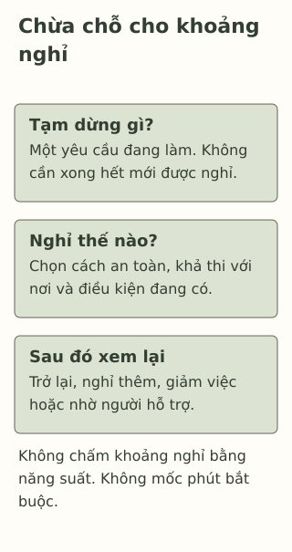

# Nghỉ một chút có phải là lười?

> **Bản nháp để duyệt · KGNT-C18 · c18-draft-r1 · 25/10/2026.**
> Chưa duyệt nội dung cuối, chưa rà soát chuyên môn độc lập, chưa có quyền xuất bản.

Ngọc vừa học xong một phần bài và còn phải giúp gia đình dọn bữa. Bạn muốn ngồi yên một lúc, nhưng nghĩ: “Chưa xong hết mà nghỉ thì có phải lười không?”

Ở một tình huống khác, Long nói sẽ nghỉ rồi quay lại bài, nhưng nhiều lần gạt bài sang sau mà chưa xem mình đang vướng gì. Hai câu chuyện đều có lúc rời việc học. Chỉ nhìn việc ấy có đủ để đánh giá con người không?

*Ngọc, Long, Quân và mọi lựa chọn trong bài là tình huống giả định do biên tập đặt ra, không phải dữ liệu học sinh thật.*

## Nghỉ không phải phần thưởng chỉ dành cho người đã xong hết

Điều 31 Công ước về quyền trẻ em ghi nhận quyền nghỉ ngơi và thời gian rảnh (United Nations, 1989). Đây là căn cứ về quyền, không phải nghiên cứu chứng minh nghỉ bao nhiêu phút sẽ tăng điểm. Bài không dùng năng suất sau nghỉ làm điều kiện để một học sinh được nghỉ.

Trong bài, “nghỉ” dùng theo nghĩa đời thường: tạm dừng một yêu cầu để có khoảng không phải tiếp tục yêu cầu ấy. Ngồi yên, nghe một đoạn nhạc nếu phù hợp hoặc rời trang bài là các lựa chọn minh họa; không có một kiểu bắt buộc. Phụ việc nhà có thể là trách nhiệm cần làm, nhưng không nên tự coi đó là khoảng nghỉ chỉ vì nó khác bài vở.

## Nghiên cứu nói được đến đâu?

Tổng quan và phân tích gộp về nghỉ ngắn ghi nhận lợi ích trung bình nhỏ với cảm giác có sức và bớt mệt, nhưng không thấy hiệu quả có ý nghĩa thống kê cho hiệu suất tổng thể (Albulescu et al., 2022). Đối tượng chủ yếu là người lớn, không phải bằng chứng trực tiếp cho mọi học sinh THCS–THPT.

Vì vậy, không thể từ nguồn này suy ra “nghỉ đúng công thức sẽ học tốt” hoặc đặt một lịch phút tối ưu cho Ngọc. Khác biệt nhiệm vụ, cách đo và việc dùng tự báo cáo cũng giới hạn kết luận. Các lựa chọn bên dưới là gợi ý biên tập để bàn tính khả thi, không phải chương trình đã chứng minh hiệu quả.

## Nhìn mục đích và hoàn cảnh

Với Ngọc, ta biết có cả bài học và việc nhà. Một phương án có thể là ngồi nghỉ rồi cùng người lớn bàn phần việc còn lại, thay vì lập lịch không còn khoảng trống.

Với Long, cần hỏi điều gì khiến việc quay lại khó: phần bài chưa rõ, thiếu điều kiện hay đang để sau dù có thể làm? Chưa đủ dữ kiện để chọn một lý do. Nếu có dấu hiệu né việc kéo dài trong câu chuyện, hướng bài tập là nhìn lại việc và tìm hỗ trợ, không gắn nhãn “lười”.

**Thời gian nghỉ không tự là phép thử đạo đức.** Một người chưa quay lại ngay có thể vẫn cần nghỉ thêm hoặc cần hỗ trợ. Một kế hoạch trở lại giúp tổ chức nhiệm vụ; không phải cam kết phải làm tiếp bất kể sức khỏe và điều kiện.

## Một khoảng nghỉ có chỗ điều chỉnh

Bạn có thể cân nhắc ba ô, theo hoàn cảnh nhân vật:

| Ô cần bàn | Ví dụ lựa chọn, chưa phải đáp án bắt buộc |
|---|---|
| Tạm dừng yêu cầu gì? | Tạm gấp sách, không tiếp tục làm thêm một bài khác ngay. |
| Nghỉ theo cách nào khả thi? | Ngồi yên tại chỗ nếu không thể rời bàn; không cần có phòng riêng hay mua gì. |
| Sau đó xem lại điều gì? | Còn việc gì cần làm, có cần giảm việc hoặc nhờ người hỗ trợ không? |

*Thẻ học tập tự biên soạn; không tái tạo mô hình phục hồi, không quy định phút nghỉ hoặc hứa tác dụng điều trị.*

**Mô tả tương đương bằng chữ:** Ba khối chứa câu hỏi tạm dừng gì, nghỉ thế nào và sau đó điều chỉnh hoặc nhờ ai. Không có thang điểm, bộ đếm hoặc mũi tên nhân quả. Xem lại sau nghỉ có thể dẫn đến nghỉ thêm hoặc giảm nhiệm vụ, không chỉ trở lại học.

## Tự thử với Quân

Quân đang chờ người nhà đón sau buổi ôn. Bạn mỏi và có thể ngồi tại chỗ, nhưng không thể tự rời khu vực chờ. Tối còn một phần bài chưa hiểu. Quân chưa biết hỏi giáo viên phần ấy thế nào.

Bạn có thể bỏ qua hoặc chỉ dùng nhân vật, không cần kể sức khỏe hay lịch sinh hoạt riêng.

**1. Trong các lựa chọn sau, đâu là một cách nghỉ được bài nêu?** Ngồi yên tạm dừng bài; chuyển ngay sang chép môn khác; làm thêm bài để đủ điều kiện nghỉ.

**2. Vì sao việc Ngọc nghỉ chưa đủ để kết luận bạn lười, và việc Long chưa quay lại cần được tìm hiểu thêm?** Chỉ ra một khác biệt dữ kiện hoặc điều chưa biết.

**3. Dùng ba ô để chọn một khoảng nghỉ cho Quân và một điều chỉnh sau đó.** Nếu vẫn mỏi hoặc phần bài vẫn chưa hiểu, phương án tiếp theo có thể là gì? Không yêu cầu Quân rời nơi chờ.

### Gợi ý phản hồi

**Câu 1:** Ngồi yên tạm dừng bài là một lựa chọn. Đổi sang chép môn khác vẫn là một yêu cầu học; không cần hoàn thành thêm bài mới được nghỉ. Cách nghỉ khác có căn cứ và an toàn cũng có thể phù hợp.

**Câu 2:** Ngọc có khối lượng học và việc nhà; rời bàn chưa nói lên ý chí. Với Long, ta biết việc quay lại đang khó nhưng chưa rõ cản trở. Có thể hỏi phần chưa hiểu hoặc điều kiện thực hiện, không đoán tính cách. Không dùng một số phút để chia người chăm và người lười.

**Câu 3:** Quân có thể tạm cất bài, ngồi nghỉ tại khu vực chờ; sau đó ghi một câu hỏi về phần chưa hiểu để hỏi giáo viên khi có thể. Nếu còn mỏi, có thể nghỉ thêm và bàn giảm việc với người lớn. Phương án khác được chấp nhận nếu phù hợp nơi chờ, có tạm dừng thật và cho phép điều chỉnh hoặc nhờ giúp; không chấm theo việc Quân có học ngay sau đó hay không.

## Khi nghỉ chưa giải quyết được khó khăn

Nếu mệt hoặc khó chịu kéo dài, gây khổ sở hay ảnh hưởng sinh hoạt, có thể trao đổi với người lớn đáng tin và người có chuyên môn (National Institute of Mental Health [NIMH], 2024). Bài không xác định nguyên nhân mệt, không gọi đó là một bệnh hay hướng dẫn điều trị. Nếu người đầu không phù hợp hoặc không an toàn, có thể tìm người khác. Không cần cố chịu để chứng minh chăm chỉ.

### Tìm hiểu sâu hơn — tùy chọn

Trong Albulescu et al. (2022), “micro-breaks” là cách nghiên cứu những khoảng dừng ngắn trong nhiệm vụ. Cách giới hạn thời lượng để chọn nghiên cứu không phải chỉ định cho cá nhân. Mẫu có tuổi trung bình 31,2 và gồm nhân viên, sinh viên cùng nhóm tình nguyện chưa mô tả rõ; do đó không thể xem như một thử nghiệm lịch nghỉ ở trường Việt Nam. Giữ khoảng nghỉ và bàn lại khối lượng công việc là lựa chọn tổ chức, không phải phép đo “phục hồi thành công”.

## Tài liệu tham khảo

Albulescu, P., Macsinga, I., Rusu, A., Sulea, C., Bodnaru, A., & Tulbure, B. T. (2022). “Give me a break!” A systematic review and meta-analysis on the efficacy of micro-breaks for increasing well-being and performance. *PLOS ONE, 17*(8), Article e0272460. https://doi.org/10.1371/journal.pone.0272460

National Institute of Mental Health. (2024). *Children and mental health: Is this just a stage?* (NIH Publication No. 24-MH-8085). https://www.nimh.nih.gov/health/publications/children-and-mental-health

United Nations. (1989). *Convention on the Rights of the Child.* UNICEF. https://www.unicef.org/child-rights-convention/convention-text

[Hồ sơ nguồn](REFERENCES.md) · [Đối chiếu nhận định](CLAIM-AUDIT.md) · [Bloom](BLOOM-REVIEW.md) · [Hồ sơ hình](VISUAL-REVIEW.md) · [Biên tập](EDITORIAL-REVIEW.md)
