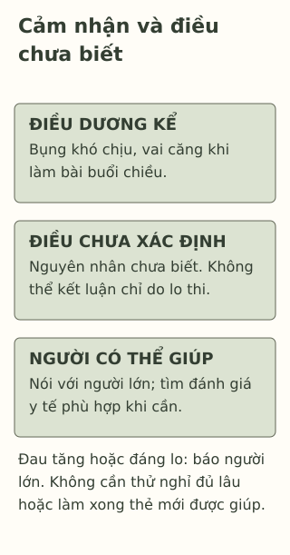

# Cơ thể đang nhắc mình điều gì?

> **Bản nháp để duyệt · KGNT-C19 · c19-draft-r1 · 25/10/2026.**
> Chưa duyệt nội dung cuối, chưa rà soát chuyên môn độc lập, chưa có quyền xuất bản.

Đang làm bài Toán buổi chiều, Dương nói bụng khó chịu và vai căng. Một bạn bảo: “Chắc tại cậu lo kỳ thi thôi.” Dương có lo về thi, nhưng chưa biết vì sao bụng đau, cũng chưa nói với người lớn về việc ấy.

Lo về thi và đau bụng cùng có mặt trong câu chuyện. Điều đó chưa cho biết cái nào gây ra cái nào, hay có nguyên nhân khác cần được xem xét. Tựa bài dùng chữ “nhắc” như một cách nói: chú ý điều cơ thể đang trải qua, không phải giải mã một thông điệp có sẵn.

*Dương, Quỳnh và mọi lời thoại/tình huống đều giả định do biên tập tạo; không phải dữ liệu sức khỏe hoặc bài tự chẩn đoán.*

## Cảm nhận thật, nguyên nhân còn cần tìm hiểu

Sydney Children’s Hospitals Network (2026, mục “Introduction”) nêu đau bụng ở trẻ có nhiều nguyên nhân, trong đó có vấn đề tiêu hóa, nhiễm trùng và stress/lo âu. Đó là những khả năng trong tài liệu y khoa, không danh sách để Dương tự chọn bệnh. Có lúc phải khám mới tìm hiểu được nguyên nhân.

National Health Service (NHS, 2023, mục “Symptoms of anxiety in children and young people”) có nêu căng người và khó chịu ở bụng trong biểu hiện có thể gặp khi lo âu. Một tín hiệu có thể đi cùng lo âu không có nghĩa nó chỉ xuất hiện vì lo âu. Bài không lấy vai căng hoặc bụng đau để suy chắc một cảm xúc, bệnh hay nguyên nhân.

Cũng không nên nói “chỉ do tâm lý nên không có gì”. Câu chuyện đã có lời Dương nói khó chịu; điều cần làm là nghe lời ấy và xem cần hỗ trợ gì, thay vì buộc bạn chứng minh đau mới đáng được quan tâm.

## Kể điều nhận thấy, giữ chỗ cho điều chưa biết

| Câu dựa trên dữ kiện | Câu đã đi quá dữ kiện |
|---|---|
| “Dương nói bụng khó chịu khi làm bài chiều nay.” | “Dương chắc chắn chỉ bị stress.” |
| “Bạn có lo về kỳ thi; chưa biết nguyên nhân đau.” | “Thi xong thì chắc chắn sẽ khỏi.” |

Khi nói với người lớn hoặc nhân viên y tế, Dương có thể kể điều nhớ được: khó chịu ở đâu, bắt đầu khi nào, đang ảnh hưởng việc gì hoặc có điều gì khác đi kèm. Đây là gợi ý diễn đạt của bài, không yêu cầu tự khám, ấn thử vùng đau, làm bài test hay ghi nhật ký sức khỏe dài ngày mới được hỏi giúp.

Sydney Children’s Hospitals Network (2026, mục “Diagnosis”) mô tả bác sĩ đánh giá nguyên nhân qua thăm khám và xét nghiệm khi cần. Một bảng tình huống không thay việc ấy. Việc ta chưa xác định nguyên nhân cũng không đủ kết luận chắc “không có vấn đề”.

*Thẻ quan sát do Không Gian Nội Tâm biên soạn với hỗ trợ AI, tham khảo Sydney Children’s Hospitals Network (2026) và NHS (2023); không phải sơ đồ chẩn đoán hoặc thang đo stress.*

**Mô tả tương đương bằng chữ:** Ba vùng giữ riêng điều Dương cảm nhận, điều chưa biết về nguyên nhân và việc nhờ người lớn/nhân viên y tế. Không đường nối bụng/vai tới một cảm xúc hay bệnh. Dải cuối nhắc không cần thử nghỉ đủ lâu hoặc làm xong thẻ mới được giúp; đau tăng hoặc đáng lo cần báo người lớn để được đánh giá.

## Nghỉ có thể là lựa chọn, không phép thử nguyên nhân

Dương có thể tạm dừng bài và nói với người lớn đang có mặt về điều khó chịu. Tạm dừng không xác định bệnh, cũng không phải điều trị đã được kiểm nghiệm trong bài. Đỡ hơn sau một khoảng nghỉ không tự chứng minh nguyên nhân là tâm lý; không đỡ cũng không đủ tự đặt một bệnh khác.

Nếu đau nhiều, tăng dần, không hết hoặc khiến mình lo, cần báo người lớn và tìm đánh giá y tế phù hợp. Hướng dẫn Sydney Children’s Hospitals Network (2026) lưu ý đau nặng, nặng hơn hoặc không hết có thể cần bác sĩ xem xét. Không dùng gợi ý nghỉ hay bài tập thở để trì hoãn việc ấy. Khi cần chăm sóc khẩn cấp, nhờ người lớn an toàn giúp ngay; bài không thay phân loại cấp cứu.

Không tự dùng thuốc hoặc tự bỏ hướng dẫn chăm sóc đang có từ người có chuyên môn vì bài này. Nếu người đầu gạt đi hoặc không an toàn, có thể tìm người lớn khác để giúp tiếp cận chăm sóc. Không phải học sinh tự quyết mọi chuyện sức khỏe một mình.

## Thử đọc câu chuyện khác

Trong giờ học, Quỳnh nói bụng đau tăng dần và không thể tiếp tục làm bài. Một bạn đề nghị “ngồi cố thêm, chắc lát hết”. Giáo viên đang ở gần; chưa có thông tin về nguyên nhân hoặc lần trước.

Có thể bỏ qua hoặc dùng nhân vật; không cần chỉ vùng đau trên cơ thể mình, kể triệu chứng thật, chấm nguy cơ hay khám cho nhau.

**1. Nêu hai tín hiệu cơ thể Dương tự kể.**

**2. Vì sao việc Dương vừa lo thi vừa đau bụng chưa chứng minh đau chỉ do lo?** Nghỉ rồi thấy đỡ có xác định được nguyên nhân không?

**3. Chọn một bước phù hợp cho Quỳnh:** nên tiếp tục bài, thử chịu thêm hay nhờ ai về việc gì? Nếu người đầu chưa nghe, còn lựa chọn nào?

### Gợi ý phản hồi

**Câu 1:** Bụng khó chịu/đau và vai căng. Đây là lời nhân vật kể, không dấu hiệu đặc hiệu cho một bệnh hoặc cảm xúc.

**Câu 2:** Cùng xuất hiện không xác định nguyên nhân; tài liệu nêu nhiều khả năng và cá nhân có thể cần thăm khám. Đỡ sau nghỉ cũng chưa tách được các nguyên nhân. Có thể diễn đạt khác nếu giữ sự không chắc chắn, không đổi sang kết luận chắc không phải lo âu.

**Câu 3:** Quỳnh có thể báo giáo viên ngay rằng đau đang tăng và không tiếp tục bài được, nhờ hỗ trợ tiếp cận người phụ trách y tế/chăm sóc phù hợp. Không cần cố học hoặc thử nghỉ đủ lâu trước. Nếu bị bỏ qua, tìm người lớn an toàn khác; nếu cần chăm sóc khẩn cấp thì nhờ giúp ngay. Đáp án đạt khi ưu tiên việc được hỗ trợ, dựa mức ảnh hưởng đã kể và không tự đoán bệnh, không chấm theo việc đau có hết không.

### Đọc sâu hơn — tùy chọn

Cùng một cách gọi như “đau bụng” có thể bao gồm những trải nghiệm và nguyên nhân khác nhau. Bài chỉ dùng ví dụ này để phân biệt cảm nhận với kết luận nguyên nhân; không khái quát mọi triệu chứng cơ thể đều là stress, cũng không phủ nhận vai trò của cảm xúc. Các nguồn hướng dẫn trẻ em không đủ đánh giá cá nhân qua màn hình.

## Tài liệu tham khảo

National Health Service. (2023, December 15). *Anxiety disorders in children.* https://www.nhs.uk/mental-health/children-and-young-adults/advice-for-parents/anxiety-disorders-in-children/

Sydney Children’s Hospitals Network. (2026, June 10). *Abdominal pain and stomach ache factsheet.* https://www.schn.health.nsw.gov.au/factsheets/abdominal-pain-and-stomach-ache

[Hồ sơ nguồn](REFERENCES.md) · [Đối chiếu nhận định](CLAIM-AUDIT.md) · [Bloom](BLOOM-REVIEW.md) · [Hình](VISUAL-REVIEW.md) · [Biên tập](EDITORIAL-REVIEW.md)
