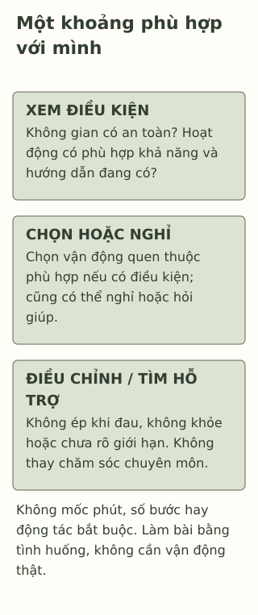

# Một khoảng vận động giữa ngày học

> **Bản nháp để duyệt · KGNT-C20 · c20-draft-r1 · 25/10/2026.**
> Chưa duyệt nội dung cuối, chưa rà soát chuyên môn độc lập, chưa có quyền xuất bản.

Hết một phần bài, Tùng muốn ra sân đi một vòng. Nhưng hôm nay trời mưa, hành lang đông và không phải ai trong nhóm cũng di chuyển theo cùng một cách. “Hay cả nhóm cứ làm một bài giống nhau?” một bạn hỏi.

Có thể bắt đầu bằng câu hỏi khác: chỗ nào an toàn, mỗi người có thể và muốn làm gì? Một khoảng vận động không cần trở thành cuộc thi số bước hoặc một động tác tất cả phải làm.

*Tùng, Huyền và mọi lựa chọn dưới đây là giả định do biên tập tạo, không bài tập phục hồi chức năng hoặc kế hoạch vận động cá nhân.*

## Vận động không chỉ là chơi một môn thể thao

Đi bộ, di chuyển bằng xe lăn theo khả năng, chơi hoặc múa đều có thể là những cách vận động. World Health Organization (WHO, 2024, mục “Overview”) dùng khái niệm **hoạt động thể chất** (*physical activity*) cho chuyển động cơ thể do cơ xương tạo ra, cần tiêu hao năng lượng. Thể thao là một phần của phạm vi ấy, không phải lựa chọn duy nhất.

Trong hướng dẫn cho tuổi 5–18, National Health Service (NHS, 2024) đề cập nhiều loại hoạt động và việc ngắt những khoảng lâu không vận động. Nguồn cũng có khuyến nghị riêng theo hoàn cảnh, gồm người trẻ sống với khuyết tật. Bài này chỉ bàn chọn một khoảng giữa ngày học, không thay toàn bộ hướng dẫn theo tuổi, không dùng số phút hoặc số bước làm chuẩn chung cho mọi học sinh.

## Có ích cho sức khỏe không có nghĩa chữa được mọi khó khăn

WHO (2024, mục “Benefits of physical activity…”) tổng hợp lợi ích ở trẻ và vị thành niên về thể chất, nhận thức và sức khỏe tâm thần. Điều đó không chứng minh đi một vòng sẽ làm một người hết lo, hết buồn hoặc học tốt ngay. Không nên lấy kết quả nhóm hay hoạt động thường xuyên để hứa hiệu quả của một khoảng vận động ngắn tự chọn.

Khi khó khăn tinh thần gây khổ sở hoặc cản trở sinh hoạt, có thể cần người lớn và đánh giá chuyên môn; National Institute of Mental Health (NIMH, 2024) mô tả việc ấy dựa nhiều thông tin. Vận động trong bài không thay đánh giá hoặc điều trị, không lý do tự dừng chăm sóc đang có. Một học sinh vẫn gặp khó khăn không phải vì chưa tập đủ hoặc thiếu cố gắng.

## Chọn theo người và nơi, không chỉ theo một hình mẫu

NHS (2024, mục “Exercising safely”) khuyến nghị hoạt động hợp tuổi, khả năng, kinh nghiệm; bắt đầu hoạt động mới từ từ và hỏi ý kiến y tế khi có tình trạng sức khỏe. Đó là căn cứ để không ép cả nhóm cùng làm bài khó hoặc vượt khả năng.

Với tình huống Tùng, một số phương án do bài đặt ra là:

- Nếu có lối đi trong nhà đủ an toàn và được phép, chọn đi một đoạn phù hợp thay vì chen ở hành lang đông.
- Nếu di chuyển ở đó không phù hợp, có thể cùng người phụ trách tìm chuyển động quen thuộc, làm được ở chỗ có không gian, theo khả năng/hướng dẫn riêng của từng người.
- Nếu đang đau, không khỏe, có hạn chế y tế hoặc chưa biết cách nào phù hợp, không cần thử cho đủ. Có thể nghỉ và hỏi người lớn/nhân viên y tế trước.

Bài không tạo một động tác thay thế dùng chung cho mọi khuyết tật, không chỉ người dùng xe lăn mới cần điều chỉnh. Khả năng di chuyển, đường đi, hỗ trợ và điều người học muốn đều cần được tính; không phải ai cũng tự thay đổi được môi trường.

*Thẻ học tập do Không Gian Nội Tâm biên soạn với hỗ trợ AI, tham khảo WHO (2024), NHS (2024); không phải chương trình thể dục đã thử nghiệm hoặc bài phục hồi chức năng.*

**Mô tả tương đương bằng chữ:** Ba vùng nhắc xem khả năng/không gian/hướng dẫn riêng, chọn một hoạt động phù hợp nếu muốn và có thể, rồi giữ đường điều chỉnh/nghỉ/hỏi hỗ trợ. Không so số bước, năng lượng tiêu hao hoặc kết quả học giữa người khác nhau; không bắt phải vận động mới được nghỉ.

## Nếu chưa thể vận động lúc ấy

Có thể để lại lựa chọn cho thời điểm khác, thay vì bù bằng bài khó hoặc tự trách mình. WHO (2024) cũng nêu cơ hội vận động phụ thuộc điều kiện xã hội, môi trường và khả năng tiếp cận, không chỉ quyết định riêng. Một nơi chưa tiếp cận được là điều người lớn/nhà trường cần cùng xem xét, không phải lỗi của học sinh.

Không cần thiết bị theo dõi, quần áo đắt tiền, sân riêng hoặc báo cáo số bước cho nhóm. Hoạt động này không đo sức khỏe, cân nặng hoặc mức “chăm” của một người.

## Thử lựa chọn cho Huyền

Huyền muốn thay đổi tư thế sau một phần bài, nhưng khu vực chờ xe chỉ cho phép ở trong phạm vi có người phụ trách. Huyền có cách di chuyển riêng và đang theo hướng dẫn vận động từ người có chuyên môn; bài chưa cho biết động tác nào được phép. Một bạn rủ chạy ra cổng cho “đủ vận động”.

Có thể bỏ qua hoặc chỉ dùng nhân vật. Không cần kể bệnh, khuyết tật, cân nặng hoặc khả năng vận động của chính mình; không phải thực hiện động tác để làm bài.

**1. Kể hai cách vận động được bài nêu.** Không phải chọn hai việc phù hợp cho tất cả mọi người.

**2. Vì sao “vận động có lợi” chưa đủ để bảo Huyền tự đổi hướng dẫn chăm sóc hoặc nói một vòng đi sẽ chữa buồn?**

**3. Dùng thẻ để chọn phương án cho Huyền:** cần kiểm điều kiện nào, có thể hỏi ai và điều chỉnh/nghỉ ra sao nếu chưa có lựa chọn phù hợp?

### Gợi ý phản hồi

**Câu 1:** Có thể nêu đi bộ, di chuyển bằng xe lăn theo khả năng, chơi hoặc múa. Có mặt trong danh sách không làm một hoạt động trở thành chỉ định cho mọi người.

**Câu 2:** Lợi ích chung không xác định điều an toàn/đủ cho cá nhân hoặc hiệu quả chữa bệnh của một lần. Huyền còn có hướng dẫn riêng; không nên tự thay bằng lời khuyên chung. Đánh giá/điều trị là việc chuyên môn, không một vòng đi hoặc thử sức của bạn bè.

**Câu 3:** Cần giữ phạm vi chờ an toàn, xem hướng dẫn riêng và hỏi người phụ trách/người lớn về lựa chọn tiếp cận được. Có thể chọn một chuyển động quen thuộc đã phù hợp với hướng dẫn nếu có đủ thông tin; nếu chưa biết, nghỉ và hỏi, không chạy ra cổng hoặc tự đoán động tác. Đáp án đạt khi hợp điều kiện, có quyền không làm và đường hỗ trợ, không phải khi đạt số phút hay thấy vui ngay.

### Đọc sâu hơn — tùy chọn

Khuyến nghị theo tuổi/nhóm đối tượng và lựa chọn giữa ngày trả lời những câu hỏi khác nhau. Hai nguồn WHO/NHS có phạm vi và cách tổ chức khuyến nghị riêng; bài không ghép con số từ các nhóm thành một lịch chung. Không có lời hứa về hormone, “giải phóng stress” hoặc hiệu quả của thẻ này. Muốn xây kế hoạch cá nhân cần thông tin thật và hướng dẫn phù hợp.

## Tài liệu tham khảo

National Health Service. (2024, October 23). *Physical activity guidelines for children and young people.* https://www.nhs.uk/live-well/exercise/physical-activity-guidelines-children-and-young-people/

National Institute of Mental Health. (2024). *Children and mental health: Is this just a stage?* (NIH Publication No. 24-MH-8085). https://www.nimh.nih.gov/health/publications/children-and-mental-health

World Health Organization. (2024, June 26). *Physical activity.* https://www.who.int/news-room/fact-sheets/detail/physical-activity

[Hồ sơ nguồn](REFERENCES.md) · [Đối chiếu nhận định](CLAIM-AUDIT.md) · [Bloom](BLOOM-REVIEW.md) · [Hình](VISUAL-REVIEW.md) · [Biên tập](EDITORIAL-REVIEW.md)
