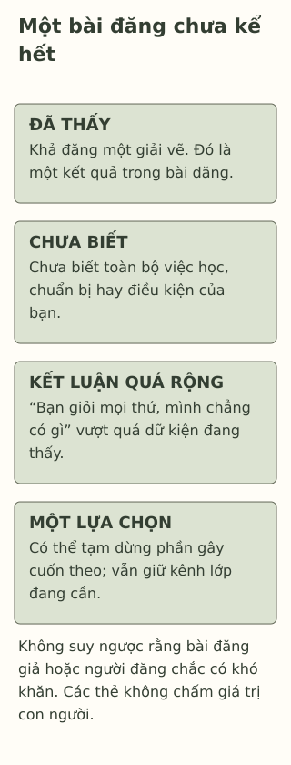

# Lướt mạng rồi thấy mình kém hơn

> **Bản nháp để duyệt · KGNT-C21 · c21-draft-r1 · 25/10/2026.**
> Chưa duyệt nội dung cuối, chưa rà soát chuyên môn độc lập, chưa có quyền xuất bản.

Linh vừa nhận một bài Toán có chỗ chưa làm được. Khi mở mạng để xem thông báo nhóm học, bạn thấy Khả đăng ảnh giấy khen cuộc thi vẽ. Linh nghĩ: “Bạn ấy làm gì cũng giỏi, còn mình chẳng có gì.”

Ảnh giấy khen cho thấy một kết quả Khả chia sẻ. Nó chưa cho biết bạn ấy làm mọi môn ra sao, mất bao lâu để chuẩn bị hoặc có điều gì chưa đăng. Linh cũng đang đặt một chỗ vướng của mình cạnh một kết quả khác môn của bạn.

*Linh, Khả, Phương và mọi bài đăng/lời nghĩ trong bài là giả định do biên tập tạo. Không dùng tài khoản, ảnh hoặc dữ liệu mạng xã hội thật.*

## Khi người khác thành thước đo cho mình

Linh không chỉ nhận ra Khả có giải; bạn đang dùng kết quả ấy để đánh giá bản thân. Ta có thể gọi đây là một ví dụ **so sánh xã hội** (*social comparison*).

Trong công trình năm 1954, Leon Festinger trình bày lý thuyết về cách con người đánh giá ý kiến và khả năng của mình qua so sánh với người khác, nhất là khi thiếu căn cứ khách quan, không mang tính xã hội (Festinger, 1954, Hypotheses I–II). Lý thuyết ấy có trước mạng xã hội; nó không chứng minh ai lướt mạng cũng thấy kém hoặc mọi lần so sánh đều có hại.

Đối chiếu với người khác đôi khi có thể cho một điều muốn tìm hiểu. Nhưng câu “mình chẳng có gì” trong tình huống đã mở rộng từ một bài Toán và một giấy khen thành phán xét bao trùm. Ta chưa có dữ kiện cho kết luận ấy, cũng không cần hạ thấp giải của Khả để nhìn lại câu nghĩ của Linh.

## Một bài đăng có khung hình, không có toàn bộ đời sống

YoungMinds (n.d., mục “Comparing yourself to others”) lưu ý người dùng có thể chọn chia sẻ những phần nổi bật; ảnh cũng có thể được dàn dựng hoặc chỉnh sửa. Điều đó không có nghĩa bài đăng nào cũng giả. Với ảnh của Khả, câu chuyện chỉ cho biết có một giấy khen được chia sẻ, không cho phép tự thêm rằng Khả đã thất bại bao nhiêu lần hoặc có hoàn cảnh dễ hơn.

| Dữ kiện trong tình huống giả định | Chưa biết từ bài đăng ấy |
|---|---|
| Khả chia sẻ một giải vẽ | Những phần học khác, quá trình chuẩn bị, điều kiện và việc chưa chia sẻ. |
| Linh nhận thấy mình đang so với bạn | Kết luận về mọi khả năng hoặc giá trị của cả hai người. |

Chỗ trống ở cột phải không cần được lấp bằng một câu chuyện tưởng tượng cho dễ chịu. Có thể giữ “chưa biết”, rồi quay lại điều Linh muốn làm với bài Toán hoặc với việc sử dụng mạng.

*Sơ đồ đối chiếu do Không Gian Nội Tâm biên soạn với hỗ trợ AI, tham khảo Festinger (1954), YoungMinds (n.d.); không phải thang tự trọng hoặc dữ liệu tác động của mạng xã hội.*

**Mô tả tương đương bằng chữ:** Vùng đầu ghi một kết quả được đăng; vùng khác giữ điều chưa biết. Phần tiếp theo nêu câu tự đánh giá vượt dữ kiện, rồi một lựa chọn tự chọn như dừng lướt/đổi nguồn xem mà giữ liên lạc cần thiết. Không khẳng định người đăng giả tạo, không dự đoán sức khỏe hoặc vẽ quan hệ nhân quả.

## Nghiên cứu không nói mọi người bị ảnh hưởng giống nhau

Tổng quan của Valkenburg et al. (2022) tổng hợp các tổng quan về mạng xã hội và sức khỏe tâm thần ở thanh thiếu niên. Phần lớn ghi nhận liên hệ yếu hoặc không nhất quán, còn cách diễn giải giữa các tổng quan khác nhau. Bằng chứng chủ yếu cắt ngang không cho phép kết luận đơn giản rằng mạng xã hội gây một khó khăn ở cá nhân; mối liên hệ cũng thay đổi theo cách dùng, cách đo và người dùng.

Vì vậy, bài không gọi cảm giác của Linh là một rối loạn hoặc lấy nó để kết luận mạng xã hội có hại với tất cả. Mạng cũng có thể là nơi liên hệ, tìm nội dung học hoặc cộng đồng; điều Linh đang cần ở lần mở này là xem thông báo học, không nhất thiết tiếp tục lướt mọi bài hiện ra.

## Chọn một thay đổi mà vẫn giữ điều cần dùng

YoungMinds (n.d., mục “Tips for having a positive time online”) gợi ý có thể nghỉ khỏi nội dung khiến mình quá tải, tắt bớt thông báo hoặc ẩn/bỏ theo dõi tài khoản không phù hợp. Đây là hướng dẫn để cân nhắc, không thử nghiệm chứng minh một thao tác chắc chắn cải thiện tâm trạng.

Với Linh, mẫu thử của bài là: **mình đang xem gì — điều nào chưa biết — một lựa chọn phù hợp lúc này**. Chẳng hạn, bạn có thể xem nốt thông báo cần cho buổi học rồi tạm dừng phần lướt, hoặc thử ẩn một nguồn nội dung không muốn gặp thường xuyên. Không cần chặn mọi bạn bè, xóa tài khoản hay bỏ kênh học cần thiết.

Nếu vẫn thấy buồn hoặc thấp hơn người khác, thao tác chưa làm điều ấy biến mất không có nghĩa Linh thất bại. Có thể tìm một người lớn đáng tin để cùng bàn, hoặc tìm người khác nếu người đầu không phù hợp. Khi có nội dung làm hại/đe dọa, việc tìm hỗ trợ an toàn quan trọng hơn hoàn thành bài tập; không cần tiếp tục xem để “luyện chịu đựng”.

## Thử một lần mở mạng khác

Phương cần vào nhóm để lấy địa điểm sinh hoạt lớp. Trước đó, bạn thấy bài đăng thành tích ngoại ngữ của một người khác và nghĩ “mình chậm hơn mọi người”. Bài không cho biết cả quá trình của người đăng. Phương vẫn cần giữ kênh báo địa điểm, chưa muốn tiếp tục xem các nội dung khác.

Có thể bỏ qua hoặc chỉ dùng nhân vật; không cần đưa tài khoản, ảnh chụp màn hình, danh sách theo dõi hoặc lời tự đánh giá riêng.

**1. Câu nghĩ nào của Linh thể hiện đang so mình với người khác?**

**2. Vì sao một giấy khen không cho biết Khả “làm gì cũng giỏi”, và một bài đăng chưa đủ để kết luận Phương chậm hơn mọi người?** Có cần giả định bài đăng là giả để phản biện không?

**3. Dùng mẫu cho Phương:** nêu điều đã thấy/chưa biết và một điều chỉnh sử dụng mạng vẫn giữ được thông tin sinh hoạt lớp. Nếu cảm giác khó chịu còn đó, có thể nhờ gì hoặc đổi cách thế nào?

### Gợi ý phản hồi

**Câu 1:** “Bạn ấy làm gì cũng giỏi, còn mình chẳng có gì” dùng một kết quả của Khả để đánh giá bao trùm bản thân. Ta nhận câu chữ trong ví dụ, không chấm con người Linh hay Khả.

**Câu 2:** Mỗi bài đăng chỉ nêu một kết quả, chưa có thông tin về mọi khả năng, bối cảnh hoặc quá trình. “Mọi người” còn rộng hơn một người được thấy. Không cần gọi bài đăng giả, chê giải hoặc tự bịa khó khăn của người đăng; dữ kiện chưa đủ đã là lý do giữ giới hạn kết luận.

**Câu 3:** Phương có thể lấy/xác nhận thông tin địa điểm rồi dừng phần lướt khác, hoặc đổi nguồn nội dung theo lựa chọn trong khi giữ nhóm cần thiết. Cách khác đạt nếu tách biết/chưa biết, có một thay đổi khả thi và không buộc mất liên lạc học tập. Nếu còn khó chịu, có thể bàn với người đáng tin hoặc thử lựa chọn khác, không chấm theo việc phải thấy tự tin ngay. Không yêu cầu người thật làm theo hoặc báo thời gian dùng máy.

### Đọc sâu hơn — tùy chọn

Festinger (1954) là nguồn lịch sử lý thuyết, không nghiên cứu người dùng nền tảng hiện nay. Valkenburg et al. (2022, mục “Methods”, “Identified gaps…”) không đồng nhất toàn bộ thời gian màn hình với mạng xã hội; tổng quan cũng có những định nghĩa/kết quả khác nhau giữa nguồn. Quan hệ giữa người với người và thay đổi trong cùng một người là hai câu hỏi khác nhau. Bài không từ kết quả trung bình chọn nguyên nhân hay mức dùng “an toàn” duy nhất cho Linh.

## Tài liệu tham khảo

Festinger, L. (1954). A theory of social comparison processes. *Human Relations, 7*(2), 117–140. https://doi.org/10.1177/001872675400700202

Valkenburg, P. M., Meier, A., & Beyens, I. (2022). Social media use and its impact on adolescent mental health: An umbrella review of the evidence. *Current Opinion in Psychology, 44*, 58–68. https://doi.org/10.1016/j.copsyc.2021.08.017

YoungMinds. (n.d.). *Social media and mental health.* https://www.youngminds.org.uk/young-person/coping-with-life/social-media-and-mental-health/

[Hồ sơ nguồn](REFERENCES.md) · [Đối chiếu nhận định](CLAIM-AUDIT.md) · [Bloom](BLOOM-REVIEW.md) · [Hình](VISUAL-REVIEW.md) · [Biên tập](EDITORIAL-REVIEW.md)
