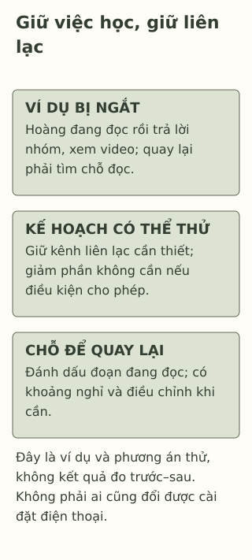

# Điện thoại cứ kéo mình ra khỏi trang vở

> **Bản nháp để duyệt · KGNT-C22 · c22-draft-r1 · 25/10/2026.**
> Chưa duyệt nội dung cuối, chưa rà soát chuyên môn độc lập, chưa có quyền xuất bản.

Hoàng đang đọc đoạn văn để tìm ý chính. Điện thoại hiện tin nhắn nhóm, bạn mở trả lời rồi xem thêm một đoạn video. Trở lại trang vở, Hoàng chưa nhớ mình đang dừng ở câu nào. Cùng lúc, bạn cũng cần giữ máy để nhận tin người nhà đến đón.

Ở đây, chiếc máy có cả việc cần và việc chưa cần lúc đọc. Bài này thử sắp xếp một khoảng học với ít lần phải đổi việc hơn, không yêu cầu bỏ mọi liên lạc hoặc kết luận Hoàng “nghiện”.

*Hoàng, Ngọc và các thông báo, nhiệm vụ dưới đây là giả định do biên tập tạo; không phải dữ liệu sử dụng máy hoặc bài kiểm tra chú ý.*

## Đang đọc rồi chuyển sang một việc khác

Trả lời tin và xem video là những việc khác với tìm ý chính. Trong câu chuyện, Hoàng lần lượt làm chúng, không chỉ nhìn cùng lúc hai cửa sổ. Khi quay lại, bạn cần tìm lại chỗ đang đọc. Đó là mô tả dữ kiện, chưa cho biết mọi lý do khiến việc đọc khó.

**Chuyển nhiệm vụ** (*task switching*) là cách gọi trong nghiên cứu khi đổi giữa các nhiệm vụ đòi cách xử lý khác nhau. Tổng quan của Monsell (2003, tr.134–135) mô tả các thí nghiệm dùng nhiệm vụ đơn giản, trong đó phản hồi ngay sau đổi việc thường chậm hơn hoặc dễ lỗi hơn. Những nghiên cứu phòng thí nghiệm, phần lớn ở người lớn, không đo chính xác việc đọc của Hoàng hoặc xác lập hậu quả cho mọi học sinh.

Bài chỉ dùng khái niệm để phân biệt đổi việc với làm tiếp cùng việc. Nó không từ đó nói điện thoại làm hỏng não, giảm trí thông minh hoặc khiến mỗi lần mở tin phải mất một số phút cố định để hồi phục.

## Một thông báo chưa kể hết nguyên nhân

Câu chuyện có thông báo và có lượt Hoàng chủ động mở video sau đó. Không nên gom mọi gián đoạn vào một nguyên nhân duy nhất, hoặc cho rằng đặt máy xa là hết mọi khó khăn: bài khó hiểu, chỗ học, mệt hoặc việc cần liên lạc vẫn có thể cần được bàn, nhưng chưa được xác định ở Hoàng.

YoungMinds (n.d., mục “Mute notifications”) gợi ý điều chỉnh thông báo để có thể chọn lúc kiểm máy. Đó là một lựa chọn thực hành, không bằng chứng rằng mọi học sinh phải tắt toàn bộ thông báo hoặc cùng dùng một chế độ.

## Một khoảng học có đường liên lạc cần thiết

Thử dùng ba ô của bài: **việc muốn làm — điều có thể ngắt quãng — điều chỉnh cùng cách liên lạc/đổi kế hoạch**.

| Ô nhìn lại | Cách thử trong ví dụ, chưa phải đáp án mọi người |
|---|---|
| Việc muốn làm | Đọc một đoạn, ghi ý chính, đánh dấu chỗ chưa hiểu. |
| Điều có thể ngắt | Tin nhóm không cần trả lời ngay, nội dung khác sau khi mở máy. |
| Điều chỉnh khả thi | Giảm thông báo không cần lúc ấy nếu máy cho phép, giữ cách nhận tin đón; ghi chỗ đang dừng để quay lại. |

Hoàng có thể cùng người nhà thống nhất cách nhận tin cần thiết nếu làm được. Không mặc định máy có mọi tùy chọn, là máy riêng, hoặc người nhà chấp nhận hẹn giờ. Nếu không tùy chỉnh được, một lựa chọn khác là mở đúng việc cần, đóng nội dung chưa cần và giữ một dấu trên trang để biết chỗ quay lại. Đây là các phương án biên tập, chưa thử nghiệm hiệu quả.

Không đặt một mốc phút tối ưu. Khoảng học có thể gắn với một phần bài vừa sức, có chỗ nghỉ, không kéo dài bất kể sức khỏe hoặc điều kiện. Khi phải ngắt để nhận tin cần thiết, quay lại cũng là một phần kế hoạch, không lỗi đạo đức.

*Sơ đồ môi trường học do Không Gian Nội Tâm biên soạn với hỗ trợ AI, tham khảo Monsell (2003) ở phạm vi khái niệm và YoungMinds (n.d.) ở gợi ý thông báo; không phải dữ liệu thử nghiệm hoặc phép đo nghiện điện thoại.*

**Mô tả tương đương bằng chữ:** Một vùng ghi việc đọc và những lượt chuyển sang tin/video. Vùng khác ghi một cách giảm ngắt không cần nhưng giữ tin đón, chỗ nghỉ và dấu quay lại bài. Phần cuối cho phép đổi cách khi máy/việc liên lạc không như dự tính. Hai vùng là kế hoạch minh họa, không kết quả “trước–sau” đã đo.

## Điện thoại cũng có thể đang giúp việc học

Nếu Hoàng dùng máy đọc tài liệu tiếp cận được, tra từ cần cho đoạn văn hoặc nhận hướng dẫn, không thể chỉ đếm lần chạm máy để biết học có bị gián đoạn không. Cần nhìn việc đang làm có phục vụ nhiệm vụ hay đang chuyển sang việc khác.

Bài không yêu cầu tắt công cụ hỗ trợ tiếp cận, cắt liên lạc an toàn hoặc giao mật khẩu/dữ liệu dùng máy cho người khác. Không có một số lần mở máy dùng để chẩn đoán, và một lượt mất tập trung chưa đủ nói Hoàng thiếu kỷ luật hay có rối loạn chú ý. Nếu việc học vẫn khó, có thể cùng giáo viên/người lớn xem yêu cầu, điều kiện và hỗ trợ khác, không chỉ tăng kiểm soát máy.

## Thử thiết kế cho Ngọc

Ngọc có tài liệu đọc trên điện thoại dùng chung, cần giữ khả năng nhận cuộc gọi của người chăm sóc. Máy không cho Ngọc tự đổi hết cài đặt. Bạn muốn đọc một đoạn để tìm hai ý, nhưng ứng dụng giải trí có thông báo hiện lên; chưa rõ có cách lấy bản tài liệu khác hay không.

Có thể bỏ qua hoặc dùng hoàn toàn nhân vật, không cần đưa màn hình, mật khẩu, số lần mở máy hoặc lịch học riêng.

**1. Nêu một tác nhân ngắt quãng và một lượt đổi việc trong chuyện Hoàng.**

**2. Vì sao “Ngọc dùng điện thoại đọc tài liệu” chưa giống “Hoàng chuyển từ đọc sang xem video”?** Có thể từ nghiên cứu phòng thí nghiệm suy một số phút hồi phục cố định cho hai bạn không?

**3. Dùng ba ô để thiết kế một khoảng đọc cho Ngọc:** việc cụ thể, điều chỉnh khả thi vẫn giữ tài liệu/cuộc gọi và cách nghỉ/quay lại hoặc hỏi hỗ trợ khi chưa làm được.

### Gợi ý phản hồi

**Câu 1:** Thông báo nhóm có thể ngắt việc đọc; mở trả lời hoặc xem video là lượt chuyển sang việc khác. Chỉ từ đó chưa xác định mọi nguyên nhân Hoàng khó đọc hoặc nhãn về con người.

**Câu 2:** Ngọc đang dùng máy làm phương tiện cho nhiệm vụ; Hoàng đã chuyển sang hoạt động khác. Cần xét mục đích, không chỉ thiết bị. Thí nghiệm của nguồn khác nhiệm vụ, độ tuổi và điều kiện; không cho thời gian hồi phục cố định hay chẩn đoán cá nhân ở đây.

**Câu 3:** Có thể chọn đọc một đoạn để ghi hai ý, mở tài liệu cần và hạn chế mở nội dung khác, đánh dấu chỗ đọc để quay lại nếu nhận cuộc gọi; dành chỗ nghỉ. Nếu không tùy chỉnh thông báo được, có thể hỏi người lớn về một phương án được phép hoặc giáo viên về tài liệu tiếp cận khác. Không yêu cầu mua máy, tắt cuộc gọi, tự sửa cài đặt máy chung hoặc bỏ hỗ trợ tiếp cận. Đáp án đạt khi giữ được mục tiêu, điều kiện và đường điều chỉnh; không phải khi không có bất kỳ lần ngắt nào hoặc điểm tăng ngay.

### Đọc sâu hơn — tùy chọn

Monsell (2003) tổng quan nhiều cách giải thích và giới hạn thí nghiệm chuyển nhiệm vụ, không phát hiện một cơ chế duy nhất hoặc một tác giả khai sinh toàn bộ lĩnh vực. Dữ liệu người lớn trong nhiệm vụ đơn giản không được dùng như con số tác động điện thoại ở THCS–THPT. Bảng của bài là kế hoạch do biên tập tạo, không phép thử trước–sau hoặc khuyến nghị phần mềm theo dõi học sinh.

## Tài liệu tham khảo

Monsell, S. (2003). Task switching. *Trends in Cognitive Sciences, 7*(3), 134–140. https://doi.org/10.1016/S1364-6613(03)00028-7

YoungMinds. (n.d.). *Social media and mental health.* https://www.youngminds.org.uk/young-person/coping-with-life/social-media-and-mental-health/

[Hồ sơ nguồn](REFERENCES.md) · [Đối chiếu nhận định](CLAIM-AUDIT.md) · [Bloom](BLOOM-REVIEW.md) · [Hình](VISUAL-REVIEW.md) · [Biên tập](EDITORIAL-REVIEW.md)
