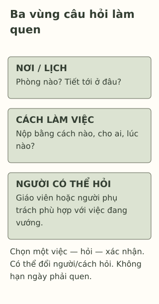

# Lớp mới, trường mới, mình bắt đầu từ đâu?

> **Bản nháp để duyệt · KGNT-C23 · c23-draft-r1 · 25/10/2026.**
> Chưa duyệt nội dung cuối, chưa rà soát chuyên môn độc lập, chưa có quyền xuất bản.

Ngày đầu ở trường mới, Trúc có thời khóa biểu nhưng chưa biết phòng thực hành ở đâu. Bạn cũng chưa rõ khi nộp bài nhóm thì gửi cho ai. Một bạn đã quen vài người từ trước bảo: “Dễ mà, cứ theo mọi người.” Trúc nhìn tờ giấy, vẫn chưa biết cần đi theo ai.

Quen một nơi mới có thể gồm nhiều việc khác nhau. Biết đường không đồng nghĩa đã quen cách nộp bài; có bạn cũ trong lớp cũng không cho biết mọi điều đều dễ. Bài này mời bạn chọn một điều cần biết trước, rồi tìm nơi hoặc người giúp xác nhận.

*Trúc, Phương, Hải và mọi chi tiết là tình huống giả định do biên tập tạo. Không phải dữ liệu về trường hoặc học sinh thật.*

## Điều gì đang mới?

Có thể chia những câu hỏi đời thường thành ba ô để dễ tìm, không phải ba giai đoạn phát triển:

| Việc cần làm quen | Ví dụ của Trúc |
|---|---|
| Nơi và lịch | Phòng thực hành ở đâu, tiết tới bắt đầu chỗ nào? |
| Cách làm việc | Nộp bài bằng cách nào, ai nhận, hạn ở đâu? |
| Người có thể hỏi | Giáo viên bộ môn, giáo viên chủ nhiệm hay người phụ trách nào phù hợp? |

YoungMinds (n.d., mục “Moving to a new school or secondary school”) đề cập những việc như tìm đường, môn học mới, quan hệ và cách học; hướng dẫn gợi ý chuẩn bị, ghi thông tin cần nhớ và hỏi hỗ trợ. Đó là hướng dẫn thực hành, không bằng chứng rằng một học sinh phải làm quen theo cùng thứ tự.

Trong tổng quan về chuyển từ tiểu học lên trung học, quan hệ với thầy cô và bạn bè là một trọng tâm trải nghiệm được ghi nhận; các tác giả đồng thời nêu nhiều giới hạn khi suy tác động của chuyển trường theo thời gian (Jindal-Snape et al., 2020, Abstract). Nghiên cứu ấy không đại diện mọi lần đổi lớp, chuyển trường ở THCS–THPT Việt Nam. Bài chỉ dùng nhận xét hẹp này, không áp một mô hình hoặc kết luận nguyên nhân cho Trúc.

## Hai bạn không có cùng điểm bắt đầu

Giả sử Phương đã học ở đây và biết cách tìm phòng, còn Trúc mới chuyển đến. Phương có thể vẫn cần hỏi cách nộp bài của một giáo viên mới. Vì vậy, câu “Phương quen nhanh hơn” chưa cho biết đang nói đến đường đi, công việc hay quan hệ nào.

Không cần đặt một hạn như “sau một tuần phải có nhóm thân”. YoungMinds (n.d.) cũng nhắc có thể dành thời gian cho tình bạn và hỏi người hỗ trợ. Nếu có một việc cụ thể đang cản trở học tập, Trúc có thể hỏi ngay, không phải chờ hết một giai đoạn thích nghi.

## Một việc, một câu hỏi, một chỗ kiểm lại

Với Trúc, việc cần trước mắt có thể là tìm phòng thực hành cho tiết tới. Bạn có thể hỏi giáo viên hoặc người phụ trách được trường chỉ dẫn, rồi đối chiếu số phòng với thời khóa biểu hiện tại. Nếu chưa có sơ đồ, chỉ dẫn trực tiếp cũng có thể là lựa chọn; không cần điện thoại hoặc tài khoản nhóm lớp mới được hỏi.

Đây là mẫu do bài tạo: **chọn một việc đang vướng — hỏi người phù hợp — xác nhận thông tin và sửa khi cần**. Nó không phải thang đánh giá thích nghi. Không cần lập kế hoạch cho mọi chuyện trong ngày đầu.

*Bản đồ câu hỏi do Không Gian Nội Tâm biên soạn với hỗ trợ AI, tham khảo hướng dẫn YoungMinds (n.d.); không phải mô hình phát triển hoặc sơ đồ một trường thật.*

**Mô tả tương đương bằng chữ:** Bản đồ có ba vùng nơi/lịch, cách làm việc và người có thể hỏi. Một dải cuối nhắc chọn một việc, hỏi và xác nhận, có thể đổi người hoặc cách tiếp cận. Không có mốc ngày, giai đoạn tâm lý hoặc tuyến đường dùng ngoài đời.

## Khi điều kiện không giống ví dụ

Không phải trường nào cũng có người đón riêng, hệ thống bạn đồng hành hoặc sơ đồ dễ đọc. Trúc có thể cùng giáo viên tìm cách xác nhận phù hợp: chỉ đường trực tiếp, ghi một lời nhắc hoặc nhờ một người được chỉ định. Nếu chỉ dẫn bằng chữ/hình chưa tiếp cận được, có thể xin cách hướng dẫn khác; khó tiếp cận thông tin không phải lỗi của học sinh.

Nếu người đầu đang bận, một cuộc hẹn ngắn hoặc người phụ trách khác có thể được bàn. Nếu người ấy không phù hợp hoặc không an toàn, không cần tiếp tục hỏi họ; có thể tìm người lớn đáng tin khác. Bài không tự xác nhận dịch vụ hoặc chức danh ở mọi trường.

## Thử với Hải

Hải vừa sang lớp mới. Bạn đã biết phòng học nhưng chưa hiểu nhóm nộp bài giấy hay qua mạng. Hải hiện không có thiết bị để vào nhóm trực tuyến; giáo viên bộ môn sẽ có mặt ở tiết tới. Câu chuyện chưa cho biết quy định nộp bài.

Bạn có thể chỉ dùng nhân vật hoặc bỏ qua hoạt động. Không cần nói trường, lớp, địa chỉ hay quan hệ riêng.

**1. Nêu hai việc mới khiến Trúc còn vướng.**

**2. Vì sao Trúc và Phương có thể cần hỗ trợ khác nhau?** Có thể chỉ từ việc biết đường mà kết luận ai thích nghi tốt hơn về mọi mặt không?

**3. Dùng mẫu ba thao tác cho Hải.** Chọn một câu hỏi, người có thể hỏi và cách xác nhận hoặc điều chỉnh nếu yêu cầu có phần trực tuyến.

### Gợi ý phản hồi

**Câu 1:** Có thể nêu chưa biết phòng thực hành và chưa rõ ai nhận/cách nộp bài nhóm. Đây là những việc cụ thể, chưa phải dấu hiệu của một vấn đề tâm lý.

**Câu 2:** Phương biết địa điểm, còn Trúc chưa có thông tin ấy; cả hai vẫn có thể cần hỏi cách làm việc. Biết một việc không cho biết mọi mặt khác hoặc đặt được hạn làm quen. Có thể diễn đạt khác nếu giữ sự khác nhau về dữ kiện, không xếp hạng giá trị hai bạn.

**Câu 3:** Hải có thể hỏi giáo viên cách nộp bài, hạn và kênh xác nhận; nói rõ chưa có thiết bị để cùng bàn phương án có thể tiếp cận. Có thể xin hướng dẫn giấy hoặc cách được giáo viên chấp nhận, không tự giả định được miễn hay bắt buộc phải mua máy. Đáp án đạt khi câu hỏi cụ thể, có người phù hợp và bước xác nhận/điều chỉnh; “cứ theo mọi người” chưa giải quyết thông tin thiếu.

### Một ghi chú cho người muốn đọc sâu

Tài liệu chuyển cấp nghiên cứu những bối cảnh có quy định, độ tuổi và nguồn lực khác nhau. Bài không lấy một kết quả trung bình để chia học sinh thành các giai đoạn hoặc hẹn ngày phải quen. Mẫu câu hỏi chỉ giúp tìm thông tin cho một việc thật sự cần làm; nó không đo sức khỏe hay chứng minh hiệu quả thích nghi. Những khó khăn cần người lớn hỗ trợ không phải chờ đến hạn nào mới được nêu.

## Tài liệu tham khảo

Jindal-Snape, D., Hannah, E. F. S., Cantali, D., Barlow, W., & MacGillivray, S. (2020). Systematic literature review of primary–secondary transitions: International research. *Review of Education, 8*(2), 526–566. https://doi.org/10.1002/rev3.3197

YoungMinds. (n.d.). *Problems at school.* https://www.youngminds.org.uk/young-person/coping-with-life/problems-at-school/
