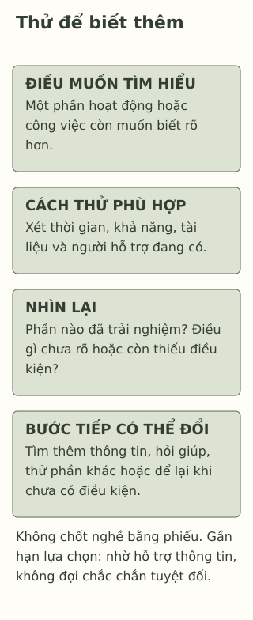

# Chưa biết mình muốn trở thành ai cũng được

> **Bản nháp để duyệt · KGNT-C24 · c24-draft-r1 · 25/10/2026.**
> Chưa duyệt nội dung cuối, chưa rà soát chuyên môn độc lập, chưa được cấp quyền xuất bản.

Cuối năm học, Vy nghe các bạn nói về nghề sau này. Vy thích sửa câu chữ cho báo lớp, cũng thích tìm vì sao một đồ vật hoạt động. Bạn chưa biết hai điều ấy có liên quan tới nghề nào. Khi được hỏi “lớn lên làm gì?”, Vy thấy mình phải đưa ngay một đáp án để dùng mãi.

Vy còn có một điều muốn giữ: việc học và làm sau này có chỗ để tiếp tục tìm hiểu điều mới. Điều đó chưa phải tên nghề, nhưng là một điều có thể đem vào cuộc trao đổi về lựa chọn.

*Vy, Lâm và toàn bộ hoạt động/lời nói trong bài là giả định do biên tập tạo; không phải hồ sơ hướng nghiệp hay dữ liệu học sinh thật.*

## Một hướng để tìm hiểu, chưa phải lời cam kết cả đời

Khám phá nghề nghiệp (*career exploration*) ở đây là tìm thêm thông tin về hoạt động, công việc và điều mình quan tâm để cân nhắc bước tiếp. OECD (2024, tr.10–11) mô tả quá trình tìm hiểu có thể diễn ra nhiều năm; một mong muốn được nói ở tuổi đi học không được mặc định sẽ cố định.

Điều ấy không có nghĩa cứ để mọi lựa chọn trôi qua. Cũng trong báo cáo này, dữ liệu theo dõi người trẻ cho thấy sự chưa rõ hướng nghề có liên hệ với một số kết quả việc làm kém thuận lợi hơn; mức độ và kết quả khác nhau giữa nghiên cứu (OECD, 2024, tr.2–3). Đó không phải lời tiên đoán về Vy, cũng không chứng minh ép bạn nói một tên nghề sẽ tạo ra thành công.

Tựa bài cho phép mình chưa có một câu trả lời cố định. Khi gần hạn chọn môn, chương trình hoặc hướng học, điều cần là cùng tìm thông tin và hỗ trợ cho quyết định đang đến, thay vì chờ chắc chắn tuyệt đối hoặc chọn đại để hết bị hỏi.

## Tách điều thích, điều coi trọng và điều chưa biết

Trong bài, **sở thích** là việc Vy muốn tìm hiểu hoặc muốn làm; **giá trị** dùng theo nghĩa đời thường là điều bạn coi trọng khi cân nhắc lựa chọn. Đây không phải hai thang đo hoặc một danh mục giá trị đã chuẩn hóa.

| Điều câu chuyện cho biết | Có thể hỏi thêm |
|---|---|
| Vy thích sửa câu chữ và tìm cách đồ vật hoạt động. | Trong mỗi việc, bạn thích phần nào? Có phần nào chưa từng được thử? |
| Vy coi trọng cơ hội tiếp tục học điều mới. | Một môi trường học/làm cụ thể có những cơ hội và yêu cầu gì? |
| Vy chưa chọn được một nghề. | Bạn đang cần quyết định gì trước mắt; còn thời hạn và thông tin nào phải kiểm? |

Thích một phần việc chưa chứng minh đã có mọi năng lực cần cho nghề. Chưa từng thử cũng chưa đủ nói “mình không hợp”. Ví dụ này giữ chỗ cho điều kiện, thông tin và cơ hội học thêm, không yêu cầu Vy tìm một “đam mê thật” duy nhất.

National Careers Service (n.d., mục “Things to consider”, “Rethinking your options”) khuyên người trẻ tìm hiểu lựa chọn, bàn với người có thể hỗ trợ và giữ phương án khác khi kế hoạch đổi. Nguồn thuộc hệ thống Anh; bài chỉ dùng hướng tìm thông tin, không áp các mốc tuổi, bằng cấp hoặc quy định ở đó cho Việt Nam.

## Một hoạt động nhỏ có câu hỏi để nhìn lại

Vy có thể thử biên tập một đoạn báo lớp đã được phép dùng, hoặc hỏi giáo viên về cách tìm hiểu một hoạt động kỹ thuật an toàn. Việc thử không cần là thực tập, chuyến đi đắt tiền hoặc thao tác với thiết bị nguy hiểm.

Phiếu của bài có bốn ý:

- **Muốn biết gì?** Chẳng hạn: mình thích chọn ý, sửa câu hay trao đổi với người viết?
- **Thử hoặc tìm hiểu bằng cách nào?** Một việc phù hợp với thời gian, khả năng, quyền sử dụng tài liệu và người hỗ trợ đang có.
- **Sau đó nhận ra gì?** Ghi một phần đã được trải nghiệm, phần chưa rõ và điều kiện ảnh hưởng.
- **Bước tiếp là gì?** Tìm thông tin khác, thử một phần khác, hỏi giúp hoặc tạm để lại khi chưa có điều kiện.

Đây là phiếu do biên tập thiết kế, không quy trình đã được thử nghiệm hiệu quả hướng nghiệp. Kết quả “mình chưa biết thêm nhiều vì không có tài liệu phù hợp” vẫn có ý nghĩa để hỏi hỗ trợ; không phải điểm kém về bản thân.

*Phiếu do Không Gian Nội Tâm tự biên soạn với hỗ trợ AI, tham khảo hướng khám phá và hỗ trợ lựa chọn của OECD (2024), National Careers Service (n.d.); không phải test định nghề.*

**Mô tả tương đương bằng chữ:** Bốn vùng ghi điều muốn biết, cách thử hoặc tìm hiểu tiếp cận được, điều nhận ra/chưa rõ và bước tiếp có thể đổi. Không chấm sở thích, không có đáp án nghề, không đòi hoàn thành mọi vùng trước khi được nhờ giúp.

## Khi cơ hội không giống nhau

Vy có thể chưa có máy riêng, tài liệu dễ đọc hoặc người quen trong nghề. Một hoạt động thay thế có thể là đọc bản mô tả do giáo viên giúp tìm, nghe thông tin bằng hình thức tiếp cận được hoặc chuẩn bị câu hỏi để nhờ người lớn cùng kiểm. Không cần tự liên hệ người lạ, cung cấp địa chỉ/số điện thoại hoặc bỏ tiền làm bài test.

Gia đình có thể có những lo lắng thực tế về kinh phí, đường đi và việc chăm sóc người thân. Có thể tách “điều muốn tìm hiểu” khỏi “điều đang hạn chế”, rồi nhờ người lớn an toàn hoặc người làm hướng nghiệp phù hợp cùng xem lựa chọn. Không phải học sinh tự giải quyết mọi rào cản hoặc thuyết phục bằng được người không an toàn. Nếu người đầu chưa giúp được, có thể tìm người khác.

## Một lựa chọn thử cho Lâm

Lâm thích sắp xếp thông tin cho nhóm và coi trọng việc có thời gian chăm sóc người thân. Sắp tới bạn phải bàn hướng học cho năm sau. Bạn chưa có máy riêng, không thể đi tham quan xa; giáo viên có thể giúp tìm tài liệu ở trường. Lâm chưa biết việc tổ chức thông tin trong các công việc thực tế diễn ra thế nào.

Có thể bỏ qua, dùng nhân vật hoặc đọc phản hồi. Không cần nêu nghề muốn làm, thu nhập, hoàn cảnh nhà hoặc kế hoạch cá nhân.

**1. Nêu một sở thích và một điều Vy coi trọng trong câu chuyện.**

**2. Vì sao thử biên tập một đoạn chưa đồng nghĩa cam kết làm một nghề?** Chưa có tên nghề có phải lý do bỏ qua hạn chọn hướng học không?

**3. Chọn một hoạt động tìm hiểu cho Lâm và một cách nhìn lại:** muốn biết điều gì, làm được bằng điều kiện nào, sẽ xem lại thông tin nào và nhờ ai nếu còn vướng?

### Gợi ý phản hồi

**Câu 1:** Sửa câu chữ hoặc tìm cách đồ vật hoạt động là sở thích được kể; cơ hội tiếp tục học điều mới là điều Vy coi trọng. Có thể dùng lời khác cùng nghĩa; không tự thêm rằng Vy muốn thu nhập hay danh tiếng cụ thể.

**Câu 2:** Một lần thử cho thêm thông tin về một phần việc trong điều kiện ấy; chưa đủ mô tả toàn bộ nghề hoặc quyết định cả đời. Vy vẫn cần hỏi thông tin, thời hạn và người hỗ trợ cho lựa chọn gần nhất. Không cần ép chắc chắn nhưng cũng không bỏ mặc quyết định đang đến.

**Câu 3:** Lâm có thể nhờ giáo viên tìm một mô tả công việc dễ tiếp cận, xem phần tổ chức thông tin và những yêu cầu thời gian được nêu, rồi ghi điều đã rõ/còn cần hỏi. Có thể chọn hoạt động khác nếu an toàn, phù hợp việc ở nhà và không cần máy riêng/chuyến đi. Đáp án đạt khi có câu hỏi, cách làm khả thi, điều nhìn lại và đường hỗ trợ; không chấm theo nghề được chọn hoặc mức chắc chắn tăng ngay.

### Đọc sâu hơn — tùy chọn

“Chưa rõ nghề” trong nghiên cứu thường được xác định từ câu trả lời khảo sát, không phải đánh giá toàn bộ bản sắc. OECD (2024) tổng hợp những liên hệ có kiểm soát một số yếu tố, không thử nghiệm phiếu này. Bài không dùng giai đoạn phát triển cố định, MBTI hay mã sở thích để quyết định tương lai của một người.

## Tài liệu tham khảo

National Careers Service. (n.d.). *Post 16 options.* https://nationalcareers.service.gov.uk/careers-advice/career-choices-at-16

OECD. (2024). *Teenage career uncertainty: Why it matters and how to reduce it?* (OECD Education Spotlights, No. 16). https://www.oecd.org/en/publications/teenage-career-uncertainty_e89c3da9-en.html

[Hồ sơ nguồn](REFERENCES.md) · [Đối chiếu nhận định](CLAIM-AUDIT.md) · [Bloom](BLOOM-REVIEW.md) · [Hình](VISUAL-REVIEW.md) · [Biên tập](EDITORIAL-REVIEW.md)
