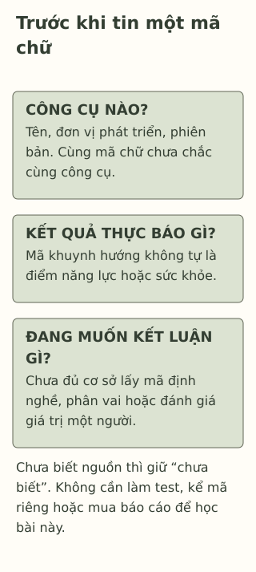

# MBTI và 16 kiểu tính cách: hiểu và đọc kết quả thế nào?

> **Bản nháp để duyệt · KGNT-E01 · e01-draft-r1 · 25/10/2026.**
> Chưa duyệt nội dung cuối, chưa rà soát chuyên môn độc lập, chưa được cấp quyền xuất bản.

Trang nhận một mã bốn chữ từ một bài trên mạng. Một bạn bảo: “Mã của cậu không hợp làm trưởng nhóm đâu.” Trang nhớ mình từng muốn thử điều phối một việc nhỏ, nhưng bắt đầu nghĩ nên thôi. Câu chuyện chưa cho biết bài nào đã được làm, phiên bản nào hoặc ai giải thích kết quả.

Trước khi lấy mã để quyết một việc, cần biết nó đến từ công cụ nào và thực sự cho phép nói đến đâu.

*Trang, Duy, mã kết quả và lời thoại trong bài là giả định do biên tập tạo. Không có bài test, hồ sơ tính cách hay kết quả của người thật.*

## MBTI là tên một công cụ cụ thể

**MBTI** viết tắt của *Myers-Briggs Type Indicator*. Theo lịch sử do The Myers-Briggs Company (n.d., mục1–2) công bố, Katharine Cook Briggs và Isabel Briggs Myers phát triển công cụ dựa trên lý thuyết kiểu tâm lý của Carl Jung; phiên bản đầu có từ 1943 và một phiên bản được ETS xuất bản năm 1962. Đây là lịch sử theo đơn vị phát triển, không phải bằng chứng công cụ phù hợp mọi mục đích.

Trong cách trình bày của MBTI, bốn cặp khuynh hướng là E–I (*Extraversion–Introversion*), S–N (*Sensing–Intuition*), T–F (*Thinking–Feeling*) và J–P (*Judging–Perceiving*). Mã chọn một chữ từ mỗi cặp, tạo 16 tổ hợp (The Myers-Briggs Company, n.d.). Có thể hiểu đây là cách công cụ mô tả khuynh hướng, không điểm trí thông minh, sức khỏe hay đạo đức.

T–F không nên được đọc thành “có suy nghĩ/không suy nghĩ” hoặc “có/không có cảm xúc”; một chữ không xóa khả năng của con người. Đơn vị phát triển cũng nêu MBTI không dùng để chẩn đoán rối loạn hoặc phân sẵn vai trò cho người làm (The Myers-Briggs Company, n.d., mục3). Điều đó đã đủ để không loại Trang khỏi một vai trong nhóm chỉ bằng mã.

## Bài “16 tính cách” chưa chắc là MBTI

16Personalities tự mô tả công cụ của mình là **NERIS Type Explorer**, dùng định dạng chữ tương tự nhưng một khung năm khía cạnh, không đưa các chức năng nhận thức Jung vào mô hình của họ (16Personalities, n.d., mục “Our Approach”). Vì vậy, kết quả từ trang này không tự trở thành kết quả MBTI chính thức; bài khác cùng dùng chữ cũng cần kiểm tên và đơn vị phát triển.

Đây là thông tin nhận diện do chính bên cung cấp công bố. Nó không tự chứng minh NERIS tương đương mọi bảng hỏi Big Five hoặc tốt hơn công cụ khác. Bài không lấy quảng cáo “chính xác”, số người làm hay cảm giác “đúng với mình” làm kiểm định độc lập.

## “Đáng tin cậy” và “được phép kết luận” là hai câu hỏi

**Độ tin cậy** (*reliability*) liên quan mức nhất quán của điểm khi lặp cách đo trong điều kiện phù hợp. **Giá trị của cách diễn giải** (*validity*) hỏi bằng chứng có hỗ trợ kết luận và mục đích sử dụng đó không. Chuẩn đo lường yêu cầu xem mục đích, đối tượng và bối cảnh cụ thể (American Educational Research Association et al., 2014, tr.23,33–35).

Vì thế, những câu hỏi trong cùng thang cùng hướng chưa chứng minh mã bốn chữ không đổi theo lần làm, càng chưa chứng minh mã chọn được nghề. Hai nghiên cứu có thể đang kiểm những điều khác nhau:

| Nguồn đã đọc | Điều nguồn xem xét | Giới hạn cần giữ |
|---|---|---|
| Erford et al. (2025), tổng hợp về **Form M** | Ghi nhận nhất quán nội tại và bằng chứng hội tụ với một số phép đo; đồng thời nêu thiếu nghiên cứu kiểm cấu trúc/đo lặp ngoài manual trong tập tài liệu họ chọn. | Chỉ phiên bản tiếng Anh/Form M và phạm vi tìm kiếm; không chứng nhận mọi bài 16 kiểu, bản Việt hóa hoặc việc phân vai học sinh. |
| Stein và Swan (2019), phân tích lý thuyết | Phê bình giả định về một “kiểu thật” chia thành các cặp rời, tính kiểm chứng và những điểm không nhất quán. | Phân tích lý thuyết, không thử nghiệm can thiệp hoặc đo tỷ lệ học sinh bị ảnh hưởng. |

Hai nguồn không trả lời hoàn toàn cùng câu hỏi. Không nên suy “có độ tin cậy nên mọi kết luận đều đúng”, cũng không đổi sang “mọi phép đo có chữ MBTI đều ngẫu nhiên”. Với Trang, chưa có cơ sở dùng mã để giới hạn vai trò; cần nhìn nhiệm vụ, điều kiện và việc bạn muốn thử.

*Sơ đồ câu hỏi do Không Gian Nội Tâm tự biên soạn với hỗ trợ AI, tham khảo American Educational Research Association et al. (2014), Erford et al. (2025); không phải bảng 16 kiểu, bài test hoặc quy trình diễn giải MBTI được chứng nhận.*

**Mô tả tương đương bằng chữ:** Ba vùng đặt tên công cụ/phiên bản, kết quả được báo và kết luận đang được đề nghị cạnh nhau. Một mã chưa đủ chứng minh năng lực, bệnh hoặc nghề phù hợp. Chưa biết tên công cụ thì giữ điều ấy là chưa biết, không đoán từ kiểu chữ hay màu trang.

## Đọc mà không nhường quyền quyết định cho một nhãn

Trang có thể hỏi nguồn kết quả và đề nghị bàn việc cụ thể: trưởng nhóm cần làm gì, bạn đã có kinh nghiệm nào, muốn học thêm gì và có ai hỗ trợ. Đây là cách trao đổi do bài tự xây, không hoạt động đã được chứng minh làm tăng tự tin.

Không cần làm lại nhiều bài để tìm mã “đúng”, đăng kết quả cho lớp hay mua báo cáo để hoàn thành bài đọc. Mỗi người có thể từ chối kể mã riêng trong hoạt động này. Nếu muốn dùng đánh giá chính thức, cần người có chuyên môn phù hợp giải thích mục đích, phiên bản, giới hạn và cách dùng thông tin; bài giáo dục này không cung cấp dịch vụ ấy.

## Thử xem lại lời kết luận về Duy

Duy có một kết quả được bạn gửi lại từ bài “16 kiểu”, nhưng không có tên công cụ hoặc phiên bản. Nhóm định loại Duy khỏi việc giới thiệu sản phẩm vì cho rằng mã ấy “không thể nói trước người khác”. Duy muốn thử cùng một bạn; chưa có dữ kiện về khả năng trình bày của bạn.

Có thể bỏ qua hoặc dùng hoàn toàn nhân vật; không cần làm test, cho điểm bạn bè hoặc kể kết quả riêng.

**1. MBTI là tên gì, và dạng kết quả phân loại thường được nói đến là gì?**

**2. Vì sao kết quả16 kiểu từ một trang khác chưa mặc định là MBTI?** Vì sao điểm nhất quán chưa đủ chứng minh mã quyết định được vai trong nhóm?

**3. Xem lại quyết định về Duy:** điều nào chưa biết, kết luận nào vượt dữ kiện và có thể bàn một lựa chọn cụ thể nào mà không gắn nhãn?

### Gợi ý phản hồi

**Câu 1:** Myers-Briggs Type Indicator; mã bốn chữ biểu thị tổ hợp của bốn cặp khuynh hướng, thường được trình bày thành 16 kiểu. Đây là nhận diện công cụ/kết quả, không yêu cầu nhớ mình thuộc kiểu nào.

**Câu 2:** Cùng định dạng chữ có thể thuộc khung/công cụ khác; cần tên và phiên bản. Độ tin cậy của điểm, sự ổn định của mã và bằng chứng dùng để phân vai là những câu hỏi khác nhau. Không tự lấy bằng chứng Form M cho NERIS hoặc bản Việt hóa chưa xác minh.

**Câu 3:** Chưa biết công cụ/phiên bản và chưa có dữ kiện trình bày; “không thể nói trước người khác” đã vượt một mã không rõ nguồn. Có thể hỏi Duy muốn tham gia phần nào, cùng chuẩn bị/giới thiệu với bạn như mong muốn nếu điều kiện cho phép, rồi xem công việc thực tế. Đạt khi chỉ ra giới hạn và mở phương án hợp lý; không cần chứng minh Duy chắc chắn làm tốt hoặc đảo thành “kiểu này phải làm trưởng nhóm”.

### Đọc sâu hơn — tùy chọn

Erford et al. (2025, Discussion/Limitations) chỉ tổng hợp Form M tiếng Anh, không mọi phiên bản; chứng cứ manual và nghiên cứu ngoài manual được phân biệt. Stein và Swan (2019) kiểm lý thuyết, không kết luận mọi công cụ nhân cách đều giống nhau. Bài không dùng giả thuyết “true type” làm sự thật về bản sắc bẩm sinh hoặc lựa chọn nghề của học sinh.

## Tài liệu tham khảo

American Educational Research Association, American Psychological Association, & National Council on Measurement in Education. (2014). *Standards for educational and psychological testing.* American Educational Research Association. https://www.testingstandards.net/uploads/7/6/6/4/76643089/standards_2014edition.pdf

Erford, B. T., Zhang, X., Sweeting, E. L., Russo, M., Rashid, A., Sherman, M. F., Bradford, E. L., Wang, X., Gao, A., Huang, X., Liu, Z., Haskew, A., MacInerney, E., Moore, E., Thompson, D., Barboza, S., Huang, X., Zhou, A., Xu, Y., . . . Yang, X. (2025). A 25-year review and psychometric synthesis of the Myers–Briggs Type Indicator (MBTI) – Form M. *Journal of Counseling & Development, 103*(4), 403–417. https://doi.org/10.1002/jcad.70006

The Myers-Briggs Company. (n.d.). *MBTI® facts.* https://www.themyersbriggs.com/en-US/Support/MBTI-Facts

16Personalities. (n.d.). *Our framework.* https://www.16personalities.com/articles/our-theory

Stein, R., & Swan, A. B. (2019). Evaluating the validity of Myers-Briggs Type Indicator theory: A teaching tool and window into intuitive psychology. *Social and Personality Psychology Compass, 13*(2), Article e12434. https://doi.org/10.1111/spc3.12434

[Hồ sơ nguồn](REFERENCES.md) · [Đối chiếu nhận định](CLAIM-AUDIT.md) · [Bloom](BLOOM-REVIEW.md) · [Hình](VISUAL-REVIEW.md) · [Biên tập](EDITORIAL-REVIEW.md)
