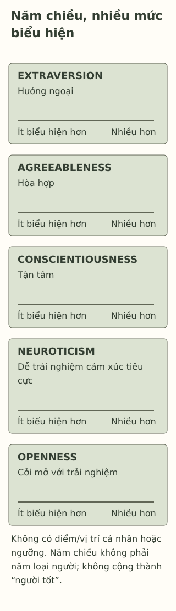

# Big Five: hiểu đặc điểm nhân cách mà không đóng khung bản thân

> **Bản nháp để duyệt · KGNT-E02 · e02-draft-r1 · 25/10/2026.**
> Chưa duyệt nội dung cuối, chưa rà soát chuyên môn độc lập, chưa được cấp quyền xuất bản.

Trong buổi làm mô hình, Ngân ít nói với nhóm mới. Đến lúc bàn phần thiết kế với bạn quen, Ngân lại trao đổi rất nhiều. Một bạn kết luận: “Vậy cậu thuộc loại hướng nội hay hướng ngoại, chỉ được chọn một chứ?”

Ta có hai quan sát ở hai hoàn cảnh. Chưa có đánh giá nhân cách của Ngân, và một mô hình mô tả đặc điểm cũng không bắt mọi người vào năm chiếc hộp.

*Ngân, Phúc và toàn bộ tình huống là giả định do biên tập tạo. Bài không đo nhân cách hoặc cung cấp điểm của người thật.*

## Năm chiều để mô tả, không phải năm loại người

**Đặc điểm nhân cách** (*trait*) nói đến những khuynh hướng trong suy nghĩ, cảm xúc và hành vi, khác với một trạng thái thoáng qua. **Big Five** gom nhiều đặc điểm cụ thể vào năm chiều rộng. Lịch sử mô hình có nhiều nhánh và nhóm nghiên cứu, không một người phát minh duy nhất: các nghiên cứu từ vựng, Tupes/Christal, Norman, Goldberg và truyền thống bảng hỏi Costa/McCrae đóng góp khác nhau (John et al., 2008, phần lịch sử).

Một cách gọi phổ biến gồm:

| Chiều / tên gốc | Giải thích ngắn trong bài |
|---|---|
| Hướng ngoại — *Extraversion* | Khuynh hướng tham gia, giao tiếp và hoạt động với thế giới xung quanh. |
| Hòa hợp — *Agreeableness* | Khuynh hướng hợp tác, quan tâm và tin cậy trong quan hệ. |
| Tận tâm — *Conscientiousness* | Khuynh hướng tổ chức, lên kế hoạch và theo đuổi việc cần làm. |
| Dễ trải nghiệm cảm xúc tiêu cực — *Neuroticism* | Khuynh hướng trải nghiệm những cảm xúc như lo, căng thẳng hoặc buồn. |
| Cởi mở với trải nghiệm — *Openness to Experience* | Khuynh hướng với ý tưởng, tưởng tượng và trải nghiệm đa dạng. |

Các giải thích giản lược từ John et al. (2008, “Preliminary Definitions”); tên Việt là cách diễn giải của bài, không bản dịch thang đo đã kiểm định. Neuroticism là tên một chiều, không chẩn đoán “tâm căn” hoặc lời gọi người yếu đuối. Hòa hợp cũng không có nghĩa phải đồng ý mọi yêu cầu.

Có thể hình dung mức biểu hiện dọc từng chiều, có nhiều vị trí ở giữa. Năm chiều cùng mô tả một người, thay vì chọn một trong năm loại. Không có “tổng điểm con người tốt”; một lần chưa làm xong bài cũng không đủ kết luận ai đó thiếu tận tâm.

*Sơ đồ khái niệm tự thiết kế bởi Không Gian Nội Tâm với hỗ trợ AI, tham khảo John et al. (2008); không phải biểu đồ kết quả, thang đo hoặc bản sao một bảng hỏi.*

**Mô tả tương đương bằng chữ:** Năm dải có cùng hình thức, lần lượt ghi Extraversion, Agreeableness, Conscientiousness, Neuroticism và Openness. Mỗi dải diễn tả có nhiều mức biểu hiện; không chấm vị trí của Ngân/người đọc, không cộng các chiều và không phân màu tốt/xấu.

## Mô hình và bảng hỏi không phải một thứ

Big Five là khung mô tả. **BFI**, **BFI-2** hoặc những bảng hỏi khác là các công cụ cụ thể, có người phát triển, câu hỏi và bằng chứng riêng. Berkeley Personality Lab (n.d.) giới thiệu BFI-2 của Christopher J. Soto và Oliver P. John; công cụ này dùng một số nhãn như *Negative Emotionality* và *Open-Mindedness*. Thấy tên gần nhau chưa có nghĩa mọi phiên bản có thể thay nhau hoặc so điểm trực tiếp.

Trang phòng nghiên cứu cũng nêu BFI-2 có bản quyền, được cho phép dùng cho nghiên cứu phi thương mại theo điều kiện; không mặc định mọi cách đăng lại, dịch hoặc đưa lên website đều được cấp quyền (Berkeley Personality Lab, n.d.). Bài này chỉ giải thích mô hình, không chép câu hỏi, tạo bản test rút gọn hay chấm cho Ngân.

## Độ tuổi và ngôn ngữ là một phần của bằng chứng

Tổng quan của Vicentini et al. (2025, Abstract/Conclusion) mô tả các bảng hỏi tự báo cáo cho trẻ và vị thành niên, cho thấy công cụ khác nhau về tuổi, ngôn ngữ và mức bằng chứng cấu trúc/nhất quán. Không phải cứ có chữ Big Five là đã phù hợp mọi học sinh.

Soto et al. (2008) nghiên cứu BFI trong mẫu Internet 10–20 tuổi ở Mỹ/Canada và ghi nhận những đặc điểm đo lường khác nhau theo tuổi. Đây là khảo sát các nhóm tuổi, không lý do đặt mốc “đủ tuổi thì biết đúng bản thân”, cũng không chứng nhận một bản tiếng Việt trên mạng. Bài không dùng kết quả ấy để tự chọn bảng hỏi cho người đọc.

## Mô tả điều đã thấy, giữ chỗ cho hoàn cảnh

Với Ngân, một câu thận trọng hơn là: “Trong nhóm mới bạn nói ít; khi bàn thiết kế với bạn quen, bạn trao đổi nhiều.” Câu này giữ được bối cảnh, không tự cho điểm hoặc chọn loại người. Nếu muốn biết bạn thích tham gia thế nào, có thể hỏi về việc cụ thể thay vì suy từ một lần im lặng.

Đặc điểm không phải lời bào chữa cho việc làm hại người khác hoặc lý do từ chối hỗ trợ. Một người có thể cần cách trình bày tài liệu, không gian hoặc thời gian khác; không cần có nhãn nhân cách mới được hỏi điều ấy.

## Thử sửa câu về Phúc

Phúc quên một phần việc trong tuần phải đổi chỗ học. Trước đó, bạn đã nộp các phần đúng hẹn. Nhóm gọi Phúc là “loại tận tâm thấp, sau này lúc nào cũng thiếu trách nhiệm”. Câu chuyện không có bảng hỏi hoặc thông tin về những mặt khác của bạn.

Có thể bỏ qua hoặc dùng nhân vật; không đánh giá bạn cùng lớp, làm test hoặc kể điểm nhân cách riêng.

**1. Gọi tên năm chiều vừa đọc.** Có thể dùng tên Việt hoặc tên gốc.

**2. Năm chiều khác năm loại người ở đâu?** Một lần Ngân ít nói hoặc Phúc quên việc cho phép kết luận điều gì, chưa cho phép điều gì?

**3. Viết lại lời nhóm về Phúc để giữ dữ kiện và giới hạn; thêm một câu hỏi về cách làm việc hoặc hỗ trợ tiếp theo.**

### Gợi ý phản hồi

**Câu 1:** Hướng ngoại, hòa hợp, tận tâm, dễ trải nghiệm cảm xúc tiêu cực và cởi mở với trải nghiệm. Chấp nhận cách dịch khác khi gắn đúng chiều gốc, không biến Neuroticism thành bệnh hoặc nhãn đạo đức.

**Câu 2:** Mỗi người có thể được mô tả trên cả năm chiều với mức khác nhau; không chọn một trong năm hộp. Những việc đã kể cho biết hành vi ở hoàn cảnh cụ thể, chưa đủ ước lượng nhân cách hoặc dự đoán “lúc nào cũng” thế.

**Câu 3:** Chẳng hạn: “Tuần đổi chỗ học, Phúc quên một phần; những phần trước đúng hẹn. Mình chưa biết việc đổi chỗ ảnh hưởng thế nào. Nhóm có thể kiểm lại phần còn thiếu và cách nhắc/điều chỉnh phù hợp không?” Đạt khi không gắn nhãn cố định, giữ điều đã biết/chưa biết và có câu hỏi công việc. Có thể nhắc trách nhiệm sửa phần thiếu mà không biến sai sót thành bản chất hoặc chẩn đoán.

### Đọc sâu hơn — tùy chọn

John et al. (2008) trình bày sự hội tụ giữa nhiều truyền thống nghiên cứu; Big Five/Five-Factor Model có lịch sử và cách giải thích khác nhau, không chỉ một bảng hỏi. Nguồn được đọc qua bản thảo chương sách của tác giả, có phân trang riêng. Các tên chiều và phần nhỏ bên trong có thể khác giữa công cụ; điều đó cần kiểm theo phiên bản, tuổi, ngôn ngữ và mục đích, không giải quyết bằng tự dịch vài câu.

## Tài liệu tham khảo

Berkeley Personality Lab. (n.d.). *Big Five Inventory (BFI-2).* https://www.ocf.berkeley.edu/~johnlab/bfi.html

John, O. P., Naumann, L. P., & Soto, C. J. (2008). Paradigm shift to the integrative Big Five trait taxonomy: History, measurement, and conceptual issues. In O. P. John, R. W. Robins, & L. A. Pervin (Eds.), *Handbook of personality: Theory and research* (3rd ed., pp. 114–158). Guilford Press. https://www.colby.edu/wp-content/uploads/2019/06/John_et_al_2008.pdf

Soto, C. J., John, O. P., Gosling, S. D., & Potter, J. (2008). The developmental psychometrics of Big Five self-reports: Acquiescence, factor structure, coherence, and differentiation from ages 10 to 20. *Journal of Personality and Social Psychology, 94*(4), 718–737. https://doi.org/10.1037/0022-3514.94.4.718

Vicentini, G., Raccanello, D., & Burro, R. (2025). Self-report questionnaires to measure Big Five personality traits in children and adolescents: A systematic review. *Scandinavian Journal of Psychology, 66*(5), 627–653. https://doi.org/10.1111/sjop.13110

[Hồ sơ nguồn](REFERENCES.md) · [Đối chiếu nhận định](CLAIM-AUDIT.md) · [Bloom](BLOOM-REVIEW.md) · [Hình](VISUAL-REVIEW.md) · [Biên tập](EDITORIAL-REVIEW.md)
