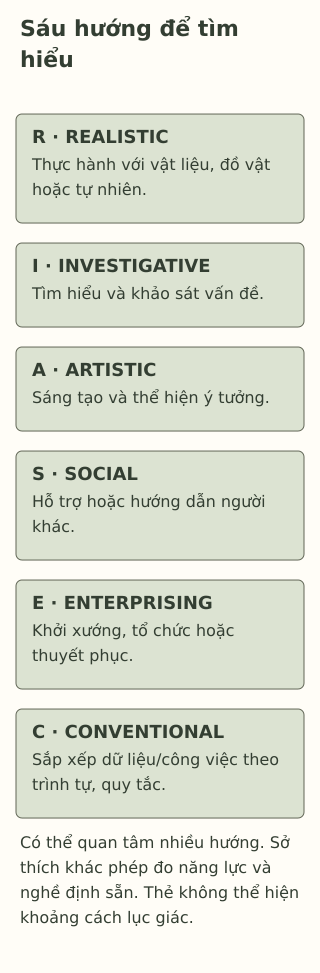

# Holland RIASEC: khám phá sở thích nghề nghiệp

> **Bản nháp để duyệt · KGNT-E03 · e03-draft-r1 · 25/10/2026.**
> Chưa duyệt nội dung cuối, chưa rà soát chuyên môn độc lập, chưa được cấp quyền xuất bản.

Hạnh thích sửa bố cục tờ giới thiệu câu lạc bộ và cùng bạn sắp xếp danh sách vật liệu. Một người bảo: “Thích thiết kế thì phải làm nghề nghệ thuật; phần còn lại không liên quan.” Hạnh chưa thử nhiều hoạt động, cũng chưa biết công việc thực tế gồm những gì.

Có một cách tổ chức các nhóm sở thích để hỏi thêm về hoạt động. Nó không đưa sẵn một nghề dành riêng cho Hạnh.

*Hạnh, Nam và các hoạt động trong bài là giả định do biên tập tạo; không phải kết quả bảng hỏi hoặc ca tư vấn nghề nghiệp.*

## Sáu nhóm là sáu hướng tìm hiểu

**RIASEC** là tên viết tắt sáu nhóm trong mô hình của John L. Holland. Cẩm nang *O\*NET Interest Profiler* tóm lược quá trình phát triển lý thuyết Holland, dẫn các công trình 1959/1997 và trình bày mô hình sở thích–môi trường công việc (Rounds et al., 2021, chương 1). Bài dùng cẩm nang này, không nhận đã đọc trực tiếp toàn văn công trình 1959 hoặc sách 1997.

Theo cách giải thích trong cẩm nang, **sở thích nghề nghiệp** (*vocational interests*) liên quan những hoạt động/môi trường/kết quả công việc một người thích hướng tới. Sáu tên có thể hiểu ngắn như sau:

| Chữ / tên gốc | Cách diễn giải để tìm hoạt động |
|---|---|
| R — *Realistic* | Thực hành với vật liệu, dụng cụ, đồ vật hoặc thế giới tự nhiên. |
| I — *Investigative* | Tìm hiểu, đặt câu hỏi và khảo sát vấn đề. |
| A — *Artistic* | Sáng tạo, thể hiện ý tưởng bằng các hình thức nghệ thuật. |
| S — *Social* | Hỗ trợ, hướng dẫn hoặc giúp người khác học. |
| E — *Enterprising* | Khởi xướng, tổ chức, dẫn dắt hoặc thuyết phục trong hoạt động. |
| C — *Conventional* | Sắp xếp dữ liệu/công việc có quy tắc, chú ý trình tự và chi tiết. |

Giản lược từ Rounds et al. (2021, tr.6–8); tên Việt là diễn giải, không bản dịch bảng hỏi chuẩn hóa. *Realistic* không có nghĩa năm nhóm kia “thiếu thực tế”; *Social* không đơn giản là thích nói chuyện; *Conventional* không phải chê người bảo thủ.

Một việc có thể chứa nhiều phần, và một người có thể quan tâm nhiều nhóm. Tờ giới thiệu của Hạnh có phần sáng tạo và phần sắp xếp; ta chưa cần gán cho bạn mã, càng không đủ dữ kiện chốt nghề.

*Sơ đồ chữ tự thiết kế bởi Không Gian Nội Tâm với hỗ trợ AI, tham khảo Rounds et al. (2021); không sao chép hình lục giác, câu hỏi hoặc báo cáo kết quả từ một công cụ.*

**Mô tả tương đương bằng chữ:** Sáu thẻ ghi đầy đủ tên gốc và nghĩa ngắn của RIASEC, không xếp bậc hoặc phân giới. Dải cuối nhắc các hướng có thể cùng có mặt, sở thích chưa là phép đo năng lực hoặc quyết định nghề. Bố cục thẻ không biểu diễn khoảng cách giữa các nhóm trong mô hình lục giác.

## Thích làm, làm được và có cơ hội làm là những điều cần tách

Hạnh thích bố cục nhưng còn cần học kỹ năng. Một bạn làm tốt việc được giao chưa chắc muốn theo công việc ấy lâu dài. Điều kiện học, sức khỏe, khả năng tiếp cận, yêu cầu đào tạo và kinh phí cũng có thể cần được bàn.

Cẩm nang nêu sự phù hợp sở thích với môi trường (*person–environment fit*) là một cân nhắc trong nhiều yếu tố, khuyến khích xem thêm giá trị và năng lực khi quyết định (Rounds et al., 2021, tr.10). Không nên đảo thành “thích là đủ” hoặc “chưa giỏi bây giờ thì không bao giờ được thử”. Đây là phân biệt để tìm thông tin, không dự báo kết quả của Hạnh.

## Mô hình Holland khác một bài trắc nghiệm cụ thể

**O\*NET Interest Profiler** là một họ công cụ của National Center for O\*NET Development phục vụ khám phá/hướng nghiệp, dựa trên RIASEC; nó không đồng nghĩa mọi bài có sáu chữ. Cẩm nang 2021 phân biệt các form và tổng hợp bằng chứng đo lường theo từng form/mẫu (Rounds et al., 2021, chương 2, 5–6). Bằng chứng ở công cụ này không tự chuyển cho bài dịch trên mạng hoặc một “test Holland” chưa rõ nguồn.

Độ tuổi cũng cần kiểm: cẩm nang lưu ý thận trọng ở khoảng 14 tuổi trở xuống vì cách đọc và hiểu hoạt động công việc, không chỉ kỹ năng bấm đáp án (Rounds et al., 2021, tr.30–31). Đây là lưu ý riêng công cụ, không mốc quyết định học sinh đã “trưởng thành” hoặc lệnh bắt phải làm test khi tới tuổi. Với THCS, việc học sáu hướng qua ví dụ không cần chấm mã.

Quyền dùng cũng theo công cụ. Trang giấy phép của National Center for O\*NET Development (n.d.) phân biệt sao chép nguyên trạng với chỉnh sửa/phát triển, có điều kiện khác nhau. Bài không đăng, dịch hay triển khai bộ câu hỏi; các câu hỏi học tập bên dưới chỉ kiểm kiến thức vừa đọc, không tạo hồ sơ RIASEC cá nhân.

## Một cách thử không cần có mã trước

Hạnh có thể chọn một phần nhỏ muốn tìm hiểu: làm bản nháp bố cục bằng vật liệu sẵn có, hoặc hỏi người phụ trách cách quản lý danh sách. Sau đó nhìn lại phần thích/chưa rõ, kỹ năng muốn học và điều kiện cần hỗ trợ. Đây là hoạt động biên tập, không bài định nghề có hiệu quả đã được kiểm nghiệm.

Không cần bỏ tiền, tự vào nơi làm việc nguy hiểm hoặc liên hệ người lạ. Có thể tìm tài liệu dễ tiếp cận/nhờ giáo viên giúp, hoặc dùng hoàn toàn câu chuyện giả định. Chưa có cơ hội thử không là bằng chứng thiếu năng lực; không cần đưa kết quả riêng cho nhóm hoặc chấp nhận bị phân vai theo giới/khuyết tật/mã sở thích.

## Chọn bước tìm hiểu cho Nam

Nam muốn hiểu cách tìm ra vì sao cây trong góc lớp phát triển khác nhau, cũng thích hướng dẫn bạn ghi lại điều đã quan sát. Bạn chỉ có vật liệu của lớp, không được tự dùng hóa chất hay đi ra ngoài trường. Chưa có bảng hỏi hoặc thông tin về năng lực nghề của Nam.

Có thể bỏ qua; không cần kể sở thích thật, chọn nghề, làm thí nghiệm hoặc thu dữ liệu của bạn bè.

**1. Gọi tên sáu nhóm RIASEC.** Có thể ghép chữ với tên gốc hoặc nghĩa đã giải thích.

**2. Vì sao việc Hạnh thích bố cục không đủ để định sẵn nghề hoặc kết luận năng lực?** Mô hình RIASEC và một bảng hỏi mang tên Holland khác nhau thế nào?

**3. Chọn một hoạt động tìm hiểu cho Nam từ điều đã kể:** liên hệ hướng sở thích nào, làm được an toàn bằng điều kiện gì, sẽ nhìn lại/hỏi thêm điều nào?

### Gợi ý phản hồi

**Câu 1:** Realistic, Investigative, Artistic, Social, Enterprising, Conventional; chấp nhận diễn giải Việt phù hợp bảng, không dùng tên nhóm làm lời khen/chê.

**Câu 2:** Sở thích là điều muốn tìm hiểu/làm, chưa đánh giá mọi kỹ năng, yêu cầu đào tạo hay điều kiện. RIASEC là khung; bảng hỏi là cách đo cụ thể, cần kiểm tác giả/phiên bản, tuổi, ngôn ngữ, bằng chứng và quyền. Không phải mọi bài sáu nhóm đều đã được kiểm như O\*NET Interest Profiler.

**Câu 3:** Có thể chọn cùng giáo viên xem một tài liệu về quan sát cây để tìm hiểu hướng I, hoặc tìm cách hướng dẫn bạn ghi thông tin để khám phá hướng S. Phương án kết hợp cũng được nếu có lý do; không bắt chọn duy nhất một chữ. Cần giữ điều kiện lớp/an toàn, nêu phần muốn biết và điều sẽ hỏi/nhìn lại. Không tự dùng hóa chất, không chấm Nam thành nhà nghiên cứu/giáo viên định sẵn hoặc yêu cầu hoạt động thật để đạt.

### Đọc sâu hơn — tùy chọn

Cẩm nang trình bày sáu nhóm theo cấu trúc lục giác; hình trong bài chỉ giúp nhớ tên, không biểu diễn độ gần giữa nhóm. Bằng chứng cấu trúc và tương quan với công cụ khác có ích cho đánh giá phép đo, chưa là bảo đảm nghề phù hợp với từng người. Các mẫu kiểm có cả người lớn ở Mỹ; bài không xác nhận bản Việt hóa/chuẩn THCS–THPT hoặc chuyển các con số đó thành hiệu lực ở Việt Nam.

## Tài liệu tham khảo

National Center for O\*NET Development. (n.d.). *O\*NET® Career Exploration Tools content license.* https://www.onetcenter.org/license_tools.html

Rounds, J., Hoff, K. A., & Lewis, P. (Eds.). (2021). *O\*NET® Interest Profiler manual* (Version 1.0). National Center for O\*NET Development. https://www.onetcenter.org/dl_files/IP_Manual.pdf

[Hồ sơ nguồn](REFERENCES.md) · [Đối chiếu nhận định](CLAIM-AUDIT.md) · [Bloom](BLOOM-REVIEW.md) · [Hình](VISUAL-REVIEW.md) · [Biên tập](EDITORIAL-REVIEW.md)
