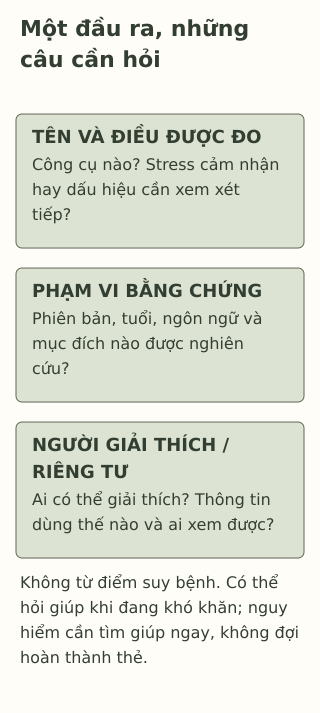

# Stress và công cụ sàng lọc: một con số nói được gì?

> **Bản nháp để duyệt · KGNT-E04 · e04-draft-r1 · 25/10/2026.**
> Chưa duyệt nội dung cuối, chưa rà soát chuyên môn độc lập, chưa được cấp quyền xuất bản.

Một trang trả cho Thư dòng “căng thẳng cao” sau vài câu hỏi, rồi bảo bạn chắc có một rối loạn. Không thấy tên công cụ, phiên bản, khoảng thời gian được hỏi hoặc người chịu trách nhiệm giải thích. Thư vừa thi, nhưng câu chuyện chưa cho biết sức khỏe và sinh hoạt của bạn ra sao.

Một đầu ra có vẻ cụ thể chưa tự cho biết đã đo điều gì. Điều cần trước hết là xem tên, mục đích và giới hạn, thay vì tìm một ngưỡng trên mạng để tự kết luận.

*Thư, Khang và đầu ra giả định do biên tập tạo; không phải điểm thật, kết quả PSS hoặc mẫu sàng lọc. Bài không có câu hỏi thang đo, cách cộng điểm hay ngưỡng.*

## “Stress” và “có một rối loạn” chưa phải cùng câu

World Health Organization (WHO, 2026, mục “What is stress?”) mô tả stress là trạng thái lo hoặc căng thẳng tinh thần trước tình huống khó. Cách đáp ứng khác nhau giữa người; một lời tự nói “mình đang stress” không đủ để gọi tên bệnh.

Có nhiều loại thông tin trông giống “test tâm lý”, nhưng mục đích khác nhau:

| Loại đang gặp | Câu hỏi nó có thể giúp đặt ra | Điều chưa được mặc định |
|---|---|---|
| Hoạt động khám phá bản thân | Mình muốn tìm hiểu điều gì? | Đã là phép đo được kiểm định hoặc sàng lọc bệnh. |
| Bảng hỏi nghiên cứu/đo một khái niệm | Công cụ đo khái niệm nào, với người và bối cảnh nào? | Mọi bảng hỏi đều dùng để chẩn đoán. |
| Thang sàng lọc phù hợp mục đích | Có dấu hiệu cần được người chuyên môn xem xét tiếp không? | Một kết quả đã xác nhận hoặc loại trừ bệnh. |
| Đánh giá chuyên môn | Cần phối hợp những thông tin nào về cá nhân để hiểu khó khăn và chăm sóc? | Chỉ một con số là toàn bộ đánh giá. |

Đây là bảng phân biệt sư phạm, không bốn hộp tách rời tuyệt đối: một bảng hỏi có thể được dùng trong nghiên cứu hoặc thực hành nếu có căn cứ phù hợp. MedlinePlus của National Library of Medicine (2026, mục “What is it used for?”, “What do the results mean?”) trình bày sàng lọc như bước đầu; kết quả có thể cần đánh giá thêm để xác định vấn đề. Không phải mọi bảng hỏi stress đều là sàng lọc rối loạn.

## Một ví dụ cụ thể: PSS đo stress được cảm nhận

**Perceived Stress Scale (PSS)** thường được gọi là thang stress cảm nhận. Trang The Common Cold Project (n.d., “Primary References”, “Purpose”, “Description”) giới thiệu nguồn gốc ở Cohen, Kamarck và Mermelstein 1983 và mô tả việc hỏi cảm nhận cuộc sống khó đoán, khó kiểm soát hoặc quá tải trong một khoảng thời gian. Bài dùng phần giới thiệu của dự án, không nhận đã đọc nội dung bản scan công trình1983.

Trang phòng nghiên cứu của Cohen nêu PSS **không phải công cụ chẩn đoán và không có ngưỡng cắt** để phân loại như một bệnh (Laboratory for the Study of Stress, Immunity, and Disease, n.d.). Vì vậy, không lấy PSS làm cớ gắn “có bệnh/không bệnh” hoặc tự thêm bảng thấp–vừa–cao. Có nhiều phiên bản; chứng cứ và mục đích phải đi với bản cụ thể.

Điều này không có nghĩa mọi thang khác đều không có ngưỡng. Với một thang sàng lọc khác, ngưỡng nếu có cũng phải đúng phiên bản, mục đích và đối tượng; kết quả vẫn cần được giải thích trong bối cảnh. Chuẩn đo lường nhấn mạnh bằng chứng cho **cách diễn giải và sử dụng cụ thể**, không một dấu bảo đảm dùng được ở mọi nơi (American Educational Research Association et al., 2014, Standard 1.0–1.1).

## Có bản tiếng Việt chưa đủ để dùng cho mọi độ tuổi

Dao-Tran et al. (2017, mục “Participants”, “Conclusion”) nghiên cứu một bản PSS-10 tiếng Việt ở phụ nữ từ 60 tuổi tại Việt Nam. Nghiên cứu có giá trị cho câu hỏi và nhóm được khảo sát, nhưng tự nó không xác nhận cách dùng cho học sinh THCS–THPT. “Tiếng Việt” không làm tuổi, bối cảnh và cách thu thông tin trở nên giống nhau.

Bài không kết luận không có nghiên cứu nào khác ở người trẻ. Ở đây chưa chọn hoặc xác minh một bản Việt hóa để triển khai cho học sinh; không lấy một hệ số độ tin cậy trong nhóm khác làm giấy phép chấm điểm cho Thư.

Quyền dùng cũng cần kiểm riêng. Trang phòng nghiên cứu hướng người muốn dùng PSS tới quy trình yêu cầu quyền, và nêu quyền bản dịch cần liên hệ người dịch (Laboratory for the Study of Stress, Immunity, and Disease, n.d.). Không sao bộ câu hỏi từ một bài báo hoặc website chỉ vì đọc miễn phí; bài học không yêu cầu người đọc tự xin quyền/làm test.

*Sơ đồ câu hỏi do Không Gian Nội Tâm tự biên soạn với hỗ trợ AI, tham khảo American Educational Research Association et al. (2014), National Library of Medicine (2026); không phải thang đo, quy trình sàng lọc hoặc phân loại nguy cơ.*

**Mô tả tương đương bằng chữ:** Ba vùng gợi hỏi tên công cụ/điều đo; phiên bản, người được nghiên cứu và mục đích; người có thể giải thích và cách dùng thông tin. Không đi từ điểm sang tên bệnh. Có thể nhờ giúp ngay khi gặp khó khăn, không cần tìm đủ mọi câu trả lời hoặc chờ điểm.

## Hỏi để hiểu, không thu thêm dữ liệu của mình để tự chứng minh

Với đầu ra của Thư, những câu hỏi có thể là: “Đây là công cụ nào? Đo stress cảm nhận hay sàng lọc vấn đề khác? Bản này được nghiên cứu cho ai? Ai có thể giải thích kết quả và bước tiếp phù hợp?” Không biết trả lời là lý do giữ giới hạn kết luận, không dấu hiệu Thư thiếu hiểu biết.

Nếu một hoạt động yêu cầu nhập thông tin, có thể hỏi ai xem được, thông tin dùng/lưu thế nào và quyền của mình trong quy trình. Không cần đưa tên trường, sức khỏe, kết quả hoặc ảnh màn hình cho nhóm lớp để làm bài này. Bài không hứa mọi trang web bảo mật hoặc mọi nơi giữ kín tuyệt đối.

Nếu khó khăn gây khổ sở hoặc ảnh hưởng việc học/sinh hoạt, có thể tìm người lớn an toàn hoặc người có chuyên môn dù chưa có điểm. WHO (2026, mục “I am feeling stressed…”) khuyên tìm người đáng tin hoặc nhân viên y tế khi khó đối phó. Nếu người đầu không phù hợp/an toàn, có thể tìm người khác. Khi có nguy hiểm tức thời hoặc nguy cơ làm hại bản thân/người khác, tìm người lớn an toàn và trợ giúp khẩn cấp phù hợp ngay; không chờ làm bảng hỏi (National Library of Medicine, 2026). Không dùng số liên hệ nước ngoài hoặc tự xử lý nguy cơ theo sơ đồ này.

## Những câu hỏi cho tình huống Khang

Khang được gửi một đầu ra “stress thấp”, không có tên hay phiên bản bảng hỏi. Bạn vẫn nói gần đây khó theo bài và muốn có người cùng trao đổi. Một bạn bảo “điểm thấp thì không được hỏi giúp”. Chưa có thông tin để xác định tình trạng sức khỏe của Khang.

Có thể bỏ qua hoặc dùng nhân vật; không cần tự sàng lọc, chấm mức stress, công khai kết quả hoặc kể triệu chứng riêng.

**1. Nhận diện loại thông tin:** PSS trong phần trên đo khái niệm gì? Sàng lọc và đánh giá chuyên môn là cùng một việc không?

**2. Vì sao không dùng một nhãn “stress thấp” để kết luận chắc Khang không có khó khăn?** Bản PSS-10 được nghiên cứu ở phụ nữ lớn tuổi có tự xác nhận cách dùng ở học sinh không?

**3. Chọn những câu cần hỏi về đầu ra của Khang và một cách tìm hỗ trợ phù hợp.** Không cần xác định điểm hoặc bệnh.

### Gợi ý phản hồi

**Câu 1:** PSS đo stress được cảm nhận, không được giới thiệu như công cụ chẩn đoán. Sàng lọc có thể gợi việc xem xét tiếp; đánh giá chuyên môn phối hợp thêm thông tin, không chỉ đổi tên một điểm.

**Câu 2:** Không rõ công cụ/phiên bản/mục đích và không biết nhãn có căn cứ nào; điểm cũng không thay điều Khang kể hoặc đánh giá cá nhân. Nghiên cứu một nhóm lớn tuổi không tự mở rộng sang học sinh. Không đảo thành kết luận Khang chắc có bệnh, hoặc mọi bảng hỏi đều vô ích.

**Câu 3:** Có thể hỏi tên/phiên bản, đo điều gì, dùng cho tuổi/ngôn ngữ/mục đích nào và ai giải thích; nếu còn thiếu thì giữ “chưa đủ cơ sở”. Khang vẫn có thể xin nói riêng với một người lớn an toàn về việc khó theo bài và nhờ tìm hỗ trợ; chọn người khác nếu cần. Đạt khi hỏi đúng giới hạn, bảo vệ riêng tư và không đặt việc hỏi giúp phụ thuộc điểm. Không buộc học sinh tự kiểm chứng công cụ, khám cho bạn hoặc hoàn thành đủ các ô mới được giúp.

### Đọc sâu hơn — tùy chọn

Độ tin cậy, giá trị cách diễn giải, bản dịch, quyền dùng và quyết định chuyên môn là những việc liên quan nhưng không thay nhau. Bài chỉ chọn PSS làm ví dụ về **đo stress khác chẩn đoán**; không đánh đồng PSS, các thang sàng lọc rối loạn và mọi “test stress” trên mạng. Không có ngưỡng, biểu mẫu hoặc cách chấm nào được triển khai ở đây.

## Tài liệu tham khảo

American Educational Research Association, American Psychological Association, & National Council on Measurement in Education. (2014). *Standards for educational and psychological testing.* American Educational Research Association. https://www.testingstandards.net/uploads/7/6/6/4/76643089/standards_2014edition.pdf

The Common Cold Project. (n.d.). *Perceived stress.* Carnegie Mellon University. https://www.cmu.edu/common-cold-project/measures-by-study/psychological-and-social-constructs/stress-measures/perceived-stress.html

Dao-Tran, T.-H., Anderson, D., & Seib, C. (2017). The Vietnamese version of the Perceived Stress Scale (PSS-10): Translation equivalence and psychometric properties among older women. *BMC Psychiatry, 17*, Article 53. https://doi.org/10.1186/s12888-017-1221-6

Laboratory for the Study of Stress, Immunity, and Disease. (n.d.). *Dr. Cohen’s scales.* Carnegie Mellon University. https://www.cmu.edu/dietrich/psychology/stress-immunity-disease-lab/scales/

National Library of Medicine. (2026, July 20). *Mental health screening.* MedlinePlus. https://medlineplus.gov/lab-tests/mental-health-screening/

World Health Organization. (2026, March 30). *Stress.* https://www.who.int/news-room/questions-and-answers/item/stress

[Hồ sơ nguồn](REFERENCES.md) · [Đối chiếu nhận định](CLAIM-AUDIT.md) · [Bloom](BLOOM-REVIEW.md) · [Hình](VISUAL-REVIEW.md) · [Biên tập](EDITORIAL-REVIEW.md)
