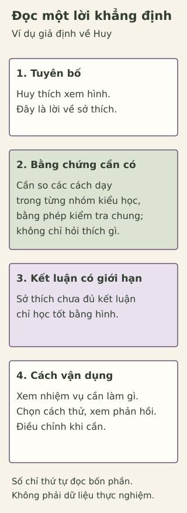

# Phong cách học tập: phân biệt sở thích với bằng chứng khoa học

> **Bản nháp để duyệt · KGNT-E05 · e05-draft-r2 · 25/10/2026.**
> Chưa được duyệt biên tập hoặc rà soát chuyên môn; chưa có quyền xuất bản.

Huy thích những trang vở có hình và sơ đồ. Bạn nghĩ: “Mình là người học bằng hình ảnh, chắc chỉ học tốt khi được xem hình.” Tuần này, Huy vừa cần luyện phát âm một đoạn tiếng Anh, vừa phải đọc một bản đồ để tìm đường giữa hai địa điểm.

Ở cả hai việc, Huy vẫn có thể dùng hình. Nhưng chỉ nhìn một trang vở đẹp đã cho biết bạn phát âm ra sao, hoặc có đọc đúng ký hiệu bản đồ chưa?

*Huy và các tình huống trong bài đều do biên tập đặt ra, không phải dữ liệu học sinh thật.*

Bài viết giúp bạn đọc kỹ một lời khẳng định về cách học, xem nó cần bằng chứng gì, rồi thử lựa chọn cho hai nhiệm vụ của Huy. Không cần làm bài test hay khai sở thích riêng.

## Khi một sở thích trở thành một nhãn

Bạn có thể gặp cách chia người học thành ba nhóm: thích học qua **nhìn** (*visual*), **nghe** (*auditory*), hoặc **vận động, thao tác** (*kinesthetic*). Ba chữ đầu tạo thành tên **VAK**. Quan niệm này thường đi cùng ý tưởng rằng mỗi người sẽ học tốt hơn nếu được dạy theo phương thức phù hợp với kiểu của mình (Aslaksen & Lorås, 2018, mục “Introduction”). Đây là quan niệm bài đang xem xét, không phải cách bài phân loại bạn.

“Mình thích xem hình” kể một sở thích. “Mình làm đúng được việc gì sau khi học?” lại cần xem kết quả thực hiện nhiệm vụ. Sở thích và khả năng không phải một điều: chỉ hỏi thích cách nào chưa đủ biết cách nào giúp học tốt hơn (Pashler và cộng sự, 2008, tr. 108–111).

Vì vậy, câu của Huy có hai phần cần tách: **thích hình** và **chỉ học tốt bằng hình**. Phần thứ hai mạnh hơn nhiều, không tự suy ra từ phần thứ nhất. Cũng không cần vì thế mà bắt Huy bỏ những sơ đồ bạn yêu thích.

## Ghép cách dạy theo “kiểu học” là một giả thuyết

Giả sử có hai nhóm: nhóm A nói thích xem hình, nhóm B nói thích nghe. Có người đề nghị dạy bằng hình cho A và bằng âm thanh cho B, vì cho rằng ghép như vậy sẽ giúp mỗi nhóm học tốt hơn. Đây là ví dụ giả định, chưa xác nhận hai nhóm là những kiểu học cố định.

Muốn xem đề nghị ấy có đúng không, cần kiểm tra **cả hai cách dạy trong mỗi nhóm** rồi so kết quả học. Theo dự đoán đang xét, nhóm thích hình cần có lợi thế khi học bằng hình so với nghe; nhóm thích nghe cần có lợi thế ngược lại. Nếu một cách dạy tốt hơn cho cả hai nhóm, kết quả đó chưa cho thấy cần ghép riêng theo sở thích (Pashler và cộng sự, 2008, tr. 109–110).

Ý tưởng “ghép cách dạy phù hợp kiểu sẽ giúp học tốt hơn” được gọi là **giả thuyết ghép**, hay *matching/meshing hypothesis* (Pashler và cộng sự, 2008, tr. 108–109). Thích một cách học là điều cần phân biệt với việc đã học tốt hơn nhờ được ghép cách dạy. Phần “Tìm hiểu sâu hơn” trình bày các yêu cầu thiết kế nghiên cứu; bạn không cần làm một bài test kiểu học để đọc tiếp.

## Các tổng quan đã thấy gì?

Tổng quan năm 2008 kết luận bằng chứng khi ấy chưa đủ để áp dụng rộng rãi việc đánh giá kiểu học rồi ghép cách dạy ở trường (Pashler và cộng sự, 2008, tr. 116). Kết luận đó cần được đọc cùng những nghiên cứu sau, thay vì coi là câu trả lời cuối cùng cho mọi cách điều chỉnh dạy học.

| Nguồn | Kết quả trong phạm vi đã xem xét | Điều cần giữ lại khi đọc |
|---|---|---|
| Aslaksen & Lorås (2018) | Không tìm thấy hỗ trợ thống kê có thể lặp lại cho lợi ích ghép theo phương thức trong bộ nghiên cứu được chọn. | Tập nghiên cứu nhỏ, tập trung chủ yếu nhìn/nghe; không kết luận mọi hỗ trợ cá nhân đều vô ích. |
| Clinton-Lisell & Litzinger (2024) | Phân tích gộp ghi nhận lợi ích trung bình nhỏ, dương của việc ghép. Tuy vậy, đa số phép đo kết quả không có mẫu lợi thế khác nhau giữa các kiểu như giả thuyết đòi hỏi. | Chất lượng nghiên cứu và mức khác biệt giữa kết quả còn hạn chế; chưa đủ căn cứ khuyến nghị áp dụng rộng rãi. |

Nguồn: Aslaksen & Lorås (2018), các mục “Scope”, “Tailoring Instruction” và “Concluding Remarks”; Clinton-Lisell & Litzinger (2024), “Results”, “Crossover interactions”, “Limitations and future directions”, “Conclusion”.

Hai tổng quan không dùng cùng một tập nghiên cứu và cách tổng hợp. Tiêu chí chọn nghiên cứu, cách đo kết quả và phương pháp tổng hợp có thể ảnh hưởng kết quả; đó là những lý do phương pháp luận có thể góp phần làm kết luận khác nhau, **chưa phải nguyên nhân cụ thể đã được chứng minh cho chênh lệch giữa hai tổng quan này** (Aslaksen & Lorås, 2018, mục “Scope”; Clinton-Lisell & Litzinger, 2024, các mục “Potential moderators”, “Inclusion criteria”).

Lợi ích trung bình nhỏ, dương chưa đủ để khuyến nghị ghép kiểu rộng rãi: còn cần xem chất lượng, mức nhất quán và bằng chứng lợi thế khác nhau giữa các nhóm. Nguồn 2024 cũng lưu ý các nghiên cứu chỉ diễn ra trong một phiên học, nên chưa xác định được hiệu quả dài hạn (Clinton-Lisell & Litzinger, 2024, các mục “Limitations and future directions”, “Conclusion”). Không nên bỏ kết quả dương, nhưng cũng không từ đó hứa ghép đúng kiểu chắc chắn có ích cho Huy hoặc mọi học sinh Việt Nam.

## Chọn theo việc cần làm

Một cách dạy có thể phù hợp với nội dung này hơn nội dung khác mà không cần chia học sinh thành kiểu cố định. Pashler và cộng sự (2008, tr. 116, “Points of Clarification”) phân biệt lựa chọn theo môn/nội dung với việc ghép theo nhãn người học.

Với Huy, ta có thể bắt đầu từ câu hỏi: **Sau khi học, bạn ấy cần làm được gì?**

- Nếu cần phát âm, một phương án thử là nghe mẫu có thể tiếp cận, luyện nói và nhờ giáo viên phản hồi về chỗ cần sửa. Hình mô tả khẩu hình có thể đi kèm, nhưng việc thích hình chưa trả lời được Huy đã phát âm ra sao.
- Nếu cần đọc bản đồ, một phương án thử là xem chú giải, lần theo tuyến đường rồi giải thích vì sao chọn đường ấy. Phản hồi có thể chỉ ra Huy đọc nhầm ký hiệu hay bỏ sót một đoạn.

Đây là **ví dụ biên tập về yêu cầu nhiệm vụ**, không phải thí nghiệm chứng minh một phương pháp luôn tốt nhất. Nghe không phải lựa chọn duy nhất cho phát âm, cũng như hình ảnh không phải lựa chọn duy nhất để học đọc bản đồ. Có thể phối hợp hoặc điều chỉnh cách học theo điều kiện tiếp cận và hướng dẫn thực tế của giáo viên.

**Một phản ví dụ:** Huy quyết định không nghe hoặc luyện nói trong bài phát âm chỉ vì nhãn “người học bằng hình”. Lựa chọn ấy chưa xem xét yêu cầu cần thực hiện. Có thể sửa bằng cách giữ hình làm hỗ trợ và tìm thêm cách luyện/nhận phản hồi phù hợp, thay vì dùng nhãn để loại bỏ lựa chọn.

Khi cần ôn kiến thức, Huy cũng có thể thử tự trả lời trước khi xem đáp án, rồi đối chiếu chỗ sai; hoặc quay lại cùng nội dung ở các buổi khác nhau. Tự kiểm tra và ôn cách quãng được đánh giá hữu ích cao trong tổng quan của Dunlosky và cộng sự (2013, mục 8–9, Bảng 4). Chúng không bảo đảm điểm cao; chọn cách triển khai vẫn cần xét nhiệm vụ và phản hồi.

## Hỗ trợ tiếp cận là một câu hỏi khác

Xem xét bằng chứng về ghép kiểu học không có nghĩa mọi người phải nhận cùng một dạng tài liệu. Chẳng hạn, học sinh có khuyết tật giác quan có thể cần hình thức tiếp cận nội dung phù hợp; nguồn 2024 cũng phân biệt lợi ích tiếp cận này khi bàn về nhiều phương thức trình bày (Clinton-Lisell & Litzinger, 2024, mục “Implications”). Không dùng lập luận về VAK để từ chối hỗ trợ cần thiết hoặc ép người học vào phương thức không thể tiếp cận.

Các ví dụ của Huy không phải yêu cầu cho mọi học sinh. Nếu phương án nghe, nhìn hoặc thao tác không phù hợp, có thể cùng giáo viên tìm cách tiếp cận đáp ứng mục tiêu học. Bài không đánh giá nhu cầu cá nhân hay thay hướng dẫn hỗ trợ chuyên môn.

*Infographic sư phạm tự biên soạn; tham khảo Pashler và cộng sự (2008), Aslaksen & Lorås (2018), Clinton-Lisell & Litzinger (2024). Không phải dữ liệu thực nghiệm, biểu đồ hiệu quả hoặc bài test kiểu học.*

**Mô tả tương đương bằng chữ:** Bốn khối lần lượt là tuyên bố “Huy thích xem hình”; yêu cầu so kết quả học của các cách dạy trong mỗi nhóm thay vì chỉ hỏi sở thích; kết luận giới hạn rằng sở thích chưa đủ; chọn cách thử theo nhiệm vụ và phản hồi. Muốn ủng hộ matching, lợi thế cần thay đổi giữa các nhóm theo dự đoán: nhóm thích hình có lợi hơn với hình so với nghe, nhóm thích nghe có lợi thế ngược lại. Nếu một cách tốt hơn cho tất cả thì chưa đủ. Chi tiết thiết kế, phép kiểm chung và tương tác chéo ở phần đọc sâu. Số trong hình chỉ thứ tự đọc, không dữ liệu hoặc nhân quả; hình không phân loại Huy.

## Thử với hai nhiệm vụ của Huy

Bạn có thể bỏ qua hoạt động hoặc chỉ dùng tình huống giả định. Không cần làm test VAK, kể sở thích riêng hay phân loại năng lực của mình.

Dùng mẫu: **xác định việc cần làm → chọn một cách thử → xem phản hồi → điều chỉnh**. Với mỗi nhiệm vụ, bạn điền điều Huy cần làm được, cách có thể thử trong điều kiện thực tế, rồi cách nhận phản hồi và sửa nếu cần. Ví dụ, mục tiêu “đọc đúng một ký hiệu” cụ thể hơn “học Địa tốt”; ví dụ này chưa chọn sẵn cách học hay đáp án cho cả phiếu.

| Nhiệm vụ | Việc Huy cần làm được | Một cách thử phù hợp, có thể tiếp cận | Phản hồi/kiểm tra gì? Nếu chưa đạt thì sửa gì? |
|---|---|---|---|
| Phát âm đoạn tiếng Anh | … | … | … |
| Đọc bản đồ tìm đường | … | … | … |

Phiếu giúp lập một phương án học, không phải nghiên cứu kiểm định matching. Một lần làm tốt hay chưa tốt cũng không xác định Huy thuộc một kiểu cố định.

## Tự kiểm tra

**1. Câu nào nói về sở thích, câu nào khẳng định hiệu quả học tập?**  
A. “Mình thích xem hình.”  
B. “Được dạy đúng kiểu nhìn sẽ giúp mình học tốt hơn cách khác.”

**2. Vì sao câu A chưa đủ chứng minh câu B? Cần xem thêm loại bằng chứng nào?**  
Giải thích bằng lời của bạn, không cần công thức thống kê.

**3. Dùng mẫu cho cả hai nhiệm vụ của Huy:** chọn cách thử, cách nhận phản hồi và một điều có thể sửa nếu chưa đạt. Nếu đã điền bảng, hãy xem lựa chọn có dựa trên yêu cầu nhiệm vụ hay chỉ trên nhãn “học bằng hình”.

### Gợi ý phản hồi

**Câu 1:** A kể điều người nói thích. B dự đoán kết quả tốt hơn khi được ghép cách dạy, nên cần bằng chứng về học tập. Nhận diện hai loại câu không có nghĩa đã xác nhận hoặc phủ nhận năng lực người nói.

**Câu 2:** Thích không cho biết đã học được gì. Cần so kết quả học của cả hai cách dạy trong mỗi nhóm sở thích, rồi xem cách có lợi hơn có đổi giữa các nhóm như dự đoán không. Chỉ hỏi hài lòng, hoặc thấy một cách tốt hơn cho cả hai nhóm, chưa đủ cho kết luận cần ghép riêng. Có thể giải thích bằng ví dụ A/B hoặc lời khác có căn cứ; không cần dùng thuật ngữ thống kê hay tự tổ chức thí nghiệm.

**Câu 3:** Có nhiều phương án. Mỗi hàng cần mục tiêu cụ thể, cách thử gắn nhiệm vụ và điều kiện tiếp cận, phản hồi kiểm đúng điều muốn học, cùng một cách điều chỉnh. Với phát âm, phản hồi cần liên quan cách phát âm; với bản đồ, cần kiểm việc đọc ký hiệu/tuyến đường. “Xem hình cho cả hai vì Huy là kiểu nhìn” chưa giải thích mục tiêu hoặc cách kiểm. Có thể sửa lựa chọn, bổ sung hỗ trợ hay hỏi giáo viên; không đánh giá Huy kém vì một lần chưa đạt.

## Giữ sở thích, mở thêm lựa chọn

Huy không cần bỏ hình ảnh. Bạn ấy có thể giữ điều mình thích và vẫn hỏi: việc này cần luyện gì, phản hồi cho biết gì, có cần thử cách khác không? Không cần dùng một nhãn để quyết định trước những điều mình có thể học.

### Tìm hiểu sâu hơn — tùy chọn cho người muốn đọc thêm

Để kiểm định chặt chẽ, Pashler và cộng sự (2008, tr. 109–110) nêu các yêu cầu thiết kế:

1. Dùng phép đo được mô tả rõ để phân người học thành các nhóm kiểu học đang xét. Việc phân nhóm không tự xác nhận nhãn là đúng hoặc ổn định.
2. Trong **mỗi nhóm**, phân ngẫu nhiên người học vào các cách dạy, để có thể so sánh cả hai cách trong từng nhóm; không phải chỉ ghép một cách cho mỗi nhóm rồi hỏi mức yêu thích.
3. Cho các nhóm/cách dạy làm cùng một phép kiểm tra kết quả học.
4. Kiểm tra mẫu lợi thế khác nhau theo nhóm như giả thuyết dự đoán, bằng thiết kế và phân tích phù hợp.

Mẫu trong đó cách dạy có lợi hơn cho nhóm này khác cách có lợi hơn cho nhóm kia được gọi là **tương tác chéo** (*crossover interaction*). Với ví dụ giả định A/B, cần lợi thế hình so với nghe ở nhóm thích hình và lợi thế ngược lại ở nhóm thích nghe. Một cách tốt hơn cho cả hai nhóm chưa riêng xác nhận matching (Pashler và cộng sự, 2008, tr. 109–110). Ví dụ không có số liệu và chưa chứng minh tồn tại hai kiểu ổn định.

Một nghiên cứu còn cần phép đo và phân tích phù hợp. Tổng quan 2024 phân biệt lợi ích trung bình với mẫu tương tác và nêu giới hạn chất lượng, nên kết quả gộp dương không tự xác nhận toàn bộ giả thuyết (Clinton-Lisell & Litzinger, 2024, mục “Conclusion”). Đây là phần đọc thêm, không yêu cầu học sinh tự phân loại người khác hoặc tiến hành thử nghiệm.

## Tài liệu tham khảo

Aslaksen, K., & Lorås, H. (2018). The modality-specific learning style hypothesis: A mini-review. *Frontiers in Psychology, 9*, Article 1538. https://doi.org/10.3389/fpsyg.2018.01538

Clinton-Lisell, V., & Litzinger, C. (2024). Is it really a neuromyth? A meta-analysis of the learning styles matching hypothesis. *Frontiers in Psychology, 15*, Article 1428732. https://doi.org/10.3389/fpsyg.2024.1428732

Dunlosky, J., Rawson, K. A., Marsh, E. J., Nathan, M. J., & Willingham, D. T. (2013). Improving students’ learning with effective learning techniques: Promising directions from cognitive and educational psychology. *Psychological Science in the Public Interest, 14*(1), 4–58. https://doi.org/10.1177/1529100612453266

Pashler, H., McDaniel, M., Rohrer, D., & Bjork, R. (2008). Learning styles: Concepts and evidence. *Psychological Science in the Public Interest, 9*(3), 105–119. https://doi.org/10.1111/j.1539-6053.2009.01038.x

[Hồ sơ nguồn và các điểm chưa xác minh](REFERENCES.md) · [Đối chiếu nhận định](CLAIM-AUDIT.md) · [Bloom](BLOOM-REVIEW.md) · [Hồ sơ hình](VISUAL-REVIEW.md)
