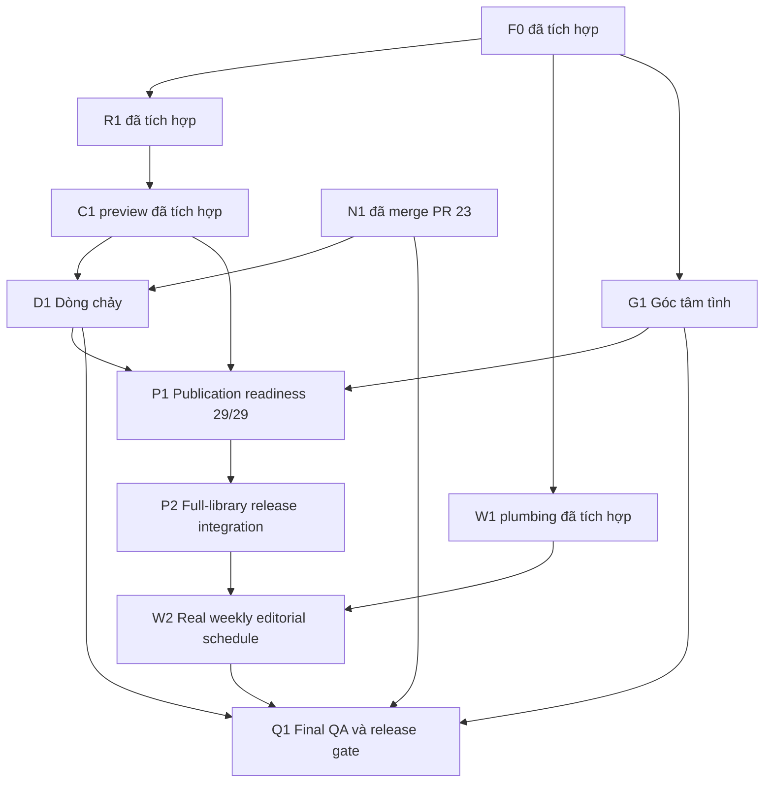

# Roadmap phát hành V1.0 — Phương án A: Full Library at Launch

Cập nhật 26/10/2026, Asia/Ho_Chi_Minh. Main đã xác minh: `cbb88fd0b31b6745765b15c782857c07bdef2823`. PR [#23](https://github.com/susootran207/Kho-ng-gian-Insight/pull/23) đã merge ngày 26/10/2026 lúc 18:05:24 +07:00; N1 đã nằm trên main, không còn chờ merge. Không sửa tệp N1.

## Quyết định sản phẩm chính thức

**Phương án A đã chốt:** website V1.0 phải ra mắt với đủ 29 bài được phê duyệt, nguyên nội dung và đúng hình tương ứng. Mọi bài đều truy cập được qua Thư viện, tìm kiếm, bộ lọc, Dòng chảy và liên kết trực tiếp. Chuyên đề tuần chỉ lựa chọn/giới thiệu nội dung nổi bật; không mở khóa, không giới hạn quyền đọc. Chuyển tuần giữ toàn bộ thư viện đã công bố.

29 bài đã biên soạn/nghiệm thu nội bộ không đồng nghĩa 29 bài được phê duyệt xuất bản, càng không đồng nghĩa 29 bài đã công khai. Quyết định A không cấp bằng chứng phê duyệt cho từng bài. Thiếu một bài hoặc một quyền hình: **release BLOCKED**, không ra mắt 28/29, không placeholder/tóm tắt, không tự sửa quyền và không tắt/nới F0.

## Trạng thái và thứ tự phụ thuộc

F0, R1, C1, W1 và N1 đã có trên main. Đây là trạng thái tích hợp mã, không phải chứng nhận chuyên môn hoặc quyền công bố. C1 còn là preview loopback; W1 registry thật còn rỗng; production chưa có 29 bài. Báo cáo cũ là bằng chứng lịch sử theo SHA, không phải QA release mới.

Thứ tự thực thi khuyến nghị sau các nền đã merge: **D1 → G1 → P1 → P2 → W2 → Q1**. Thu thập hồ sơ P1 có thể chuẩn bị độc lập sau khi được cấp phạm vi, nhưng đóng P1 phải có QA/thử đọc đúng revision; P2 cần P1 đủ 29/29. D1 dùng fixture/tập eligible rỗng trước P2; nghiệm thu link thật của D1 đóng ở Q1. Mỗi giai đoạn cần chỉ thị riêng và PR nghiệm thu; tài liệu này không cho phép bắt đầu.

| Mốc | Phạm vi dự kiến và đầu ra | Điều kiện đóng |
|---|---|---|
| D1 — giữ nguyên mục tiêu | /dong-chay qua ReadingShell, 4 chặng, CTA lọc Thư viện; giữ section/#dong-chay, nhãn/query cũ, không ép đọc tuần tự hoặc suy đoán tâm trạng | Stage/query/search AND, reload/Back/Forward, keyboard/320–1440, empty đúng, chỉ link eligible. Trước P2 không lấy nháp làm public; Q1 kiểm lại 29 link thật |
| G1 — giữ nguyên mục tiêu | Giữ /#tam-tinh, quyền bỏ qua, nghi thức không có người nhận; không route inbox/backend/analytics | Blank/space disabled, 500 ký tự, tối đa 4 đèn, cleanup 9,5s kể cả reduced motion, pagehide/unmount sạch; canary không request/storage/log/URL/DOM đèn; không hứa xóa vật lý RAM |
| P1 — publication readiness | Hồ sơ kiểm duyệt từng bài/revision/hash và 29 SVG theo [checklist](P1-PUBLICATION-CHECKLIST.md); không đổi nguồn để hợp schema | 29/29 bundle đủ người thật, ngày, scope, proof/hash, đủ 5 review và từng assetRights; các giới hạn khoa học/an toàn/quyền được giải quyết. Thiếu bất kỳ bài: BLOCKED |
| P2 — full-library release integration | Adapter production từ F0 PublicView qua R1; một nguồn ARTICLE, loại xung đột legacy, nối tất cả bề mặt vào cùng tập eligible | 29/29 eligible và 29/29 SVG đúng quyền; fidelity/crawl/search/filter/direct/related/Dòng chảy đạt; clean production + F0/canary đạt; không deploy trong PR tích hợp |
| W2 — real weekly editorial schedule | Lịch thật có dữ liệu/bằng chứng riêng, chọn bài từ thư viện đã công bố; đề xuất vận hành GitHub Pages dưới đây | Cùng snapshot homepage/index/detail/filter, +07:00, boundary/gap/overlap/future/rollback được kiểm; đổi tuần giữ đủ 29 bài |
| Q1 — final QA/release | Tổng kiểm trên SHA/artifact production cuối sau khi các PR trước được nghiệm thu/merge bởi người có quyền | Toàn [QA release](QA-PLAN.md) đạt, mọi gate chuyên môn/quyền còn hiệu lực, lịch có dữ liệu; release candidate đủ bằng chứng. Deploy/publish cần chỉ thị riêng |

## P2 — từ C1 sang production

Tái dùng compiler GFM/Reader/source map của C1/R1 ở tầng build dùng chung; **không import preview entry, virtual:c1-preview, server endpoint, banner hoặc provenance dossier vào production**. Chuỗi production dự kiến: manifest đã có bằng chứng thật → F0 selectSourceView public/eligibility → compile đúng byte nguồn đủ quyền → DTO Reader/cards + asset allowlist → module public tối thiểu. F0 kiểm trước serialize/copy hình và scan trước/sau emit/CLI như hiện tại.

ARTICLE vẫn là nguồn prose duy nhất; không chép 29 bài sang catalogue JSON hoặc giữ hai catalogue cùng ưu tiên mơ hồ. Bốn slug legacy C03/C05/C09/C17 resolve về một ARTICLE đủ quyền; không kế thừa grant legacy, không nối hai mảng gây duplicate. C03 giữ slug cũ và title ARTICLE. Homepage/Thư viện/search/filter/related/Dòng chảy/direct route và W2 dùng cùng tập public; weekly subset không được dùng làm toàn bộ library.

W1 v1 nhận catalogue legacy theo slug; P2 phải đề xuất adapter/type nối nguồn public vào boundary này, giữ kiểm topic riêng và kiểm article bằng F0 source evidence. Không giả ARTICLE thành legacy để tái dùng giấy duyệt khác hash. Nếu cần thay contract plumbing, PR P2 phải chứng minh âm/dương tương đương; không bỏ graph guard/scanner hoặc đổi allowlist để nháp lọt qua. Dossier/review records/manifest thô/fixture/maps vẫn ngoài artifact.

Kiểm 29 ARTICLE + 29 hình đúng source/hash, source-map fidelity, 4 slug trùng chỉ một route, repository base/hash router, query không bypass, preview chạy trước rồi production clean. Nháp thiếu quyền trong fixture vẫn không vào output; bản public hợp quyền không bị blacklist chỉ vì từng là nháp.

## W2 — lịch biên tập thật và GitHub Pages

Chọn chuyên đề từ 29 bài đã công bố. Chủ dự án duyệt ID/slug/title/description/thứ tự bài/startsAt/endsAt và proof riêng đúng hash của topic. FEATURED/T01–T09 không tự thành lịch. Dùng **Asia/Ho_Chi_Minh (UTC+07:00)**, ISO offset +07:00, start inclusive/end exclusive; cấm overlap; future không lộ sớm; gap dùng chuyên đề đã bắt đầu gần nhất còn eligible với nhãn đọc lại, nếu không có thì empty trung thực.

Giữ một snapshot thời gian ở build cho homepage/index/detail/library. GitHub Pages chỉ phục vụ file tĩnh: **đến giờ không tự đổi chuyên đề; phải rebuild và deploy artifact mới** nếu selector là build time. Đề xuất phù hợp giai đoạn đầu: lịch được review trước, người phụ trách kích hoạt rebuild/deploy thủ công có kiểm soát tại/sau mốc, kiểm selection và SHA/artifact trước phát hành, smoke test sau deploy, có người thay thế và rollback artifact đã duyệt. Nếu chậm chuyển tuần, hiện chuyên đề cũ cho tới deploy tiếp, không che hoặc khóa 29 bài.

Có thể cân nhắc Actions schedule + workflow_dispatch sau này, nhưng cron có thể trễ và cần thiết kế quyền/phê duyệt/giám sát riêng; không hứa chuyển chính xác theo giây. Build sớm dùng clock tương lai không được deploy trước mốc. Đổi order/title/interval làm hash topic đổi và cần duyệt lại. Rollback chuyên đề không được phục hồi artifact thiếu bài hoặc quyền đã bị rút. Thu hồi quyền là sự cố cần build/redeploy có kiểm soát, không đợi hết tuần.

**Chưa triển khai selector mới, lịch thật, cron, workflow, hosting hay deploy trong phiên này.**

## Tiêu chí phát hành bắt buộc

- 29/29 bài eligible tại đúng revision/hash và 29/29 SVG có quyền/credit đúng phạm vi.
- Full library đủ 29 bản nguyên văn và hình; search/filter/Dòng chảy/related/direct links hoạt động dưới repository base.
- Lịch chuyên đề thật có dữ liệu, proof hợp lệ và người vận hành/mốc chuyển tuần được chốt; chuyên đề không là quyền truy cập.
- Production QA tại SHA/artifact cuối đạt, gồm fidelity, khả năng tiếp cận, riêng tư, F0 negative/canary, clean graph/artifact và hồi quy thiết kế.
- Một bài chưa phê duyệt, proof sai hash, quyền hình thiếu hoặc QA blocker: **release BLOCKED**. Không giảm số bài hoặc tự gán license.
- Chủ dự án quyết định release trên bằng chứng cụ thể; merge/deploy/publish vẫn là hành động được cấp riêng.

## Ranh giới và điểm dừng

PR hiện tại chỉ sửa kế hoạch. Không sửa ARTICLE/REFERENCES/dossier/SVG, manifest, catalogue, status, CI hoặc UI; không thực hiện D1/G1/P1/P2/W2/Q1. Giữ Mây/tử đằng B/font/palette/artwork/composition, không backend/login/trắc nghiệm/lưu tâm tình. Không sửa các báo cáo F0–W1/N1 lịch sử; roadmap cũ xem tại [snapshot nền](https://github.com/susootran207/Kho-ng-gian-Insight/blob/cbb88fd0b31b6745765b15c782857c07bdef2823/docs/phase-3/integration-plan/IMPLEMENTATION-ROADMAP.md).

Bàn giao mỗi giai đoạn: scope/diff, SHA/revision/hash, case QA, lệnh/kết quả thật, ảnh khi có UI, lỗi/giới hạn, publication counts và điểm cần chủ dự án quyết. **Dừng tại Draft PR tài liệu; không merge, deploy, publish hoặc tự bắt đầu giai đoạn tiếp theo.**
