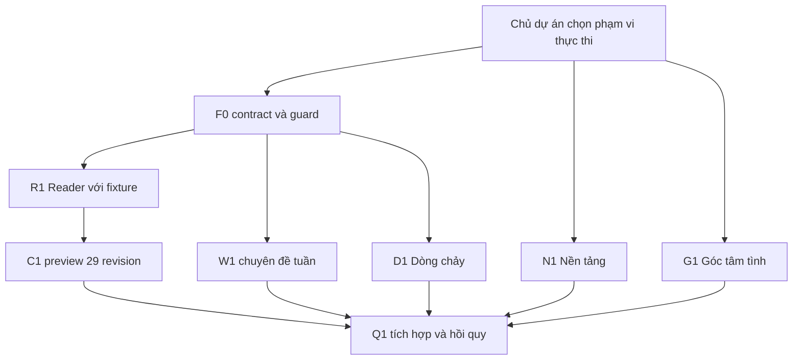

# Roadmap PR — đề xuất, chưa được phép triển khai

Mục tiêu: hoàn thiện trải nghiệm từ nền Phase1–2 và29 bản nháp đã nghiệm thu; giữ thiết kế đã duyệt. Main kiểm:29510528e0cf465b8d709aed3190d9d5e8608de9. [Kiểm toán](CURRENT-STATE-AUDIT.md), [hợp đồng](CONTENT-INTEGRATION.md), [QA](QA-PLAN.md), [điểm chọn](DECISIONS-NEEDED.md).

PR hiện tại chỉ năm tài liệu. **Phê duyệt kế hoạch không tự cấp quyền thực hiện tất cả PR.** Chủ dự án chọn phạm vi đợt đầu; mỗi PR sau có báo cáo/checklist/diff và dừng chờ nghiệm thu, không tự merge.

## 1. Thứ tự dựa trên mã hiện tại

PLAN lịch sử đặt3.3→3.4→3.5→3.6 rồi nội dung/tích hợp. Nay29 bài đã có; Reader hiện chỉ paragraphs và guard chưa phủ29 nguồn. Làm weekly trước adapter sẽ lặp nhập nội dung và có nguy cơ nối nhầm mẫu cũ. Vì vậy đề xuất:

W1/D1 có thể phát triển logic với fixture sau F0, nhưng nghiệm thu link tới bài thật cần C1. N1/G1 không phụ thuộc nội dung29. Router.tsx/App.tsx là điểm nhập chung: xử lý tuần tự mỗi PR theo main mới, không giả các thay đổi cùng tệp là độc lập. Thứ tự một người khuyến nghị **F0 → R1 → C1 → W1 → N1 → D1 → G1 → Q1**. Không cần deadline giả hoặc29 PR nội dung.

## 2. Ranh giới chung cho mọi PR

- Không thay ARTICLE/dossier/SVG đã nghiệm thu, matrix lịch sử, HTML gốc, Mây/CatArt, tử đằng B/approvedWisteria, artwork/font/palette và composition đã duyệt.
- global.css/atmosphere.css và garden components ngoài scope mặc định; style mới giới hạn selector trong reading/module. Nếu buộc đụng vùng khóa do lỗi thực chất, báo diff/vấn đề và xin phạm vi bổ sung trước.
- Không backend/login/trắc nghiệm/analytics, gửi hoặc lưu tâm tình, preview query bypass, published29, deployment/hosting config.
- Reuse ReadingShell/header/footer/breadcrumb/Arrow/LeafMark/ArticleCard/empty states. Có thể tách component khỏi Router.tsx khi có mục tiêu rõ và test tương đương; không refactor toàn app tiện tay.
- Mỗi PR: main mới, code diff nhỏ, bằng chứng test phù hợp, kiểm public clean, screenshot trước/sau cùng dữ liệu/viewport, danh sách chưa xác minh. Không rewrite lịch sử hay tự merge.

## F0 — Hợp đồng nguồn, revision và publication boundary

**Mục tiêu/chức năng:** chuyển đề xuất CONTENT-INTEGRATION thành contract được kiểm bằng máy; phân PreviewView/PublicView; generator manifest29 không chứa bài nguyên văn trong production; nâng guard fail closed trước nhập nội dung.

**Tệp dự kiến:** prototype/editorial/schema.ts; build/editorial.ts; build/content-contract.ts mới; scripts/check-publication.mts; tests/fixtures và test contract/guard mới; tài liệu contract trong docs/phase-3/integration-plan/. Không sửa catalogue.json; chưa nối Reader/App. Dependency parser nếu cần thuộc R1, không cài framework mới.

**Phụ thuộc:** chủ dự án cho phép F0 và chốt D01–D03/D06 trong DECISIONS. Các tên tệp mới có thể điều chỉnh trong PR, không lan phạm vi.

**Nghiệm thu:**

- Contract nhận ID/slug/revision/hash/metadata/refs/assets/dossier; validate trùng, path traversal, link đứt, mismatchrevision/hash, thiếu quyền/phê duyệt đúng phạm vi.
- Tests: draft/in_review/approved không vào PublicView; published thiếu/mismatch record/hash/quyền bị reject; topic/related/stage/homepage không dangling. Fixture published tổng hợp chỉ trong test, không thay dữ liệu thật.
- Bổ sung scan cho source29/asset/fixture; canary âm chứng minh scan bắt được nháp/article+SVG và escaped text bị copy nhầm.
- Clean production build+guard PASS; catalogue vẫn0 published; no raw docs/fixture/map trong output; snapshot nguồn29 không đổi.
- Thêm mục30 fixture hợp lệ để chứng minh mở rộng, không max29. UI Phase2 không thay hành vi.

**Rủi ro giao diện:** thấp vì build/schema; adapter type có thể làm hỏng mẫu cũ, cần tương thích và regression. **Không đổi:** UI/layout, status thật,29 bài, nguồn approval.

## R1 — Reader GFM tái sử dụng bằng fixture cô lập

**Mục tiêu/chức năng:** Reader nhận AST/source map; heading/TOC, bảng/list, APA, citation, figure/alt/caption/description, hoạt động/phản hồi và zoom hình. Không biến bài thành quiz.

**Tệp dự kiến:** src/reading/Router.tsx (tách ArticleReader/ReadingShell khi cần), components đọc mới trong src/reading/; styles/reading.css; build/Markdown adapter; tests/fixtures/reader; package.json/lock chỉ nếu parser được chọn; preview entry/config riêng. Không sửa App/canopy.

**Phụ thuộc:** F0; parser/preview separation và cách link dossier đã duyệt.

**Nghiệm thu:**

- Fixture tổng hợp đủ node GFM, heading trùng/tiếng Việt, URL dài, bảng rộng, figure dài. Không MDX/raw HTML/script; URL/asset allowlist và test input độc hại.
- So block/text nguồn và render không mất thông tin; TOC reload/hash/focus/Back hoạt động, nguồn mở tab mới được thông báo.
-320/390/768/1440, zoom200%, bàn phím/skip link, không tràn trang; bảng cuộn vùng riêng; hình có mô tả luôn đọc được và xem lớn bằng phím, đóng trả focus nếu dùng overlay.
- Câu hỏi và lời giải đầy đủ, tùy chọn bỏ qua; không form nhập nội tâm/chấm điểm/lưu dữ liệu.
- Build public không fixture/preview assets; regression route/filter/legacy source đúng. Axe không có lỗi A/AA trong phạm vi, vẫn ghi giới hạn screen reader.
- Không dùng fake expert ở UI; nguồn r2/r1 thật chưa nhập ở PR này.

**Rủi ro giao diện:** vừa, do typography/table/TOC. So reading screenshots cũ với cùng fixture và cô lập CSS. **Không đổi:** trang chủ/Mây/tử đằng/font/palette/nội dung thật.

## C1 — Adapter29 bài và preview cục bộ

**Mục tiêu/chức năng:** chủ dự án xem đủ29 revision trên Reader thật, search/filter/topic/related bằng dữ liệu đã chốt; không nhập lại prose.

**Tệp dự kiến:** build/adapter/manifest và preview entry/manifest mới ngoài public graph; tests kiểm mapping và preview29; Reader chỉ sửa lỗi tích hợp cụ thể. Không đưa29 vào catalogue production, không copy SVG vào public/.

**Phụ thuộc:** F0+R1, chủ dự án cho phép preview29 đúng bảng CONTENT-INTEGRATION. Không cần chuyên môn đã xong để engineering preview.

**Nghiệm thu:**

-29 route preview/29 ID/29 slug đúng, mẫu4 dùngr2 / lô 25 dùngr1; sáu Markdown+SVG mỗi ID được kiểm provenance; checksum toàn bộ nguồn cũ giữ nguyên.
- Trích title/APA/table/list/figure/alt/caption/description/hoạt động/phản hồi không thiếu; audit text/block mapping29/29, xem trực tiếp từng bài hẹp/rộng, ghi ngoại lệ.
- C03/C05/C09/C17 không duplicate catalogue mẫu; thông báo phân biệt legacy UI mẫu và bản nghiệm thu; title C03 mới/slug cũ.
- Related/internal links resolve đúng eligibility; không đưa REFERENCES/VISUAL dossier thô vào public. Search dấu/không dấu+lọc4 chặng+Back/Forward/return filter với29 bài đạt.
- Preview chỉ loopback, banner/revision rõ; clean build public vẫn empty catalogue, direct/query/asset URL không mở29 nháp, scan canary/hash/fixture PASS.
- Không status approved/published mới, không reviewer giả, không thay nội dung để “hợp renderer”.

**Rủi ro giao diện:** vừa do bài dài/bảng/hình nhỏ; giải bằng renderer/zoom, không sửa29 nguồn. **Không đổi:** thiết kế trang chủ/artwork và guard nguyên tắc public.

## W1 — Chuyên đề tuần dùng cùng dữ liệu với trang chủ

**Mục tiêu/chức năng:** selector chung homepage/index/detail; lời dẫn, thứ tự, khoảng hiệu lực và fallback. Dữ liệu chủ dự án chọn, không tự chọn7 FEATURED thành bài tuần.

**Tệp dự kiến:** editorial/topic/weekly contract; build selector; App.tsx chỉ vùng weekly plumbing; Router.tsx hoặc Topics components tách; tests weekly/timezone; style module nhỏ nếu cần. Dữ liệu29 chỉ preview; production không nháp.

**Phụ thuộc:** F0; C1 trước nghiệm thu end-to-end thật; tên/lời dẫn/lịch T01–T09 được chọn (hoặc chỉ fixture/empty khi chưa chọn).

**Nghiệm thu:**

- Cùng thời điểm/eligibility thì homepage và topic detail cùng chuyên đề/thứ tự/links.
- Lịch ISO có offset+07:00, khoảng start inclusive/end exclusive; test trước/đúng/sau mốc, tuần tương lai, gap, overlap bị reject và không có bài eligible. Chọn gần nhất đã bắt đầu còn hợp lệ về quyền; nếu rỗng dùng empty trung thực.
- Không auto xuất bản theo lịch. Lịch chỉ chọn trong tập được phép; zero published vẫn không hiện bài nháp.
- Static build chỉ đổi lịch khi build lại; nếu chọn client clock cần ghi độ tin cậy clock và không cấp eligibility ở client. Khuyến nghị build-time deterministic + rebuild thủ công khi sau này được phép, không thêm cron/deploy trong PR.
- Giữ section/#chuyen-de và illustration/typography đã duyệt; DEV legacy excerpt không lẫn bài mới; keyboard/mobile/route tests và public scan PASS.

**Rủi ro giao diện:** vừa ở weekly text height/canopy/companion dock; so vị trí và safe area. **Không đổi:** bài gốc, artwork weekly, Mây/B, bố cục trang chủ, publication permission.

## N1 — Trang Nền tảng, giữ section cũ

**Mục tiêu/chức năng:** /nen-tang giải thích dự án/đối tượng/cách đọc/nguồn/Bloom/hình/trạng thái/riêng tư/giới hạn dịch vụ đúng thực tế; section trang chủ dẫn vào.

**Tệp dự kiến:** reading/FoundationPage.tsx; router/nav link bổ sung có kiểm soát; styles/reading.css hoặc module riêng; nội dung giới thiệu mới và tests. Không chỉnh29 bài.

**Phụ thuộc:** được cấp riêng N1; dùng shell hiện có, không phải chờ W1/C1. Thông tin trạng thái phải đối chiếu contract hiện hành khi nhập main.

**Nghiệm thu:** route/reload/base path/404/breadcrumb/title/focus và320–1440 đạt; /#nen-tang vẫn tới section cũ; không reviewer/đối tác/kết quả chuyên môn giả; nguồn/privacy mô tả đúng pipeline thực, phân biệt29 bản nháp nghiệm thu với quyền xuất bản; link tới Góc tâm tình/Thư viện hợp lệ. Có bản copy review và screenshot trước/sau.

**Rủi ro giao diện:** thấp–vừa ở header/section CTA; không đổi caption/layout/leaf mark cũ ngoài link bổ sung. **Không đổi:** thiết kế garden, hiệu ứng, khoa học29 bài, không biến thành dịch vụ tư vấn.

## D1 — Dòng chảy4 chặng và lối tới thư viện

**Mục tiêu/chức năng:** đề xuất /dong-chay đọc4 chặng, gợi ý từ eligibility và CTA library filter; timeline cũ giữ vị trí/hành vi chọn.

**Tệp dự kiến:** stage metadata/helper chung; reading/FlowPage.tsx; content.ts/App.tsx vùng timeline; Router nav/routes; tests query/stage; style module. Không đổi style timeline toàn cục.

**Phụ thuộc:** F0 stage contract, C1 trước nghiệm thu link bài thật; D04 quyết định trang riêng và đa giai đoạn. Giữ một season chính trong đợt đầu để không migration rộng.

**Nghiệm thu:**4 stage keys ánh xạ đúng nhãn và query tiếng Việt cũ; chọn stage→filter kết hợp search/topic, reload/Back/Forward giữ đúng; topic không nhầm stage; zero eligible có empty; link related/card không nháp public. /#dong-chay còn tới timeline; aria-expanded/controls có đích thật, keyboard hợp disclosure; không suy đoán tâm trạng hay ép đi tuần tự.320/390/768/1440 và regression timeline/companion PASS.

**Rủi ro giao diện:** vừa do panel/CTA thay chiều cao; kiểm safe dock Mây. **Không đổi:**4 chặng/visual timeline, nội dung bài, tracking/cá nhân hóa không thêm.

## G1 — Hoàn thiện Góc tâm tình và chứng minh riêng tư

**Mục tiêu/chức năng:** làm rõ tùy chọn không viết/đọc tiếp, nghi thức thả đèn không có người nhận; phản hồi thao tác. Giữ section, không tạo hộp thư. Xử lý timer bookkeeping nếu xác minh cần, không đụng nội dung lời viết.

**Tệp dự kiến:** components/LanternGarden.tsx; tests privacy/reduced-motion; style khu trú nếu cần. Không thêm route riêng theo khuyến nghị D05.

**Phụ thuộc:** được cấp riêng G1; không phụ thuộc29 bài. Nếu CTA đọc tiếp thì dùng eligibility selector sau F0.

**Nghiệm thu:** blank/space disabled,500 ký tự, clear state/DOM trước lantern metadata, tối đa4, cleanup sau9,5s kể cả motion paused/reduced, pagehide/unmount/rời route sạch, status không chứa lời viết; synthetic canary không ở request URL/body/headers,storage/logs/DOM đèn/URL. Kiểm no request cả thao tác; không analytics/backend. Keyboard/mobile/OS+manual reduction và contrast/status đạt; quyền bỏ qua không đòi viết; thông báo không hứa đã có người nhận hay xóa vật lý RAM.

**Rủi ro giao diện:** thấp–vừa do copy/form height; giữ night artwork và motion/timing đã duyệt. **Không đổi:** không lưu lời tâm tình, không login, không công cụ trị liệu/khẩn cấp.

## Q1 — Tổng kiểm tích hợp và hồi quy

**Mục tiêu/chức năng:** đóng bằng chứng kỹ thuật cho các PR đã được nghiệm thu; sửa lỗi ứng dụng thực chất trong phạm vi được cấp, không làm vòng redesign.

**Tệp dự kiến:** tests/*, test configs/scripts và báo cáo/screenshot mới trong docs; sửa component chỉ theo bug đã ghi vị trí, phạm vi và duyệt. Không auto cập nhật baseline để che regression, không thay29 nguồn.

**Phụ thuộc:** F0/R1/C1/W1/N1/D1/G1 đã nhập main do người có quyền, môi trường build/browser hoạt động.

**Nghiệm thu:** toàn QA-PLAN và route matrix PASS; production artifact không29 nháp/raw dossier/fixture/maps;404/direct asset/query negative; kiểm29 reader/APA/figure/alt/caption/Bloom; widths/zoom/keyboard/Axe và assistive/thiết bị thật theo bằng chứng có người thực hiện; so Mây/B/artwork/menu/reflection và performance với baseline cùng máy. Nếu hạng mục chưa có thiết bị/người thì ghi chưa xác minh và quyết định chấp nhận giới hạn riêng, không báo đạt toàn diện.

**Rủi ro giao diện:** thấp nếu chỉ test, thay đổi theo lỗi có thể tăng; mỗi fix có regression đích. **Không đổi:** publication status/quyền, không merge/deploy/publish.

## 3. Bàn giao mỗi PR và giảm sửa lại

Checklist cố định: mục tiêu+scope; contract revision; diff ngoài phạm vi=0; acceptance case ID từ QA; lệnh/kết quả thật; ảnh trước/sau cùng viewport/data; lỗi còn mở+severity+phụ thuộc; tình trạng nội dung/publication; bước cần chủ dự án chọn.

Chỉ chạy lại phần chịu tác động cộng guard/hồi quy cần thiết; không yêu cầu r2 nội dung hoặc đọc lại toàn nguồn nếu chỉ chỉnh UI không đổi nghĩa. Phát hiện lỗi biên tập cần phiếu riêng, không “tiện sửa” trong PR chức năng.

**Đợt đầu khuyến nghị F0**, vì có thể nghiệm thu contract/guard trước mọi tích hợp. Không tự bắt đầu sau Draft PR kế hoạch.
