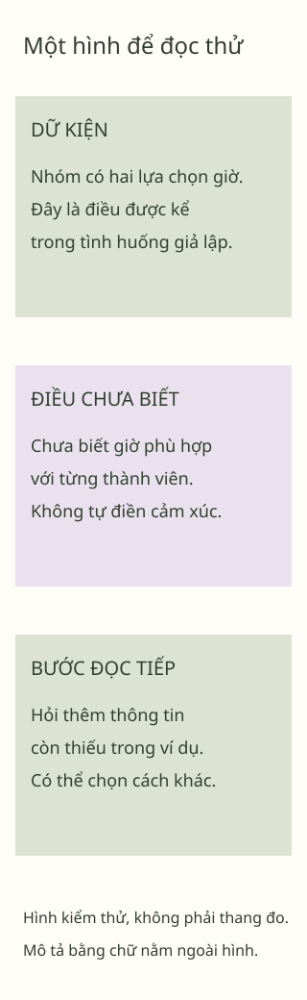

## Một khoảng dừng để đọc

Đây là **bài giả lập cho kiểm thử giao diện**, không phải một trong 29 bài của Không Gian Nội Tâm. Bạn có thể đọc phần *giải thích ngắn*, bỏ qua hoạt động hoặc xem gợi ý phản hồi. Không có câu trả lời nào được thu thập.

> Một khối trích dẫn trong fixture chỉ minh họa bố cục. Nó không phải lời của học sinh thật hay nhận định khoa học.

### Điều mình nhận thấy

- Tên các phần giữ nguyên khi mở mục lục.
- Chữ **đậm** và chữ *nghiêng* vẫn có vai trò riêng.
  - Một ý nhỏ nằm trong danh sách lồng.
- Một ~~nhãn cũ~~ được gạch bỏ chỉ để kiểm GFM.

1. Đọc một tình huống giả định.
2. Chọn thông tin có trong chính tình huống.
3. Đọc phản hồi có lý do; có thể dừng ở đây.

## Một khoảng dừng để đọc

Đây là heading trùng để kiểm anchor có hậu tố ổn định. Có thể [quay tới phần đầu](#mot-khoang-dung-de-doc) hoặc dùng mục lục. Một dòng xuống cứng theo sau:  
Nội dung dòng tiếp theo phải còn đầy đủ.

### Bảng và một đường dẫn dài

| Nội dung được kể | Điều có thể nhận diện | Điều vẫn chưa biết | Bước đọc tiếp |
|:---|:---|:---|:---|
| Nhân vật đặt một cuốn vở lên bàn. | Một hành động được mô tả trong câu. | Không suy ra cảm xúc hoặc sức khỏe của nhân vật. | Đọc thêm dữ kiện của tình huống. |
| Nhóm có hai ý kiến về giờ gặp. | Hai lựa chọn thời gian. | Chưa có lời kể về điều kiện của từng người. | Hỏi thông tin còn thiếu trong ví dụ. |

DOI dưới đây dùng DOI có thật của tài liệu khung Bloom, thêm fragment kiểm thử chiều dài liên kết; fragment không phải nguồn mới: https://doi.org/10.1207/s15430421tip4104_2#reader-layout-fixture-mot-duong-dan-dai-de-kiem-tra-viec-xuong-dong-tren-dien-thoai-va-phong-to-hai-tram-phan-tram

## Một hình có phần giải thích



*Hình giả lập do dự án tạo để kiểm Reader; không phải thang đo, dữ liệu nghiên cứu hoặc mô hình chẩn đoán.*

**Mô tả tương đương bằng chữ:** Vùng đầu ghi dữ kiện trong ví dụ. Vùng giữa giữ thông tin chưa có. Vùng cuối dành cho một bước đọc tiếp có thể thay đổi. Hình không chấm điểm, không nối tới tên bệnh; toàn bộ ý chính cũng có trong đoạn chữ này.

## Thử đọc cùng nhân vật

Minh đang sắp xếp một buổi trao đổi bài. Có hai giờ được đề xuất, nhưng chưa biết các bạn có thể tham gia giờ nào. Minh chưa kể cảm xúc của mình. Đây hoàn toàn là tình huống giả lập.

**1. Nhớ:** Có bao nhiêu lựa chọn giờ trong tình huống?

**2. Hiểu:** Vì sao hai lựa chọn giờ chưa đủ cho biết Minh đang cảm thấy thế nào?

**3. Vận dụng:** Chọn một câu hỏi để biết thêm điều kiện tham gia của nhóm. Không cần kể chuyện riêng hoặc nhập câu trả lời vào website.

### Gợi ý phản hồi

**Câu 1:** Có hai lựa chọn giờ. Đây là thông tin đã được kể.

**Câu 2:** Câu chuyện mới nói về thời gian, chưa có lời kể cảm xúc của Minh. Giữ rõ điều chưa biết giúp tránh tự gắn nhãn.

**Câu 3:** Có thể hỏi “Mọi người có thể tham gia giờ nào trong hai giờ này?”. Cách viết khác vẫn phù hợp nếu hỏi thông tin còn thiếu, không ép chia sẻ việc riêng.

## Một số cách trình bày khác

Một ví dụ mã chỉ là chữ: `<script>không được thực thi</script>`.

```text
Đoạn mã kiểm thử chỉ được đọc.
Không thực thi HTML, MDX hoặc JavaScript.
```

- [x] Dấu chọn có sẵn trong tài liệu, chỉ để đọc.
- [ ] Không lưu tương tác hoặc tiến độ.

Một liên kết có định nghĩa riêng: [trang minh họa][reference-example].

---

## Tài liệu tham khảo

Krathwohl, D. R. (2002). A revision of Bloom’s taxonomy: An overview. *Theory Into Practice, 41*(4), 212–218. https://doi.org/10.1207/s15430421tip4104_2

Mục APA này chỉ kiểm trình bày và liên kết. Fixture không dùng nó để tuyên bố hoạt động đã có hiệu quả hoặc học sinh đạt mục tiêu.

[reference-example]: https://example.org/ "Trang ví dụ, không phải nguồn khoa học"

Mã đối chiếu bản giả lập: `F0_FIXTURE_ONLY_R1_READER`.
